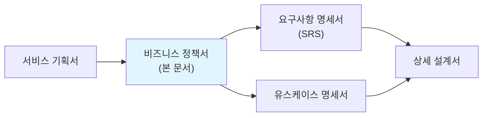
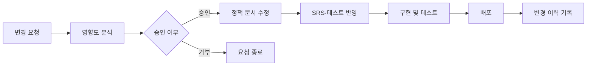

# 비즈니스 정책서 (Business Policy Document)

> 이 문서는 서비스의 비즈니스 동작 규칙을 독립적으로 정의하는 문서이다.
> "이런 상황에서 시스템은 어떻게 동작해야 하는가"를 **목적 / 규칙 / 예시** 구조로 기술하여, AI(Claude Code 등)가 구현 시 비즈니스 규칙을 정확히 따르도록 한다.
> 규칙의 수치는 G0 검토에서 확정할 **제안값**이다. 확정되지 않은 결정은 12.4절과 [서비스 기획서 7.3절](서비스기획서.md#73-가정의존성미결-결정)에 모은다.

| 항목 | 내용 |
|------|------|
| **프로젝트명** | IT 뉴스레터 (가칭, DEC-001) |
| **문서 버전** | v1.2 |
| **작성일** | 2026-11-25 |
| **작성자** | Claude (초안 작성) / 임지영 (프로젝트 담당) |
| **승인자** | 임지영 / 프로젝트 담당 |
| **문서 상태** | 승인됨 (G0, 2026-11-25) |

---

## 변경 이력

| 버전 | 날짜 | 작성자 | 변경 내용 |
|------|------|--------|-----------|
| v0.1 | 2026-11-25 | Claude | 초안 작성. 템플릿의 인증·결제·알림·광고·통계 정책은 MVP 제외로 정리하고, 발행·수집·선정·요약·오늘의 공부·실패 처리·공개·표기 정책을 새로 정의 |
| v1.0 | 2026-11-25 | Claude | G0 검토 반영: 링크는 https만(BP-SUM-004, BP-STUDY-006), 매일 발행 확정(BP-PUB-003), 누구나 공개(BP-CONTENT-001), RSS 피드 규칙 추가(BP-CONTENT-006), 공부 참고 자료 출처 규칙 추가(BP-STUDY-007). 승인 |
| v1.1 | 2026-11-25 | Claude | G1 승인에 따른 변경: GitHub는 공식 검색 API로(BP-SRC-001·002), GeekNews 링크 규칙(BP-SRC-007), 식별 User-Agent(BP-SRC-008), 위키백과 라이선스 표기(BP-STUDY-008), 삭제 요청 채널(BP-CONTENT-005). 13.3절 기록 |
| v1.2 | 2026-11-25 | Claude | G3 승인에 따른 변경: BP-RANK-004에 개발 도구가 아닌 저장소 예시 추가. 13.3절 기록 |

---

## 목차

1. [문서 개요](#1-문서-개요)
2. [정책 목록 및 요약](#2-정책-목록-및-요약)
3. [발행 일정 정책 (BP-PUB)](#3-발행-일정-정책-bp-pub)
4. [수집 출처 정책 (BP-SRC)](#4-수집-출처-정책-bp-src)
5. [선정·정렬 정책 (BP-RANK)](#5-선정정렬-정책-bp-rank)
6. [요약·출처 표기 정책 (BP-SUM)](#6-요약출처-표기-정책-bp-sum)
7. [오늘의 공부 정책 (BP-STUDY)](#7-오늘의-공부-정책-bp-study)
8. [실패 처리 정책 (BP-ERROR)](#8-실패-처리-정책-bp-error)
9. [공개·보관 정책 (BP-CONTENT)](#9-공개보관-정책-bp-content)
10. [표기·문체 정책 (BP-TEXT)](#10-표기문체-정책-bp-text)
11. [추가 정책 템플릿](#11-추가-정책-템플릿)
12. [MVP 정책 적용 범위](#12-mvp-정책-적용-범위)
13. [정책 변경 관리](#13-정책-변경-관리)

---

## 1. 문서 개요

### 1.1 목적

이 문서는 **IT 뉴스레터(가칭)** 서비스의 비즈니스 동작 규칙을 한곳에 모아 정의한다.

이 서비스는 로그인·결제·광고·알림이 없는 정적 웹사이트다. 그래서 규칙의 대부분은 사용자 화면보다 **매일 자동으로 호를 만드는 과정**(수집 → 선정 → 요약 → 발행)에 있다. 이 규칙들이 요약의 신뢰도와 매일 발행의 안정성을 결정한다.

**이 문서의 대상 독자:**

| 독자 | 활용 방법 |
|------|-----------|
| AI 코딩 도구 (Claude Code 등) | 구현 시 비즈니스 규칙 참조. 예시의 "상황 -> 결과"를 테스트 케이스로 활용 |
| 작성자 (개발·운영) | 수집·요약 파이프라인 구현과 운영 판단의 기준 |
| 테스트 | 예시를 경계값·실패 시나리오 테스트에 활용 |

### 1.2 정책 작성 가이드

모든 정책은 **목적 / 규칙 / 예시 / 변경이력** 4요소를 갖는다. 규칙은 조건과 결과를 수치로 적고 "적절히", "필요 시" 같은 표현을 쓰지 않는다. 예시는 다음 형식으로 쓴다.

```
상황: [구체적 상황 설명]
결과: [시스템의 동작]
```

### 1.3 관련 문서

| 문서명 | 관계 |
|--------|------|
| [서비스 기획서](서비스기획서.md) | 사용자 문제(OBJ), MVP 범위(MVP·EX), 가설(H), 미결 결정(DEC) |
| [요구사항 명세서 (SRS)](../01-요구사항분석/요구사항명세서-SRS.md) | 요구사항의 출처에 개별 규칙 ID 기재 |
| [유스케이스 명세서](../01-요구사항분석/유스케이스명세서.md) | 정상·예외 흐름에 적용된 규칙 ID 참조 |



---

## 2. 정책 목록 및 요약

| 정책 ID | 정책 카테고리 | 핵심 규칙 요약 | MVP 적용 | 섹션 |
|---------|-------------|---------------|----------|------|
| BP-PUB | 발행 일정 | KST 기준 하루 1호, 목표 08:00, 호 번호는 발행할 때만 1 증가 | Y | [3장](#3-발행-일정-정책-bp-pub) |
| BP-SRC | 수집 출처 | 4개 출처의 공식 피드·API만(GitHub는 검색 API), 출처당 하루 1회 수집, 원문 본문은 저장하지 않음, 식별 User-Agent | Y | [4장](#4-수집-출처-정책-bp-src) |
| BP-RANK | 선정·정렬 | 같은 원문은 하나로, 7일 내 실린 소식 제외, 하루 최대 12건, 중요도순 | Y | [5장](#5-선정정렬-정책-bp-rank) |
| BP-SUM | 요약·출처 표기 | 원문 텍스트로만 2~3문장 요약, https 원문 링크 필수 | Y | [6장](#6-요약출처-표기-정책-bp-sum) |
| BP-STUDY | 오늘의 공부 | 호당 1개, 30일 내 중복 금지, 요점 정확히 3개, 위키백과 문서를 근거로 작성하고 CC BY-SA 4.0 표기 | Y | [7장](#7-오늘의-공부-정책-bp-study) |
| BP-ERROR | 실패 처리 | 일부 실패는 남은 소식으로 발행, 0건이면 발행하지 않고 직전 호 유지 | Y | [8장](#8-실패-처리-정책-bp-error) |
| BP-CONTENT | 공개·보관 | 누구나 로그인 없이 열람, 지난 호 영구 보관, RSS로 최근 호 제공, 권리자 요청 시 삭제 | Y | [9장](#9-공개보관-정책-bp-content) |
| BP-TEXT | 표기·문체 | 해요체, 과장·이모지 금지, KST 시각과 한국식 숫자 표기 | Y | [10장](#10-표기문체-정책-bp-text) |

템플릿의 인증/권한, 과금/결제, 알림/푸시, 광고, 통계/카운팅 정책은 이 서비스에 해당하지 않아 12.2절에 제외 근거와 함께 정리했다.

---

## 3. 발행 일정 정책 (BP-PUB)

### 3.1 목적

하루에 정확히 한 번, 예측 가능한 시각에 새 호가 올라오게 하고, 호 번호와 날짜가 꼬이지 않게 한다.

### 3.2 규칙

| 규칙 ID | 규칙 | 비고 |
|---------|------|------|
| BP-PUB-001 | 서비스 기준 시간대는 KST(UTC+9)다. 호 날짜, 화면의 모든 시각, "오늘" 판정은 KST로 한다 | |
| BP-PUB-002 | 발행 작업은 매일 08:00 KST(23:00 UTC)에 시작한다. 10:00 KST까지 배포되면 정상 발행으로 본다 | GitHub 일정 실행 지연 감안 |
| BP-PUB-003 | 발행 요일은 매일이다 (주말·공휴일 포함) | DEC-003 확정 |
| BP-PUB-004 | 호 번호는 직전 호 번호 + 1이다. 발행하지 않은 날은 번호를 쓰지 않는다 | 번호에 빈칸 없음 |
| BP-PUB-005 | 한 날짜(KST)에는 호가 하나만 있다. 같은 날 다시 실행하면 그 날 호를 같은 번호로 덮어쓴다 | 수동 재실행 대비 |
| BP-PUB-006 | 수집 기간은 직전 호의 수집 시작 시각부터 이번 수집 시작 시각까지다. 직전 호가 없으면 최근 24시간이다 | 쉰 날의 소식도 다음 호에 포함 |

### 3.3 예시

**정상 케이스:**

```
상황: 11월 25일 08:00 KST에 발행 작업이 시작되고, 직전 호는 11월 24일 제127호다
결과: 11월 24일 08:00 ~ 11월 25일 08:00 KST 소식으로 제128호(날짜 2026-11-25)를 만들어 배포한다
```

**경계 케이스:**

```
상황: GitHub 일정 실행이 늦어져 09:40 KST에 배포가 끝난다
결과: 정상 발행으로 본다 (10:00 KST 이전)
```

```
상황: 11월 25일 호를 이미 발행한 뒤 같은 날 14:00 KST에 작성자가 작업을 수동으로 다시 실행한다
결과: 새 번호를 만들지 않고 제128호(2026-11-25)를 새 결과로 덮어쓴다
```

**에러 케이스:**

```
상황: 11월 26일 발행이 실패해 호가 만들어지지 않았고, 11월 27일 발행은 성공한다
결과: 11월 27일 호는 제129호다(제128호 다음). 수집 기간은 11월 25일 08:00 ~ 11월 27일 08:00 KST다
```

### 3.4 변경이력

| 날짜 | 규칙 ID | 변경 내용 | 변경 사유 |
|------|---------|-----------|-----------|
| 2026-11-25 | 전체 | 최초 작성 | - |

---

## 4. 수집 출처 정책 (BP-SRC)

### 4.1 목적

허용된 방식으로만 소식을 모아 출처 서비스에 부담을 주지 않고, 저작권과 이용 조건을 지킨다.

### 4.2 규칙

| 규칙 ID | 규칙 | 비고 |
|---------|------|------|
| BP-SRC-001 | 수집 출처는 GeekNews(Atom 피드), Hacker News(공식 API), GitHub(공식 검색 API), arXiv(공식 API) 4곳이다. 출처를 더하거나 빼려면 이 정책을 변경한다 | v1.1: GitHub Trending 페이지 대신 검색 API (SRS ISSUE-01) |
| BP-SRC-002 | 각 출처는 공식 RSS·Atom 피드 또는 공식 API로만 수집한다. 웹페이지를 긁어 오지 않는다 | v1.1 |
| BP-SRC-003 | 출처당 발행 1회에 수집 실행은 1번이다. 같은 출처에 연속 요청할 때는 1초 이상 간격을 둔다 | |
| BP-SRC-004 | 로그인이 필요한 글, 유료 글, 차단·CAPTCHA를 우회해야 하는 글은 수집하지 않는다 | |
| BP-SRC-005 | 원문 본문은 요약을 만드는 데만 쓰고 저장하지 않는다. 저장하는 것은 제목, 원문 링크, 출처명, 발행 시각, 반응 수, 요약이다 | 저작권, EX-009 |
| BP-SRC-006 | 네이버 뉴스는 자동 수집 출처에 넣지 않는다 | EX-007 |
| BP-SRC-007 | GeekNews 소식의 원문 링크는 피드가 주는 GeekNews 토론 페이지 주소다. 외부 원문 주소를 따로 찾지 않는다 | v1.1 (SRS ISSUE-03) |
| BP-SRC-008 | 모든 외부 요청에 서비스 이름·버전과 연락처(프로젝트 GitHub 저장소 주소)를 담은 User-Agent를 보낸다 | v1.1 (SRS ISSUE-05, 위키미디어 정책) |

### 4.3 예시

**정상 케이스:**

```
상황: 발행 작업이 GeekNews RSS를 읽는다
결과: 수집 기간 안의 항목만 가져와 제목·링크·발행 시각·RSS 요약 텍스트를 다음 단계로 넘긴다
```

**경계 케이스:**

```
상황: Hacker News 상위 글이 외부 기사 링크다
결과: 외부 기사 원문을 한 번 가져와 요약 입력으로 쓰고, 본문은 저장하지 않는다
```

**에러 케이스:**

```
상황: 원문 사이트가 로그인 페이지나 CAPTCHA를 돌려준다
결과: 그 소식은 원문 텍스트가 없는 것으로 보고 BP-SUM-001에 따라 제외한다. 우회 시도를 하지 않는다
```

### 4.4 변경이력

| 날짜 | 규칙 ID | 변경 내용 | 변경 사유 |
|------|---------|-----------|-----------|
| 2026-11-25 | 전체 | 최초 작성 | - |

---

## 5. 선정·정렬 정책 (BP-RANK)

### 5.1 목적

같은 소식이 여러 번 나오지 않게 하고, 하루 분량을 6분 안에 읽을 수 있게 제한하며, 중요한 소식을 먼저 보여 준다.

### 5.2 규칙

| 규칙 ID | 규칙 | 비고 |
|---------|------|------|
| BP-RANK-001 | 원문 링크를 정규화(쿼리의 `utm_*` 제거, 끝의 `/` 제거)했을 때 같으면 같은 소식이다. 하나만 남기고, 반응 수가 큰 출처의 정보를 쓴다 | |
| BP-RANK-002 | 직전 7개 호에 이미 실린 원문 링크는 제외한다 | |
| BP-RANK-003 | 각 소식은 `trend` 또는 `issue`로 분류한다. `issue`는 보안 사고, 서비스 장애, 정책·규제·법적 분쟁처럼 "알고 있어야 할 사건"이고, 나머지 기술·도구·연구·제품 소식은 `trend`다 | |
| BP-RANK-004 | IT와 관련 없는 소식(LLM 분류 결과 "무관")은 제외한다. 개발자가 쓰는 소프트웨어·도구·라이브러리가 아닌 저장소(게임 실행·포팅, 콘텐츠 모음 등)도 "무관"으로 본다 | v1.2 (상세 설계 부록 E 제안 1) |
| BP-RANK-005 | 주제 태그는 `AI`, `개발 도구`, `클라우드`, `보안`, `정책`, `장애`, `연구`, `기타` 중 하나다 | 필터 칩에 사용 |
| BP-RANK-006 | 한 호의 소식은 최대 12건(`trend` 최대 8건, `issue` 최대 4건)이다. 넘치면 정렬 순서대로 자른다 | H-001 |
| BP-RANK-007 | 정렬은 LLM이 매긴 중요도(1~5) 내림차순, 같으면 출처 반응 수 내림차순, 같으면 발행 시각 최신순이다 | |
| BP-RANK-008 | 정렬 1위 소식이 홈의 "주요 소식"이 된다 | |

### 5.3 예시

**정상 케이스:**

```
상황: GeekNews와 Hacker News가 같은 기사(https://example.com/post?utm_source=hn)를 소개했다. 반응 수는 GeekNews 30, HN 412다
결과: 한 건으로 합치고 출처는 Hacker News, 반응 수는 412로 표시한다
```

**경계 케이스:**

```
상황: 필터 후 trend 15건, issue 2건이 남았다
결과: trend는 정렬 상위 8건만, issue는 2건 모두 싣는다. 총 10건
```

```
상황: 필터 후 소식이 3건만 남았다
결과: 3건으로 호를 발행한다 (최소 건수 없음. 0건은 BP-ERROR-002)
```

**에러 케이스:**

```
상황: LLM이 분류 결과로 trend·issue·무관이 아닌 값을 돌려준다
결과: 그 소식은 분류 실패로 보고 제외한다 (BP-ERROR-003)
```

### 5.4 변경이력

| 날짜 | 규칙 ID | 변경 내용 | 변경 사유 |
|------|---------|-----------|-----------|
| 2026-11-25 | 전체 | 최초 작성 | - |

---

## 6. 요약·출처 표기 정책 (BP-SUM)

### 6.1 목적

요약이 원문에 없는 내용을 지어내지 않게 하고, 독자가 언제든 원문으로 확인할 수 있게 한다. (OBJ-004, H-002)

### 6.2 규칙

| 규칙 ID | 규칙 | 비고 |
|---------|------|------|
| BP-SUM-001 | 요약은 수집한 원문 텍스트(원문 본문 또는 출처가 준 요약)만 입력으로 만든다. 원문 텍스트가 없으면 요약을 만들지 않고 그 소식을 제외한다 | |
| BP-SUM-002 | 요약은 2~3문장, 공백 포함 200자 이내다 | H-001 |
| BP-SUM-003 | 원문에 없는 수치·평가·전망·추측을 넣지 않는다. 고유명사와 수치는 원문 표기 그대로 쓴다 | |
| BP-SUM-004 | 모든 소식에는 원문 링크가 있어야 한다. 링크는 `https://`로 시작해야 하며, `http://`를 포함해 다른 형식이면 그 소식을 제외한다 | 보안, G0 결정 |
| BP-SUM-005 | 제목은 원문 제목을 한국어로 옮기거나 다듬되 뜻을 바꾸지 않는다. 과장 표현을 더하지 않는다 | BP-TEXT-002 |
| BP-SUM-006 | 소식마다 출처명과 발행 시각(BP-TEXT-004 형식)을 함께 표시한다 | |
| BP-SUM-007 | 사이트의 모든 페이지 하단에 "요약은 원문을 바탕으로 자동 생성돼요. 정확한 내용은 원문에서 확인해 주세요."를 표시한다 | |

### 6.3 예시

**정상 케이스:**

```
상황: 원문이 "새 버전은 양자화 모델을 기본 제공한다"는 내용을 담고 있다
결과: "새 버전은 양자화된 모델을 기본으로 제공해요."처럼 원문 내용만으로 요약하고 원문 링크를 붙인다
```

**경계 케이스:**

```
상황: 원문이 너무 길어 LLM 입력 한도를 넘는다
결과: 원문 앞부분만 입력으로 쓰고, 입력에 없는 뒷부분 내용은 요약에 넣지 않는다
```

**에러 케이스:**

```
상황: 수집 데이터의 원문 링크가 "javascript:alert(1)"이다
결과: 그 소식을 제외하고 실행 로그에 남긴다
```

```
상황: Hacker News 글의 외부 링크가 "http://example.org/post"(https 아님)다
결과: BP-SUM-004에 따라 그 소식을 제외한다. https로 임의로 바꾸지 않는다
```

```
상황: 원문은 GPU 수를 적지 않았는데 생성된 요약에 "GPU 8장"이 들어 있다
결과: BP-SUM-003 위반이다. 주간 대조(H-002)에서 사실 오류로 기록하고, 작성자가 해당 호 데이터를 고쳐 재배포한다
```

### 6.4 변경이력

| 날짜 | 규칙 ID | 변경 내용 | 변경 사유 |
|------|---------|-----------|-----------|
| 2026-11-25 | 전체 | 최초 작성 | - |

---

## 7. 오늘의 공부 정책 (BP-STUDY)

### 7.1 목적

매일 짧게 읽을 수 있는 공부 주제를 하나씩 제공해 학습을 이어 가게 한다. (OBJ-003)

### 7.2 규칙

| 규칙 ID | 규칙 | 비고 |
|---------|------|------|
| BP-STUDY-001 | 호마다 오늘의 공부는 정확히 1개다 | |
| BP-STUDY-002 | 주제는 그 호의 소식에 나온 기술 개념 중에서 고르고, 직전 30개 호에서 다룬 주제는 다시 고르지 않는다 | |
| BP-STUDY-003 | 주제마다 영문 소문자·숫자·하이픈으로 된 고유 식별자(slug)를 가지며, 이미 쓴 slug는 다시 쓰지 않는다 | 페이지 주소 `/study/<slug>/` |
| BP-STUDY-004 | 구성은 한 줄 정의, 소제목 2~4개의 설명 글, 요점 정확히 3개, 참고 링크 1개 이상이다 | |
| BP-STUDY-005 | 설명 글은 공백 포함 600~1,500자다 | 읽는 데 3~5분 |
| BP-STUDY-006 | 설명 글은 참고 자료에 있는 내용 안에서만 쓴다. 참고 링크는 `https://`로 시작해야 한다 | |
| BP-STUDY-007 | 참고 자료는 ① 위키백과 공식 API로 가져온 주제 문서(한국어 문서 우선, 없으면 영어 문서)와 ② 그 주제가 나온 그날 소식의 원문이다. 위키백과 문서가 없는 주제는 고르지 않는다. 참고 링크에 위키백과 문서 주소를 넣어 출처를 밝히고, 위키백과 문장을 그대로 옮기지 않는다 | DEC-010 확정 |
| BP-STUDY-008 | 오늘의 공부 페이지마다 "이 글은 위키백과 '<문서명>' 문서를 참고해 작성했어요." 문구와 문서 링크, CC BY-SA 4.0 라이선스 링크를 표시한다. 오늘의 공부 글은 CC BY-SA 4.0으로 공개한다 | v1.1 (SRS ISSUE-02) |

### 7.3 예시

**정상 케이스:**

```
상황: 오늘 호에 벡터 검색을 쓰는 오픈소스 LLM 소식이 있고, 최근 30호에서 "벡터 데이터베이스"를 다루지 않았다
결과: "벡터 데이터베이스"(slug: vector-database)를 오늘의 공부로 고르고, 요점 3개와 참고 링크를 붙인다
```

**경계 케이스:**

```
상황: 후보 주제 "WebAssembly"를 25개 호 전에 다뤘다
결과: 30호 이내이므로 고르지 않고 다음 후보를 본다
```

```
상황: 후보 주제에 한국어 위키백과 문서는 없고 영어 문서만 있다
결과: 영어 문서를 참고 자료로 쓰고, 설명 글은 한국어로 쓴다. 참고 링크는 영어 위키백과 문서 주소다
```

**에러 케이스:**

```
상황: 오늘의 공부 생성이 실패하거나 규칙(요점 3개, 참고 링크)을 만족하지 못한다
결과: 소식은 그대로 발행하고, 홈과 오늘의 공부 메뉴에는 직전 호의 오늘의 공부를 보여 준다 (BP-ERROR-004)
```

### 7.4 변경이력

| 날짜 | 규칙 ID | 변경 내용 | 변경 사유 |
|------|---------|-----------|-----------|
| 2026-11-25 | 전체 | 최초 작성 | - |

---

## 8. 실패 처리 정책 (BP-ERROR)

### 8.1 목적

일부가 실패해도 가능한 만큼 발행하고, 잘못된 결과가 사이트에 올라가지 않게 한다. 사람 개입 없는 매일 발행(H-003)을 지킨다.

### 8.2 규칙

| 규칙 ID | 규칙 | 비고 |
|---------|------|------|
| BP-ERROR-001 | 출처 일부의 수집이 실패하면 나머지 출처의 소식으로 발행하고, 실패한 출처를 실행 로그에 남긴다 | |
| BP-ERROR-002 | 선정 후 소식이 0건이면 새 호를 만들지 않는다. 사이트는 직전 호를 그대로 유지하고, 실행은 실패로 표시한다 | 호 번호 쓰지 않음 (BP-PUB-004) |
| BP-ERROR-003 | 한 소식의 분류·요약이 실패하면 그 소식만 제외한다. LLM 호출이 모두 실패하면 BP-ERROR-002를 따른다 | |
| BP-ERROR-004 | 오늘의 공부만 실패하면 소식은 발행하고, 오늘의 공부는 직전 호의 것을 보여 준다 | |
| BP-ERROR-005 | 네트워크 오류·5xx 응답은 5초 뒤 1회만 다시 시도한다. 403·429 등 차단·제한 응답은 다시 시도하지 않는다 | 출처 부담 방지 |
| BP-ERROR-006 | 생성된 호 데이터가 검증(필수 항목, 링크 형식, 건수 상한)을 통과하지 못하면 배포하지 않는다 | |
| BP-ERROR-007 | 실행이 실패하면 GitHub Actions 실패 알림으로 작성자가 알게 한다. 별도 알림 시스템은 두지 않는다 | |
| BP-ERROR-008 | 없는 주소로 접속하면 "페이지를 찾을 수 없어요" 안내와 홈으로 가는 링크를 보여 준다 | 404 페이지 |

### 8.3 예시

**정상 케이스:**

```
상황: arXiv 수집만 타임아웃으로 실패하고 나머지 3개 출처는 성공한다
결과: 5초 뒤 arXiv를 1회 다시 시도하고, 그래도 실패하면 3개 출처 소식으로 발행한다. 로그에 "arXiv 수집 실패"를 남긴다
```

**경계 케이스:**

```
상황: GitHub 검색 API가 429(요청 제한)를 돌려준다
결과: 다시 시도하지 않고 그 출처를 건너뛴다
```

**에러 케이스:**

```
상황: 모든 출처가 실패해 소식이 0건이다
결과: 새 호를 만들지 않고 직전 호(예: 제127호)를 홈에 그대로 둔다. 실행은 실패로 표시되고 작성자에게 GitHub 실패 알림이 간다
```

```
상황: 생성된 호에 원문 링크가 없는 소식이 섞여 데이터 검증에 실패한다
결과: 배포하지 않는다. 사이트는 직전 호를 유지한다
```

### 8.4 변경이력

| 날짜 | 규칙 ID | 변경 내용 | 변경 사유 |
|------|---------|-----------|-----------|
| 2026-11-25 | 전체 | 최초 작성 | - |

---

## 9. 공개·보관 정책 (BP-CONTENT)

### 9.1 목적

누가 무엇을 볼 수 있는지, 지난 호를 어떻게 보관하고 고치는지 정한다.

### 9.2 규칙

| 규칙 ID | 규칙 | 비고 |
|---------|------|------|
| BP-CONTENT-001 | 모든 페이지는 누구나 로그인 없이 열람한다. 사용자 정보를 받거나 저장하지 않는다 | DEC-005 확정 |
| BP-CONTENT-002 | 사이트는 6개 메뉴 페이지(홈, IT 트렌드, IT 이슈, 오늘의 공부, 지난 호, 소개)와 호별·공부 주제별 페이지로 구성한다 | 5페이지 이상 조건 (DEC-007) |
| BP-CONTENT-003 | 지난 호는 기간 제한 없이 보관하고 공개한다 | |
| BP-CONTENT-004 | 발행된 호를 고치거나 지우는 것은 작성자만 하며, 호 데이터 파일을 수정해 커밋하는 방식으로 한다. 수정 후 사이트를 다시 생성한다 | EX-005 |
| BP-CONTENT-005 | 원문 권리자가 소식 삭제를 요청하면 3일 이내에 해당 소식을 지우고 다시 배포한다. 요청은 프로젝트 GitHub 저장소 이슈로 받고, 소개 페이지에 그 주소를 안내한다 | v1.1 (DEC-011, 저장소 공개 필요) |
| BP-CONTENT-006 | 사이트는 `/feed.xml`로 RSS 2.0 피드를 제공한다. 피드에는 최근 20개 호를 최신순으로 넣고, 각 항목은 호 제목("제N호 · 대표 제목"), 호 페이지 링크(https), 발행일, 호 요약을 갖는다 | DEC-006 확정. 메일 발송 대신 구독 수단 |

### 9.3 예시

**정상 케이스:**

```
상황: 방문자가 /archive/에서 제126호를 연다
결과: 로그인 없이 제126호 페이지를 보여 준다
```

**경계 케이스:**

```
상황: 작성자가 제128호 요약의 사실 오류를 발견한다
결과: 작성자가 제128호 데이터 파일의 요약을 고쳐 커밋하고, 사이트를 다시 생성해 배포한다. 호 번호와 날짜는 그대로다
```

**에러 케이스:**

```
상황: 원문 권리자가 특정 소식 삭제를 요청한다
결과: 3일 이내에 해당 호 데이터에서 소식을 지우고 재배포한다. 호의 다른 소식과 번호는 유지한다
```

```
상황: 지금까지 발행된 호가 25개이고 RSS 리더가 /feed.xml을 읽는다
결과: 제25호부터 제6호까지 최근 20개 호만 최신순으로 받는다
```

### 9.4 변경이력

| 날짜 | 규칙 ID | 변경 내용 | 변경 사유 |
|------|---------|-----------|-----------|
| 2026-11-25 | 전체 | 최초 작성 | - |

---

## 10. 표기·문체 정책 (BP-TEXT)

### 10.1 목적

사이트 전체의 말투와 숫자·시각 표기를 일관되게 해 빠르게 읽히게 한다. 기준은 디자인 시스템의 콘텐츠 원칙이다.

### 10.2 규칙

| 규칙 ID | 규칙 | 비고 |
|---------|------|------|
| BP-TEXT-001 | 모든 화면 문구와 요약은 해요체로 쓴다. 격식체(~합니다)와 단정형(~다)을 쓰지 않는다 | 기획 문서는 예외 |
| BP-TEXT-002 | "혁신적", "최고의", "차세대" 같은 과장 표현, 이모지, 제목의 `!`, 챗봇 말투("~해보세요!")를 쓰지 않는다 | |
| BP-TEXT-003 | 숫자는 세 자리마다 쉼표를 찍고 단위를 붙여 쓴다: `1,200명`, `12%`, `댓글 214개` | |
| BP-TEXT-004 | 소식의 발행 시각은 호 날짜와 같은 날이면 `HH:mm`, 다른 날이면 `M월 D일 HH:mm`으로 KST 기준 표시한다 | |
| BP-TEXT-005 | 날짜는 `11월 25일 (수)`, 지난 호 목록은 `2026.11.25`, 호 번호는 `제128호`로 쓴다 | |
| BP-TEXT-006 | 버튼과 링크는 일어날 일을 쓴다: `원문 보기`, `자세히 읽기`, `지난 호 보기`. "여기를 클릭" 같은 문구를 쓰지 않는다 | |

### 10.3 예시

**정상 케이스:**

```
상황: 제128호(11월 25일) 소식이 11월 25일 05:10 KST에 발행됐다
결과: "GeekNews · 05:10"으로 표시한다
```

**경계 케이스:**

```
상황: 제128호(11월 25일) 소식이 11월 24일 23:40 KST에 발행됐다
결과: "arXiv · 11월 24일 23:40"으로 표시한다
```

**에러 케이스:**

```
상황: 출처가 발행 시각을 UTC(2026-11-24T14:40:00Z)로 준다
결과: KST로 바꿔 11월 24일 23:40으로 표시한다
```

### 10.4 변경이력

| 날짜 | 규칙 ID | 변경 내용 | 변경 사유 |
|------|---------|-----------|-----------|
| 2026-11-25 | 전체 | 최초 작성 | - |

---

## 11. 추가 정책 템플릿

새 정책이 필요하면 아래 형식으로 추가한다.

### [N]. [정책명] 정책

#### [N].1 목적

[이 정책이 존재하는 이유를 1~2문장으로 기술한다]

#### [N].2 규칙

| 규칙 ID | 규칙 | 비고 |
|---------|------|------|
| [BP-XXX-001] | [구체적인 규칙. 조건절 + 결과를 명확히] | |

#### [N].3 예시

```
상황: [구체적 상황]
결과: [시스템 동작]
```

#### [N].4 변경이력

| 날짜 | 규칙 ID | 변경 내용 | 변경 사유 |
|------|---------|-----------|-----------|
| | | | |

---

## 12. MVP 정책 적용 범위

### 12.1 MVP에서 적용하는 정책

| 정책 ID | 정책명 | MVP 적용 범위 | 간소화 사항 |
|---------|--------|-------------|------------|
| BP-PUB | 발행 일정 | 전체 적용 | 없음 (매일 발행 확정) |
| BP-SRC | 수집 출처 | 전체 적용 | 이용 조건 미확인 출처는 DEC-004 결정 전까지 제외 |
| BP-RANK | 선정·정렬 | 전체 적용 | 없음 |
| BP-SUM | 요약·출처 표기 | 전체 적용 | 사실 오류 점검은 자동화하지 않고 주간 수동 대조(H-002) |
| BP-STUDY | 오늘의 공부 | 전체 적용 | 없음 |
| BP-ERROR | 실패 처리 | 전체 적용 | 알림은 GitHub 기본 실패 알림만 사용 |
| BP-CONTENT | 공개·보관 | 전체 적용 | 수정·삭제는 데이터 파일 직접 수정 (관리 화면 없음) |
| BP-TEXT | 표기·문체 | 전체 적용 | 없음 |

| 적용 규칙 ID | 대상·시행 시점 | 경계·예외·승인자 | 기존 데이터·진행 중 건 처리 | 관련 MVP·FR·TC |
| --- | --- | --- | --- | --- |
| BP-PUB-002 | 매일 발행 / 운영 시작일부터, KST | 10:00 KST까지 배포 시 정상(경계 포함) / 임지영 | 프로토타입 예시 호(제126~128호)는 운영 시작 전 삭제 | MVP-006 / FR·TC는 01 단계에서 연결 |
| BP-SUM-004 | 모든 소식·참고 링크 / 운영 시작일부터 | 예외 없음 / 임지영 | 예시 데이터의 `example.com` 링크는 운영 데이터가 아님 | MVP-003 / 미결 |
| BP-ERROR-002 | 발행 작업 / 운영 시작일부터 | 0건만 해당, 1건 이상은 발행 / 임지영 | 해당 없음 | MVP-006 / 미결 |

수동 처리(오류 정정, 권리자 삭제 요청)는 작성자가 GitHub 저장소에서 데이터 파일을 고쳐 커밋하고, 커밋 메시지에 사유를 남긴다.

### 12.2 MVP에서 제외하는 정책

| 정책 ID | 정책명 | 제외 근거 | 도입 시점 |
|---------|--------|-----------|-----------|
| BP-AUTH | 인증/권한 | 회원가입·로그인이 없다 (EX-002) | 개인화(EX-003) 도입 시 |
| BP-PAY | 과금/결제 | 수익화하지 않는다 (EX-006) | 별도 기획 |
| BP-NOTI | 알림/푸시 | 메일·푸시를 보내지 않는다 (EX-001). 새 호 소식은 RSS 피드(BP-CONTENT-006)로만 제공 | 도입 계획 없음 |
| BP-AD | 광고 | 광고를 싣지 않는다 (EX-006) | 별도 기획 |
| BP-STAT | 통계/카운팅 | 방문 통계를 수집하지 않는다. 화면의 반응 수는 출처 값을 그대로 표시 | v2 (방문 통계 도입 시) |

### 12.3 MVP 정책 간소화 가이드

| 간소화 유형 | 이 프로젝트에서 | 예시 |
|------------|------|------|
| 수동 처리로 대체 | 오류 정정·삭제 요청 처리 | 데이터 파일 수정 후 커밋 |
| 단순 규칙 적용 | 실패 시 재시도 1회만 | BP-ERROR-005 |
| 기능 제한 안내 | 오늘의 공부 실패 시 직전 주제 표시 | BP-ERROR-004 |

### 12.4 이 문서와 관련된 미결 결정

전체 목록은 [서비스 기획서 7.3절](서비스기획서.md#73-가정의존성미결-결정)에 있다.

| ID | 영향받는 규칙 | 내용 | 상태 |
| --- | --- | --- | --- |
| DEC-003 | BP-PUB-003 | 발행 요일 | 확정: 매일 |
| DEC-004 | BP-SRC-001, BP-SRC-002 | 출처별 이용 조건 | 확정: 조사 완료, GitHub는 검색 API로 (v1.1) |
| DEC-005 | BP-CONTENT-001 | 사이트 공개 범위 | 확정: 누구나 |
| DEC-006 | BP-CONTENT-006 | RSS 피드 포함 여부 | 확정: 포함 |
| DEC-010 | BP-STUDY-006, BP-STUDY-007, BP-STUDY-008 | 오늘의 공부 참고 자료 출처 | 확정: 위키백과 API + 그날 소식 원문, CC BY-SA 표기 |
| DEC-011 | BP-CONTENT-005, BP-SRC-008 | 권리자 삭제 요청·User-Agent 연락 채널 | 확정: GitHub 저장소 이슈 (저장소 공개 필요) |

---

## 13. 정책 변경 관리

### 13.1 정책 변경 프로세스



### 13.2 정책 변경 시 확인 사항

- [ ] 변경되는 정책의 영향 범위(관련 기능, 화면, 데이터 파일)를 파악했는가
- [ ] 이미 발행된 호 데이터에 미치는 영향을 분석했는가 (소급 적용 여부)
- [ ] SRS의 관련 기능 요구사항(BR-xxx)을 함께 업데이트했는가
- [ ] 관련 테스트를 갱신했는가
- [ ] 변경 이력 테이블에 기록했는가

### 13.3 통합 변경 이력

| 날짜 | 정책 ID | 규칙 ID | 변경 전 | 변경 후 | 변경 사유 | 승인자 |
|------|---------|---------|---------|---------|-----------|--------|
| 2026-11-25 | 전체 | 전체 | - | v0.1 최초 작성 | G0 검토용 초안 | - |
| 2026-11-25 | BP-SUM | BP-SUM-004 | http·https 허용 | https만 허용 | G0 검토 결정 | 임지영 |
| 2026-11-25 | BP-STUDY | BP-STUDY-006, BP-STUDY-007 | 참고 링크 http·https, 참고 자료 출처 미정 | https만, 위키백과 API + 그날 소식 원문 | G0 검토 결정, DEC-010 제안 | 임지영 |
| 2026-11-25 | BP-CONTENT | BP-CONTENT-006 | (없음) | RSS 피드 최근 20개 호 | DEC-006 확정 | 임지영 |
| 2026-11-25 | BP-PUB | BP-PUB-003 | 매일 (변경 가능) | 매일 확정 | DEC-003 확정 | 임지영 |
| 2026-11-25 | BP-SRC | BP-SRC-001, BP-SRC-002 | GitHub Trending, 공식 수단 없으면 조건 확인 후 수집 | GitHub 공식 검색 API, 웹페이지 수집 금지 | G1: SRS ISSUE-01 (GitHub 이용 정책) | 임지영 |
| 2026-11-25 | BP-SRC | BP-SRC-007, BP-SRC-008 | (없음) | GeekNews 링크 규칙, 식별 User-Agent | G1: SRS ISSUE-03, ISSUE-05 | 임지영 |
| 2026-11-25 | BP-STUDY | BP-STUDY-008 | (없음) | 위키백과 출처·CC BY-SA 4.0 표기, 공부 글 CC BY-SA 공개 | G1: SRS ISSUE-02 | 임지영 |
| 2026-11-25 | BP-CONTENT | BP-CONTENT-005 | 요청 채널 미정 | GitHub 저장소 이슈 | G1: DEC-011 | 임지영 |
| 2026-11-25 | BP-RANK | BP-RANK-004 | IT와 관련 없는 소식 제외 | 개발 도구가 아닌 저장소(게임 실행·포팅 등)도 무관으로 | G3: GitHub 검색 결과 확인(CHK-01) | 임지영 |

---

## 부록

### A. 정책 ID 체계

정책 분류는 BP-PUB, 세부 규칙은 BP-PUB-001처럼 표시한다. SRS·유스케이스·RTM에는 동작을 결정하는 가장 구체적인 ID를 기록한다.

| 접두사 | 의미 | 예시 |
|--------|------|------|
| BP-PUB | 발행 일정 정책 | BP-PUB-002 |
| BP-SRC | 수집 출처 정책 | BP-SRC-005 |
| BP-RANK | 선정·정렬 정책 | BP-RANK-006 |
| BP-SUM | 요약·출처 표기 정책 | BP-SUM-001 |
| BP-STUDY | 오늘의 공부 정책 | BP-STUDY-002 |
| BP-ERROR | 실패 처리 정책 | BP-ERROR-002 |
| BP-CONTENT | 공개·보관 정책 | BP-CONTENT-005 |
| BP-TEXT | 표기·문체 정책 | BP-TEXT-004 |

### B. 용어 정의

| 용어 | 정의 |
|------|------|
| 비즈니스 정책 | 서비스의 동작 규칙을 정의하는 비즈니스 수준의 규칙 |
| BR (Business Rule) | SRS에서 참조하는 비즈니스 규칙 코드. 본 문서의 규칙 ID와 매핑 |
| 호(issue) | 하루치 소식·오늘의 공부를 묶은 발행 단위 |
| 수집 기간 | 한 호에 넣을 소식의 발행 시각 범위 (BP-PUB-006) |
| 반응 수 | 출처가 제공하는 관심 지표 (댓글 수, 포인트, 스타 수, 인용 수 등). 출처마다 단위가 다르다 |
| 중요도 | LLM이 소식마다 매기는 1~5 점수. 정렬 1순위 기준 |
| 원문 근거 요약 | 수집한 원문 텍스트에 있는 내용만으로 작성한 요약 |
| slug | 오늘의 공부 주제의 고유 식별자. 페이지 주소에 쓰인다 |

### C. 승인

| 역할 | 이름 | 서명 | 날짜 |
|------|------|------|------|
| 기획 책임자 | 임지영 | 대화 승인 | 2026-11-25 |
| 개발 리드 | 임지영 | 대화 승인 | 2026-11-25 |
| QA 리드 | 해당 없음 (1인 프로젝트) | | |
