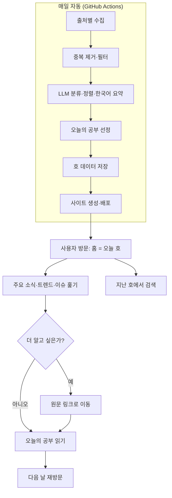
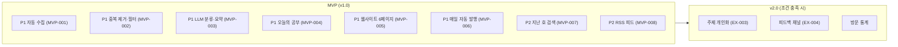
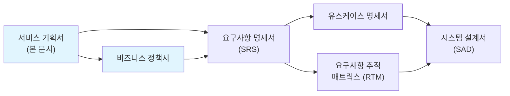

# 서비스 기획서 (Service Planning Document)

> 이 문서는 SRS(요구사항 명세서) 작성 이전에 "왜 이 서비스를 만드는가", "핵심 가치는 무엇인가", "MVP에 무엇을 포함/제외하는가"를 정의하는 선행 기획 문서이다.
> SRS가 "무엇을 만들 것인가(What)"에 집중한다면, 이 문서는 "왜 만드는가(Why)"와 "어디까지 만드는가(Scope)"에 집중한다.
> 근거가 확인되지 않은 항목은 `가정` 또는 `미결`로 표시하고 7.3절에 모은다. 목표 수치는 G0 검토에서 확정할 **제안값**이다.

| 항목 | 내용 |
|------|------|
| **프로젝트명** | IT 뉴스레터 (가칭, DEC-001) |
| **문서 버전** | v1.1 |
| **작성일** | 2026-11-25 |
| **작성자** | Claude (초안 작성) / 임지영 (프로젝트 담당) |
| **승인자** | 임지영 / 프로젝트 담당 |
| **문서 상태** | 승인됨 (G0, 2026-11-25) |

---

## 변경 이력

| 버전 | 날짜 | 작성자 | 변경 내용 |
|------|------|--------|-----------|
| v0.1 | 2026-11-25 | Claude | 초안 작성. 대화로 정한 방향(웹사이트 전환, 5페이지 이상, 스택)과 프로토타입 내용을 반영 |
| v1.0 | 2026-11-25 | Claude | G0 검토 반영: 매일 발행, 누구나 공개, RSS 포함, 링크는 https만, 5페이지 이상은 과제 조건, 페르소나를 취업 준비생·현직 개발자로 변경, 마감일 없음, LLM은 Claude, 공부 참고 자료 출처 제안(DEC-010). 승인 |
| v1.1 | 2026-11-25 | Claude | G1 결정 반영: GitHub 출처를 공식 검색 API로 변경(MVP-001), DEC-004·010·011 확정 |

---

## 목차

1. [서비스 개요](#1-서비스-개요)
2. [핵심 메커니즘](#2-핵심-메커니즘)
3. [콘텐츠/기능 전략](#3-콘텐츠기능-전략)
4. [수익화 전략](#4-수익화-전략)
5. [MVP 스코프 정의](#5-mvp-스코프-정의)
6. [KPI 가설 검증 프레임워크](#6-kpi-가설-검증-프레임워크)
7. [다음 단계](#7-다음-단계)
8. [관련 문서](#8-관련-문서)

---

## 1. 서비스 개요

### 1.1 서비스명 및 컨셉

| 항목 | 내용 |
|------|------|
| 서비스명 | IT 뉴스레터 (가칭, DEC-001) |
| 한 줄 설명 | 여러 개발자 커뮤니티의 IT 소식을 매일 아침 한국어로 요약하고, 오늘 공부할 주제 하나를 함께 보여 주는 웹사이트 |
| 서비스 유형 | 정적 웹 서비스 (매일 자동 생성·배포) |
| 대상 플랫폼 | Web (데스크톱·모바일 브라우저) |

**서비스 컨셉 설명:**

IT 공부를 하는 사람은 기술 흐름을 따라가야 하지만, 소식은 GeekNews, Hacker News, GitHub, arXiv 등 여러 곳에 흩어져 있고 상당수가 영어다. 매일 여러 사이트를 돌며 읽을 것을 고르는 데 시간이 들고, 무엇을 공부해야 할지도 막연하다. 이 서비스는 정해진 출처에서 소식을 매일 자동으로 모아 겹치는 것을 걸러 내고, LLM으로 분류·정렬한 뒤 원문에 있는 내용만으로 한국어 요약을 만든다. 결과는 "오늘 호" 하나로 묶어 웹사이트에 올리고, 모든 소식에는 원문 링크를 붙인다. 여기에 그날 소식과 이어지는 "오늘의 공부" 주제 하나를 설명과 요점으로 덧붙인다.

**배경 및 동기:**

- 처음에는 작성자 본인에게 매일 메일로 보내는 뉴스레터로 구상했으나, 2026-11-25 메일 대신 **웹사이트로 전환**하기로 결정했다. 지난 호를 다시 찾아보기 쉽고, 메일 발송 인프라가 필요 없다.
- 결과물은 **5페이지 이상**의 웹사이트여야 한다. 이번 과제의 조건이다 (DEC-007).
- LLM으로 짧은 한국어 요약을 자동 생성할 수 있게 되었고, GitHub Actions와 Cloudflare Pages로 서버 없이 매일 갱신되는 사이트를 운영할 수 있다.

#### 사용자 문제와 근거

| 문제 ID | 사용자·상황·겪는 문제 | 현재 대안과 한계 | 관찰 근거 | 확인 상태·다음 검증 |
| --- | --- | --- | --- | --- |
| OBJ-001 | 개발 직군 취업 준비생과 현직 개발자가 매일 기술 소식을 따라가고 싶지만, 출처가 여러 곳이라 확인에 시간이 든다 | 사이트를 하나씩 방문하거나 북마크 / 매일 여러 곳을 도는 시간, 놓치는 소식 | 작성자 본인 경험 (별도 사용자 조사 없음) | 가정 / H-004: 작성자 4주 사용 기록으로 확인 |
| OBJ-002 | 영어 소식이 많아 제목만 보고 넘기거나 내용 파악에 오래 걸린다 | 번역기, 원문 직독 / 문맥 없는 기계 번역, 읽는 시간 증가 | 작성자 본인 경험 | 가정 / H-001: 하루 분량을 6분 안에 읽는지 측정 |
| OBJ-003 | 소식을 읽어도 무엇을 공부해야 할지 정하기 어렵다 | 스스로 주제 선정 / 선정 기준 없음, 지속이 어려움 | 작성자 본인 경험 | 가정 / H-004 사용 기록에서 "오늘의 공부" 열람 여부 확인 |
| OBJ-004 | AI 요약은 원문에 없는 내용을 지어낼 수 있어 믿기 어렵다 | 요약 서비스 사용 후 원문 재확인 / 이중 작업 | 일반적으로 알려진 LLM 한계 | 확인 필요 / H-002: 요약 표본을 원문과 대조 |

### 1.2 핵심 가치 제안 (Value Proposition)

| 항목 | 내용 |
|------|------|
| 핵심 가치 | 매일 아침 한 페이지에서, 원문에 근거한 한국어 요약으로 오늘의 IT 소식과 공부 주제를 6분 안에 파악한다 |
| 차별점 | 여러 출처를 하나의 "호"로 묶고, 요약은 원문에 있는 내용만 쓰며, 그날의 공부 주제를 함께 준다 |
| 대안 대비 우위 | 여러 사이트를 직접 도는 것보다 빠르고, 기계 번역보다 문맥이 정리돼 있으며, 원문 링크로 바로 검증할 수 있다 |

**가치 제안 캔버스:**

| 구분 | 내용 |
|------|------|
| 사용자의 할 일 (Jobs) | 기술 흐름을 매일 따라가고, 꾸준히 공부할 주제를 찾는다 |
| 사용자의 고통 (Pains) | 출처 분산, 영어 원문, 중복 소식, 요약의 신뢰성, 공부 주제 선정의 막막함 |
| 사용자의 이득 (Gains) | 짧은 시간에 전체 흐름 파악, 필요한 것만 원문으로 깊게 읽기, 공부 습관 |
| 고통 해결제 (Pain Relievers) | 자동 수집과 중복 제거, 한국어 요약, 모든 소식에 원문 링크, 분류(트렌드·이슈) |
| 이득 생성제 (Gain Creators) | 오늘의 공부 주제와 요점 3개, 주요 소식 1건 강조, 지난 호 검색 |

### 1.3 타겟 사용자 정의

#### 1.3.1 주요 사용자 페르소나

**페르소나 1: 개발 직군 취업 준비생**

| 항목 | 내용 |
|------|------|
| 이름 | 취준생 A (가상) |
| 연령/직업 | 20대 / 개발 직군 취업 준비생 |
| 기술 수준 | 초급~중급 (한 가지 언어로 프로젝트를 해 봤음) |
| 핵심 목표 | 업계 흐름과 기술 용어를 익혀 면접과 자기소개에서 말할 거리를 만든다 |
| 핵심 불편 | 어디서부터 읽어야 할지 모름, 영어 원문이 부담, 공부 주제를 정하기 어려움 |
| 사용 시나리오 | 아침에 사이트를 열어 오늘 호를 훑고, 오늘의 공부 글을 끝까지 읽는다. 면접 전에 지난 호를 주제로 검색한다 |
| 성공 기준 | 6분 안에 오늘 호를 읽고, 오늘의 공부 주제를 한두 문장으로 설명할 수 있다 |

**페르소나 2: 현직 개발자**

| 항목 | 내용 |
|------|------|
| 이름 | 개발자 B (가상) |
| 연령/직업 | 20~30대 / 현직 개발자 (주니어~미들) |
| 기술 수준 | 중급~고급 |
| 핵심 목표 | 바쁜 와중에 놓치면 안 되는 이슈(보안 사고, 장애, 정책 변화)와 새 도구를 빠르게 확인한다 |
| 핵심 불편 | 여러 사이트를 도는 시간, 같은 소식의 중복, 요약을 믿기 어려움 |
| 사용 시나리오 | 출근길에 RSS나 홈에서 주요 소식과 IT 이슈만 보고, 업무와 관련 있는 소식은 원문으로 이동한다 |
| 성공 기준 | 업무에 영향을 주는 이슈를 당일 아침에 알게 되고, 원문을 열었을 때 요약과 내용이 다르지 않다 |

MVP의 품질 검증(H-001~H-004)은 프로젝트 담당자가 직접 사용하며 기록한다.

#### 1.3.2 사용자 세그먼트

| 세그먼트 | 설명 | 규모 추정 | 우선순위 | MVP 포함 |
|----------|------|-----------|----------|----------|
| 개발 직군 취업 준비생 | 업계 흐름과 공부 주제가 필요한 사람 (페르소나 1) | 미측정 | P1 | Y |
| 현직 개발자 | 이슈와 새 도구를 빠르게 확인하려는 사람 (페르소나 2) | 미측정 | P1 | Y |
| 프로젝트 담당자 | 직접 사용하며 품질을 검증하는 사람 | 1명 | P1 | Y |
| 메일로 받고 싶은 독자 | 매일 메일 발송을 원하는 사람 | 미측정 | - | N (EX-001: 웹사이트 형식으로 확정) |

#### 1.3.3 비사용자 (Anti-Persona)

| 비사용자 | 이유 | 대안 |
|----------|------|------|
| 실시간 속보가 필요한 사람 | 하루 한 번만 갱신한다 | 각 출처 사이트, 뉴스 앱 |
| 투자·시세 정보를 찾는 사람 | 기술 소식만 다루고 시세는 다루지 않는다 | 증권·금융 서비스 |
| 개인화 추천을 원하는 사람 | 모든 방문자가 같은 호를 본다 (EX-003) | 개인화 뉴스 앱 |
| 기사 전문이나 영어 원문을 그대로 원하는 사람 | 요약과 링크만 제공하고 전문을 옮기지 않는다 | 원문 사이트 |
| 토론·댓글 커뮤니티를 원하는 사람 | 댓글·좋아요가 없다 (EX-004) | GeekNews, Hacker News |

---

## 2. 핵심 메커니즘

### 2.1 서비스 작동 원리

**핵심 루프 (Core Loop):**

1. 시스템이 매일 정해진 시각(목표 08:00 KST)에 정해진 출처에서 지난 하루의 소식을 모은다.
2. 시스템이 겹치는 소식을 하나로 합치고 IT와 무관한 항목을 거른 뒤, LLM으로 분류(트렌드·이슈)·정렬하고 원문 텍스트만으로 한국어 요약을 만든다. 오늘의 공부 주제 하나도 고른다.
3. 결과를 "오늘 호"로 저장하고 웹사이트를 다시 만들어 배포한다.
4. 사용자가 사이트에서 오늘 호를 읽고, 관심 소식은 원문으로 이동하고, 오늘의 공부를 읽는다. 다음 날 새 호를 보러 다시 온다.

**이론적 근거:** 해당 없음.

### 2.2 전체 서비스 플로우

회원가입·로그인·결제가 없으므로 진입 즉시 오늘 호를 본다.

### 2.3 핵심 사용자 여정 (Key User Journey)

#### 여정 1: 아침에 오늘 호 읽기

| 단계 | 사용자 행동 | 시스템 반응 | 감정 목표 | 핵심 지표 |
|------|------------|------------|-----------|-----------|
| 1. 진입 | 사이트 홈 접속 | 오늘 호(호수·날짜·소식 수·읽는 시간) 표시 | 기대감 | 발행 성공률 (H-003) |
| 2. 탐색 | 주요 소식과 트렌드·이슈 목록을 훑음 | 분류된 목록과 2~3문장 요약 표시 | 빠른 파악 | 읽는 시간 (H-001) |
| 3. 행동 | 관심 소식의 "원문 보기" 클릭 | 원문 사이트를 새 탭으로 연다 | 신뢰 | 요약 사실 오류 (H-002) |
| 4. 가치 인식 | 오늘의 공부 카드에서 "자세히 읽기" | 공부 주제 글 페이지 표시 | 배움 | 오늘의 공부 열람 여부 (H-004) |
| 5. 재방문 | 다음 날 아침 재접속 | 새 호로 갱신된 홈 표시 | 습관 | 주간 읽은 날 수 (H-004) |

#### 여정 2: 지난 소식 다시 찾기

| 단계 | 사용자 행동 | 시스템 반응 | 감정 목표 | 핵심 지표 |
|------|------------|------------|-----------|-----------|
| 1 | 헤더에서 "지난 호" 이동 | 호수·날짜·대표 제목 목록 표시 | 정리됨 | - |
| 2 | 키워드 입력 (예: "보안") | 해당 키워드가 있는 호만 남김 | 빠름 | - |
| 3 | 호 선택 | 그 날의 호 페이지 표시, 원문 링크 사용 가능 | 신뢰 | - |

---

## 3. 콘텐츠/기능 전략

### 3.1 핵심 기능 방향

| 기능 영역 | 전략 방향 | 우선순위 | MVP 포함 | 비고 |
|-----------|-----------|----------|----------|------|
| 자동 수집·정제 | 공식 API·RSS가 있는 출처만, 하루 한 번, 낮은 요청량 | P1 | Y | 출처 이용 조건은 DEC-004 |
| LLM 요약·분류 | 원문 텍스트에 근거한 짧은 한국어 요약, 원문 링크 필수 | P1 | Y | 모델·비용은 DEC-002 |
| 오늘의 공부 | 그날 소식과 이어지는 주제 1개를 설명·요점 3개로 | P1 | Y | |
| 웹사이트 6페이지 | 홈, IT 트렌드, IT 이슈, 오늘의 공부, 지난 호, 소개 | P1 | Y | 5페이지 이상 조건 충족 |
| 지난 호 아카이브·검색 | 호별 페이지와 클라이언트 측 키워드 검색 | P2 | Y | |
| RSS 피드 | 새 호를 RSS로 제공. 메일 대신 "구독"하는 방법 | P2 | Y | DEC-006 확정 |
| 메일·푸시 발송 | 매일 메일이나 푸시로 보내기 | - | N | EX-001 (웹사이트 형식으로 확정) |

**기능 방향 의사결정 기록:**

| 항목 | A안 | B안 | 선택 | 근거 |
|------|-----|-----|------|------|
| 전달 방식 | 매일 메일 발송 | 웹사이트 게시 | B | 지난 호 열람이 쉽고 발송 인프라가 필요 없다. 5페이지 이상 조건과 맞는다 (2026-11-25 결정) |
| 웹 기술 | Next.js (React) | Python + Jinja2 정적 생성 | B | 작성자가 Python에 익숙하고 Next.js를 배울 계획이 없다. 하루 1회 갱신, 모든 방문자가 같은 화면이라 정적 사이트로 충분하다 (2026-11-25 결정) |
| 네이버 뉴스 자동 수집 | 수집 출처에 포함 | 제외 | B | 사용 스킬의 고지문이 체계적·대량 수집과 DB 구축을 금지한다. 직접 검색 용도로만 쓴다 (EX-007) |

### 3.2 보상/게이미피케이션 체계

해당 없음. 학습 동기는 매일 새 호와 오늘의 공부 자체로 만든다.

### 3.3 콘텐츠 전략

| 항목 | 내용 |
|------|------|
| 콘텐츠 유형 | 텍스트 (제목, 2~3문장 요약, 원문 링크, 공부 글) |
| 콘텐츠 생산 방식 | AI 생성 (원문 텍스트를 입력으로 한 LLM 요약). 작성자가 필요 시 데이터 파일을 직접 수정 |
| 콘텐츠 큐레이션 | 규칙 기반 수집 + LLM 분류·정렬 (규칙은 비즈니스 정책서 BP-SRC, BP-RANK) |
| 콘텐츠 갱신 주기 | 매일 (주말 포함, 목표 08:00 KST) |
| 품질 관리 | 원문 근거 요약 규칙 (BP-SUM), 링크 검사, 작성자의 주간 표본 대조 (H-002) |

### 3.4 브랜드/톤앤매너

| 항목 | 내용 |
|------|------|
| 브랜드 톤 | 차분하고 담백함. 과장 없이 사실만 |
| 커뮤니케이션 스타일 | 해요체. 이모지·과장 표현("혁신적", "최고의")·챗봇 말투 금지. 숫자는 `1,200명`, `12%`처럼 붙여 쓴다 |
| 시각적 아이덴티티 | 토스 TDS 시각 언어를 빌린 디자인 시스템 (회색 바탕 + 흰 카드 + 블루 강조 1색, Pretendard). [디자인 시스템](https://claude.ai/artifact/D1jHCFGWMkQTcqQgAj9KKv) 참조 |
| 캐릭터/마스코트 | 없음 |

---

## 4. 수익화 전략

### 4.1 수익 모델 선택

| 항목 | 내용 |
|------|------|
| 주요 수익 모델 | 없음 (학습·개인 프로젝트) |
| 보조 수익 모델 | 없음 |
| 무료/유료 경계 | 모든 콘텐츠 무료 공개 |
| 가격 전략 | 해당 없음 |

**선택 근거:** 1차 목표는 작성자 본인의 학습 도구이자 과제 결과물이다. 운영 비용은 무료 등급(GitHub Actions, Cloudflare Pages)과 LLM API 사용료뿐이며, LLM 월 비용 상한은 DEC-002에서 정한다.

### 4.2 단계별 수익화 계획

해당 없음. 수익화를 검토하려면 별도 기획을 다시 거친다.

### 4.3 과금 정책 요약

해당 없음 (결제·구독·환불 기능 없음).

---

## 5. MVP 스코프 정의

### 5.1 MVP 정의 기준

| 항목 | 내용 |
|------|------|
| MVP 목표 | 사람 손을 거치지 않고 매일 원문에 근거한 한국어 IT 요약 호가 웹사이트에 올라가고, 작성자가 실제로 매일 읽게 되는지 확인한다 |
| MVP 기간 | 정해진 마감 없음. 단계별 검토를 통과하면 다음 단계로 진행 (DEC-009) |
| MVP 성공 기준 | 연속 30일 운영 동안 H-001~H-004 성공 기준 충족 (6.1절, 제안값) |
| MVP 실패 시 대응 | 발행 실패가 잦으면 출처 수를 줄이고, 요약 오류가 많으면 요약을 "원문 발췌 + 한 줄 설명"으로 단순화한다 |

### 5.2 포함 항목 (In-Scope)

예상 공수는 상세 설계 이후 WBS에서 산정한다.

| ID | 기능/항목 | 설명 | 우선순위 | 예상 공수 | 비고 |
|----|-----------|------|----------|-----------|------|
| MVP-001 | 소식 자동 수집 | GeekNews(Atom 피드), Hacker News(공식 API), GitHub(공식 검색 API), arXiv(공식 API)에서 지난 하루 소식 수집 | P1 | 미산정 | OBJ-001, DEC-004 |
| MVP-002 | 중복 제거·필터 | 같은 소식 합치기, IT 무관 항목 제외 | P1 | 미산정 | OBJ-001 |
| MVP-003 | LLM 분류·정렬·요약 | 트렌드/이슈 분류, 주제 태그, 중요도 정렬, 원문 근거 한국어 요약 2~3문장 | P1 | 미산정 | OBJ-002, OBJ-004 |
| MVP-004 | 오늘의 공부 | 주제 1개 선정, 설명 글과 요점 3개, 참고 링크 | P1 | 미산정 | OBJ-003 |
| MVP-005 | 웹사이트 6페이지 | 홈, IT 트렌드, IT 이슈, 오늘의 공부, 지난 호, 소개 (디자인 시스템 적용) | P1 | 프로토타입 있음 | 5페이지 이상 조건 |
| MVP-006 | 매일 자동 발행 | GitHub Actions 일정 실행, Cloudflare Pages 배포, 실패 시 전날 호 유지 | P1 | 워크플로 초안 있음 | H-003 |
| MVP-007 | 지난 호 아카이브·검색 | 호별 페이지, 키워드 검색 | P2 | 프로토타입 있음 | OBJ-001 |
| MVP-008 | RSS 피드 | 최근 호를 RSS로 제공 (메일 구독 대신) | P2 | 프로토타입 있음 | DEC-006 확정 |

### 5.3 제외 항목 (Out-of-Scope) + 제외 근거

| ID | 제외 항목 | 제외 근거 | 대안 (MVP에서는 대신 무엇을 하는가) | v2 진입 조건 |
|----|-----------|-----------|--------------------------------------|-------------|
| EX-001 | 이메일 발송 | 2026-11-25 웹사이트 형식으로 확정. 발송 인프라·수신 동의 관리 부담 | 웹사이트 방문, RSS 피드(MVP-008) | 도입 계획 없음 |
| EX-002 | 회원가입·로그인·구독자 관리 | 모든 방문자가 같은 공개 콘텐츠를 본다. 개인정보를 다루지 않기 위함 | 로그인 없이 열람 | 개인화(EX-003)나 북마크가 필요해질 때 |
| EX-003 | 개인화 추천 | 정적 사이트 구조와 맞지 않고 1차 사용자가 1명이다 | 모두에게 같은 호, 주제 필터 칩 | 방문자가 늘고 관심 분야가 갈린다는 근거가 생길 때 |
| EX-004 | 댓글·좋아요 등 커뮤니티 | 운영·신고 처리 부담, 핵심 가설과 무관 | 원문 사이트(GeekNews, HN)의 토론 링크 | 독자 피드백 채널 요청이 반복될 때 |
| EX-005 | 관리자 편집 화면 | 작성자 1명이 운영. 화면 개발 대비 가치 낮음 | 호 데이터 파일(JSON)을 직접 수정해 커밋 | 수동 수정이 주 3회 이상 필요할 때 |
| EX-006 | 수익화·광고 | 학습·개인 프로젝트 | 없음 | 별도 기획 |
| EX-007 | 네이버 뉴스 자동 수집 | 사용 스킬의 고지문이 체계적·대량 수집과 DB 구축을 금지 | 작성자가 필요할 때 직접 검색 | 네이버 공식 API를 직접 발급받고 이용 약관상 허용될 때 |
| EX-008 | 모바일 앱 | 반응형 웹으로 충분 | 모바일 브라우저 | 해당 없음 |
| EX-009 | 기사 전문 저장·재게시 | 저작권 문제. 요약과 링크만 제공 | 원문 링크 | 해당 없음 (도입하지 않음) |
| EX-010 | 실시간·하루 여러 번 갱신 | 하루 1회로 충분하고 비용·출처 요청량 증가 | 하루 1회 호 | 해당 없음 |

### 5.4 MVP 기능 범위 다이어그램

### 5.5 기술적 MVP 결정사항

| 결정 항목 | MVP 선택 | 근거 | v2에서 전환 가능 |
|-----------|----------|------|------------------|
| 인프라 | GitHub Actions (일정 실행·빌드) + Cloudflare Pages (호스팅) | 서버 운영 없음, 무료 등급, 작성자가 써 보고 싶어 함 | Y |
| 프론트엔드 | Jinja2 템플릿으로 만든 정적 HTML + 디자인 시스템 CSS | 작성자가 Python 사용, React 학습 의사 없음 | Y |
| 백엔드 | 없음. 수집·요약·생성은 Python 스크립트가 Actions에서 실행 | 하루 1회 배치로 충분 | Y |
| 데이터베이스 | 없음. 호별 JSON 파일을 저장소에 커밋 (커밋 이력 = 아카이브) | 데이터가 작고 사람이 직접 고칠 수 있다 | Y |
| LLM | Claude (Anthropic API, 공식 Python SDK `anthropic`). API 키는 GitHub Secrets에 보관 | 작성자 결정. 기본 모델 후보는 `claude-opus-5-5`이며, 최종 모델과 월 비용 상한은 02 시스템 설계에서 정한다 (DEC-002) | Y |

---

## 6. KPI 가설 검증 프레임워크

1차 사용자가 1명이므로 방문자 수 같은 성장 지표 대신 **품질·안정성·실사용** 지표로 검증한다. 목표값은 모두 제안값이다.

### 6.1 검증할 가설 목록

| ID | 가설 | 검증 방법 | 성공 기준 (제안) | 실패 시 대응 | 우선순위 |
|----|------|-----------|-----------|-------------|----------|
| H-001 | 하루 소식을 5~12건, 건당 2~3문장으로 제한하면 오늘 호 전체를 6분 안에 읽을 수 있을 것이다 | 작성자가 주 3회 읽은 시간 기록 | 4주 평균 6분 이하 | 건수 상한을 낮추거나 요약 길이를 줄인다 | P1 |
| H-002 | 원문 텍스트만 입력으로 주고 링크를 붙이면 요약의 사실 오류가 거의 없을 것이다 | 매주 무작위 10건을 원문과 대조 | 4주 누적 사실 오류 0~1건 | 요약 방식을 "원문 발췌 + 한 줄 설명"으로 바꾼다 | P1 |
| H-003 | Actions 일정 실행과 실패 처리 규칙으로 사람 개입 없이 매일 발행될 것이다 | Actions 실행 기록 | 연속 30일 중 발행 성공 28일 이상 | 실패 원인 출처를 제외하거나 재시도 규칙을 보강한다 | P1 |
| H-004 | 매일 새 호와 오늘의 공부가 있으면 작성자가 주 5일 이상 읽을 것이다 | 작성자의 읽은 날 기록 | 4주 연속 주 5일 이상 | 발행 시각이나 분량을 조정하고, 4주 후 계속 여부 판단 | P2 |

### 6.2 핵심 지표 (Key Metrics)

| 구분 | 지표명 | 정의 | 목표값 (제안) | 측정 방법 | 측정 주기 |
|------|--------|------|--------|-----------|-----------|
| **North Star** | 주간 "읽은 호" 수 | 작성자가 끝까지 읽은 호의 수 | 주 5호 | 작성자 기록 | 주간 |
| 획득 | 해당 없음 | MVP는 홍보하지 않는다 | - | - | - |
| 활성화 | 발행 성공률 | 발행 예정일 중 새 호가 배포된 날 비율 | 93% 이상 (30일 중 28일) | Actions 실행 기록 | 일간 |
| 유지 | 주간 읽은 날 수 | 작성자가 사이트를 연 날 수 | 주 5일 | 작성자 기록 | 주간 |
| 수익 | 해당 없음 | - | - | - | - |
| 추천 | 해당 없음 | - | - | - | - |

| KPI ID·가설 ID | 산식·분모 | 기준값·목표값 | 측정 대상·기간·최소 표본 | 데이터 출처·담당자·판정일 |
| --- | --- | --- | --- | --- |
| KPI-001 / H-003 | 새 호 배포 성공일 / 발행 예정일 | 미측정 / 93% 이상 | Actions 실행 / 운영 시작 후 30일 / 30회 | Actions 실행 기록 / 임지영 / 운영 시작 30일 후 |
| KPI-002 / H-002 | 사실 오류 건수 / 대조한 요약 건수 | 미측정 / 4주 누적 1건 이하 | 요약 / 4주 / 40건 | 대조 기록 문서 / 임지영 / 4주 후 |
| KPI-003 / H-001 | 기록한 읽기 시간의 평균 | 미측정 / 6분 이하 | 오늘 호 / 4주 / 12회 | 작성자 기록 / 임지영 / 4주 후 |
| KPI-004 / H-004 | 주간 읽은 날 수 | 미측정 / 주 5일 | 작성자 / 4주 / 20일 | 작성자 기록 / 임지영 / 4주 후 |

### 6.3 가설 검증 매트릭스

| 가설 ID | 결과 시나리오 | 판단 | 다음 액션 |
|---------|--------------|------|-----------|
| H-002 | 오류 0~1건 | 가설 검증 완료 | 현재 요약 방식 유지 |
| H-002 | 오류 2~3건, 원인이 특정 출처에 몰림 | 추가 관찰 필요 | 해당 출처의 입력 텍스트 처리 보완 후 2주 재측정 |
| H-002 | 오류 4건 이상 | 가설 기각 | 요약을 "원문 발췌 + 한 줄 설명"으로 바꾼다 |
| H-003 | 30일 중 28일 이상 성공 | 가설 검증 완료 | 운영 유지 |
| H-003 | 성공 27일 이하 | 가설 기각 | 실패 원인별로 출처 제외·재시도 규칙 보강 후 재측정 |
| 공통 | 기록 누락으로 표본 부족 | 판단 보류 | 기록 방법을 정하고 2주 연장 |

### 6.4 데이터 수집 계획

| 데이터 항목 | 수집 이벤트 | 수집 도구 | 용도 | MVP 필수 |
|------------|------------|-----------|------|----------|
| 발행 성공·실패 | 매일 Actions 실행 | GitHub Actions 실행 기록 | H-003 | Y |
| 요약 대조 결과 | 주 1회 표본 검사 | 저장소 내 기록 파일 (위치는 SRS에서 정함) | H-002 | Y |
| 읽은 날·읽은 시간 | 작성자가 읽을 때 | 작성자 수기 기록 | H-001, H-004 | Y |
| 방문 통계 | 페이지 로드 | Cloudflare Web Analytics (쿠키 없음) | 공개 사이트 이용 참고 | N (v2) |

---

## 7. 다음 단계

### 7.1 기획 완료 체크리스트

- [x] 서비스 컨셉이 한 문장으로 명확히 정의되었는가
- [x] 타겟 사용자가 구체적으로 정의되었는가 (비사용자 포함)
- [x] 핵심 가치 제안이 경쟁 대비 차별화되었는가
- [x] 핵심 메커니즘(Core Loop)이 명확한가
- [x] 수익 모델이 선택되고 근거가 있는가 (수익화 없음)
- [x] MVP 포함/제외 항목이 모두 정의되었는가
- [x] **제외 항목에 "왜 제외하는가"와 "대안"이 모두 기록되었는가**
- [x] 검증할 가설이 정량적 성공 기준과 함께 정의되었는가 (제안값, G0에서 확정)
- [x] 가설 실패 시 대응 방안이 사전에 정의되었는가
- [x] 비즈니스 동작 규칙이 비즈니스정책서에 독립적으로 정의되었는가
- [x] 이해관계자 리뷰가 완료되었는가 (G0 승인, 2026-11-25)

### 7.2 v2+ 로드맵

| 버전 | 진입 조건 | 주요 기능 | 목표 |
|------|-----------|-----------|------|
| v1.0 (MVP) | - | 5.2절 참조 | 핵심 가설 검증 |
| v1.1 | MVP 운영 시작 후 2주 | 요약·분류 규칙 보정, 출처별 오류 수정 | 안정화 |
| v2.0 | H-001~H-003 성공, 독자 요청 발생 | EX-003(주제 개인화), EX-004(피드백 채널), 방문 통계 중 요청이 많은 것 | 독자 확대 |

정해진 마감이 없으므로(DEC-009) 날짜 대신 단계별 게이트(G0~G6) 통과 순서로 진행한다.

### 7.3 가정·의존성·미결 결정

| ID | 확인할 내용·근거 | 범위·일정 영향 | 담당자·결정 기한 | 상태·결정 기록 |
| --- | --- | --- | --- | --- |
| DEC-001 | 서비스명 | 화면 문구, 도메인 | 임지영 / 사이트 공개 전 | 가칭 "IT 뉴스레터" 유지 (2026-11-25). 이름이 정해지면 갱신 |
| DEC-002 | LLM 제공자·모델, 월 비용 상한, API 키 관리 | MVP-003, MVP-004 | 임지영 / 02 시스템 설계 | 부분 확정 (2026-11-25): 제공자는 Claude(Anthropic API), 키는 GitHub Secrets. 모델(기본 후보 `claude-opus-5-5`)과 월 비용 상한은 02에서 결정 |
| DEC-003 | 발행 요일 | MVP-006, BP-PUB-003 | 임지영 / G0 | 확정 (2026-11-25): 매일 발행 (주말 포함) |
| DEC-004 | 출처별 이용 조건 확인 | MVP-001 | Claude 조사 → 임지영 확인 / G1 | 확정 (2026-11-25, G1): 조사 결과는 SRS 5.3절·7.4절. GeekNews·HN·arXiv는 조건 준수 시 사용, GitHub는 Trending 페이지 대신 공식 검색 API (정책서 v1.1 BP-SRC-001) |
| DEC-005 | 사이트 공개 범위 | 세그먼트, BP-CONTENT-001 | 임지영 / G0 | 확정 (2026-11-25): 누구나 열람 |
| DEC-006 | RSS 피드(MVP-008) 포함 여부 | MVP-008 | 임지영 / G0 | 확정 (2026-11-25): 포함. 메일 발송은 하지 않음 (EX-001) |
| DEC-007 | "5페이지 이상" 조건의 출처 | MVP-005 | 임지영 / G0 | 확정 (2026-11-25): 이번 과제의 조건. 메뉴 페이지 6개로 충족 |
| DEC-008 | 페르소나 | 1.3절 | 임지영 / G0 | 확정 (2026-11-25): 개발 직군 취업 준비생, 현직 개발자 |
| DEC-009 | MVP 기간·마감일 | 7.2절 | 임지영 / G0 | 확정 (2026-11-25): 정해진 마감 없음, 게이트 순서로 진행 |
| DEC-010 | 오늘의 공부 참고 자료를 구하는 방법 | MVP-004, BP-STUDY-006~008 | 임지영 / G1 | 확정 (2026-11-25): 위키백과 공식 API(한국어 우선, 없으면 영어) + 그날 소식 원문. 위키백과 문서가 없는 주제는 고르지 않음. 공부 페이지에 출처와 CC BY-SA 4.0 표기 (BP-STUDY-008). 공식 기술 문서 자동 검색은 v2 |
| DEC-011 | 권리자 삭제 요청·User-Agent 연락 채널 | BP-CONTENT-005, BP-SRC-008 | 임지영 / G1 | 확정 (2026-11-25): 프로젝트 GitHub 저장소 이슈로 받음. 사이트 공개 전에 저장소를 공개 상태로 둬야 함 |

**제약 조건:** 공용 PC에서 작업하므로 개발 도구는 프로젝트 폴더 안(`.venv`)에만 둔다. 운영 비용은 무료 등급과 LLM 사용료로 제한한다.

G0 검토 결과와 승인된 기획 버전은 [단계별 검토 체크리스트](../08-검토/단계별검토-체크리스트.md#phase-0-기획-검토)에 연결한다.

---

## 8. 관련 문서

### 8.1 문서 간 관계

### 8.2 SRS와의 역할 분담

| 항목 | 서비스 기획서 (본 문서) | SRS |
|------|----------------------|-----|
| 관점 | 비즈니스/사용자 관점 | 시스템/구현 관점 |
| 범위 정의 | "왜 이것을 만드는가" + "왜 이것을 안 만드는가" | "무엇을 만드는가" (기능/비기능 요구사항) |
| 비즈니스 목표 | 상세 기술 (배경, 동기, 가설) | SRS 1.2절에서 요약 참조 |
| 사용자 정의 | 페르소나 + 비사용자 + 감정 목표 | 사용자 특성 테이블 (기술 수준, 사용 빈도) |
| 우선순위 | P1/P2/P3 + 제외 근거 + v2 진입 조건 | P2~P4 (SRS 1.5절) |
| 수익화 | 해당 없음 | 해당 없음 |
| KPI/가설 | 검증 프레임워크 전체 | 해당 없음 (SRS 범위 아님) |
| 비즈니스 규칙 | "비즈니스정책서 참조" 안내 | FR별 비즈니스 규칙 요약 (BR-xxx) |

> **작성 순서:** 서비스 기획서 -> 비즈니스정책서 -> SRS

### 8.3 참조 문서 목록

| 문서명 | 위치 | 관계 |
|--------|------|------|
| 비즈니스 정책서 | `00-기획/비즈니스정책서.md` | 본 문서의 비즈니스 규칙을 상세 정의 |
| 요구사항 명세서 (SRS) | `01-요구사항분석/요구사항명세서-SRS.md` | 본 문서의 MVP 스코프를 시스템 요구사항으로 구체화 |
| 유스케이스 명세서 | `01-요구사항분석/유스케이스명세서.md` | 핵심 사용자 여정을 유스케이스로 상세화 |
| 요구사항 추적 매트릭스 | `01-요구사항분석/요구사항추적매트릭스-RTM.md` | 요구사항 추적 |
| 디자인 원본 | `docs/DESIGN.md` | 디자인 시스템의 출처 (토스 TDS 정리본) |
| 디자인 시스템 | https://claude.ai/artifact/D1jHCFGWMkQTcqQgAj9KKv | 토큰·컴포넌트·페이지 템플릿 6종 |
| 프로토타입 | 브랜치 `feat/static-site` (`build.py`, `templates/`) | 예시 데이터로 6페이지를 생성하는 사이트 뼈대 |

---

## 부록

### A. 경쟁 분석

가격·규모 같은 외부 수치는 조사하지 않았다. 아래는 서비스 성격만 비교한다.

| 항목 | GeekNews | Hacker News | 우리 서비스 |
|------|----------|----------|------------|
| 서비스명 | GeekNews (news.hada.io) | Hacker News | IT 뉴스레터 (가칭) |
| 주요 기능 | 한국어 IT 소식 게시·토론 | 영어 IT 소식 게시·토론 | 여러 출처를 하루 한 호로 묶은 한국어 요약 + 오늘의 공부 |
| 강점 | 한국어, 커뮤니티 토론 | 반응 속도, 토론의 깊이 | 출처 통합, 하루 분량 제한, 공부 주제 제공 |
| 약점 (우리 관점) | 단일 출처, 계속 올라오는 흐름 | 영어, 양이 많음 | 실시간성 없음, 토론 없음 |
| 타겟 사용자 | 한국어 사용 개발자 | 영어권 개발자·창업자 | 개발 직군 취업 준비생, 현직 개발자 |
| **차별화 포인트** | | | 하루 6분 분량의 정리된 한 호, 원문 근거 요약, 오늘의 공부 |

GeekNews와 Hacker News는 경쟁 서비스이면서 수집 출처다. 원문 링크로 해당 서비스로 다시 보낸다.

### B. 용어 정의

| 용어 | 정의 |
|------|------|
| MVP | Minimum Viable Product. 핵심 가설을 검증할 수 있는 최소 기능 제품 |
| North Star Metric | 서비스의 핵심 가치를 대표하는 단일 지표 |
| Core Loop | 사용자가 반복적으로 수행하는 핵심 행동 흐름 |
| 호(issue) | 하루치 소식·오늘의 공부를 묶은 발행 단위. 1부터 순서대로 번호를 붙인다 |
| 소식(item) | 출처에서 가져온 글 하나와 그 요약·원문 링크 |
| 오늘의 공부 | 호마다 하나씩 고르는 학습 주제와 설명 글 |
| 출처(source) | 소식을 수집하는 외부 서비스 (GeekNews, Hacker News, GitHub, arXiv) |
| 원문 근거 요약 | 수집한 원문 텍스트에 있는 내용만으로 작성한 요약 |

### C. 승인

| 역할 | 이름 | 서명 | 날짜 |
|------|------|------|------|
| 기획 책임자 | 임지영 | 대화 승인 | 2026-11-25 |
| 프로젝트 스폰서 | 해당 없음 | | |
| 기술 책임자 | 임지영 | 대화 승인 | 2026-11-25 |
