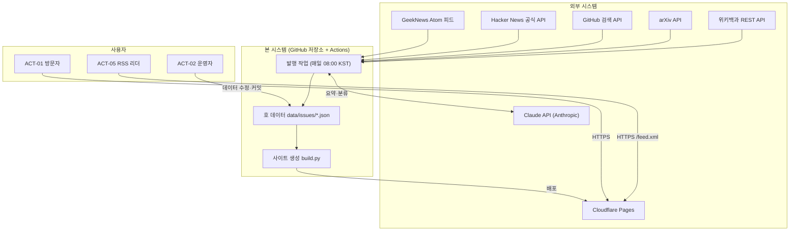
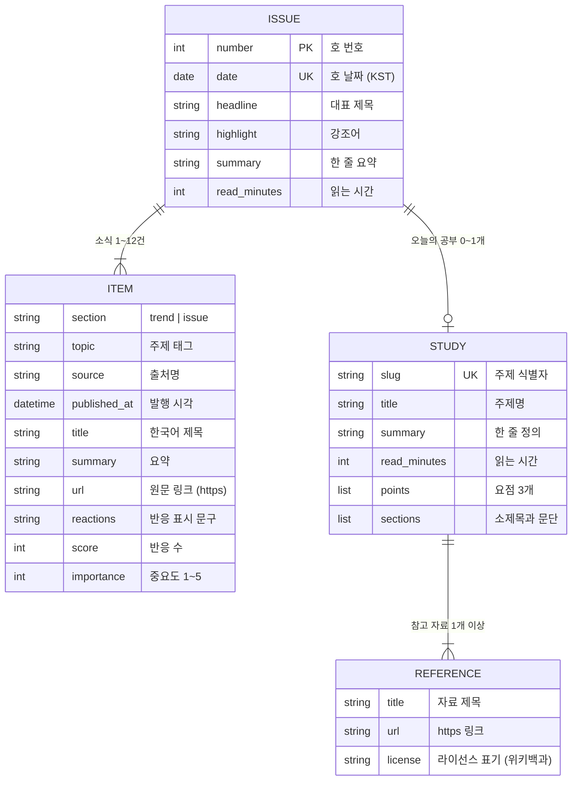

# 소프트웨어 요구사항 명세서 (SRS)

> Software Requirements Specification
> 모든 요구사항은 출처(MVP-ID, 정책 규칙 ID)와 관찰 가능한 수용 기준을 함께 기록한다. 목표 수치는 G0에서 승인된 값이다. 승인이 필요한 변경 제안은 부록 C에 모았다.

---

## 문서 정보

| 항목 | 내용 |
|------|------|
| 프로젝트명 | IT 뉴스레터 (가칭) |
| 문서 번호 | SRS-ITNL-001 |
| 버전 | 1.1 |
| 작성일 | 2026-11-25 |
| 작성자 | Claude (초안 작성) / 임지영 (프로젝트 담당) |
| 보안 등급 | 공개 |

---

## 변경 이력

| 버전 | 날짜 | 변경 내용 | 작성자 | 승인자 |
|------|------|-----------|--------|--------|
| 0.1 | 2026-11-25 | 초안 작성. G0 승인 기준선(서비스 기획서 v1.0, 비즈니스 정책서 v1.0)과 출처 이용 조건 조사(DEC-004) 반영 | Claude | - |
| 1.0 | 2026-11-25 | G1 승인. ISSUE-01·02·03·05·06 승인 결정 반영, 기준선을 서비스 기획서 v1.1·비즈니스 정책서 v1.1로 갱신 | Claude | 임지영 |
| 1.1 | 2026-11-25 | G2 결정 반영: NFR-011 목표값을 월 $40으로 확정, ISSUE-04 해결 | Claude | 임지영 |

---

## 목차

1. [문서 개요](#1-문서-개요)
2. [전체 시스템 설명](#2-전체-시스템-설명)
3. [기능 요구사항](#3-기능-요구사항)
4. [비기능 요구사항](#4-비기능-요구사항)
5. [외부 인터페이스 요구사항](#5-외부-인터페이스-요구사항)
6. [데이터 요구사항](#6-데이터-요구사항)
7. [제약 조건](#7-제약-조건)
8. [승인 내역](#8-승인-내역)

---

## 1. 문서 개요

### 1.1 목적

본 문서는 **IT 뉴스레터(가칭)** 시스템의 소프트웨어 요구사항을 정의한다. 이 시스템은 매일 정해진 출처에서 IT 소식을 모아 Claude로 분류·요약하고, 그 결과를 "호"로 묶어 정적 웹사이트에 게시한다.

본 문서는 다음 용도로 쓴다:

- 개발 범위와 기능의 정의
- 02 시스템 설계, 03 상세 설계, 구현, 테스트의 기준
- 요구사항 추적(RTM)의 기반
- G1 승인의 근거

### 1.2 범위

- **포함 범위**: 매일 자동 실행되는 수집·선정·요약·오늘의 공부 생성 파이프라인, 호 데이터 저장, 정적 웹사이트 생성(메뉴 페이지 6개 + 호별·공부 주제별 페이지 + 404), RSS 피드, Cloudflare Pages 배포, 운영자의 수동 정정 절차 (서비스 기획서 MVP-001~008)
- **제외 범위**: 메일 발송, 회원가입·로그인, 개인화 추천, 댓글·좋아요, 관리자 화면, 광고·결제, 네이버 뉴스 자동 수집, 모바일 앱, 기사 전문 저장, 하루 여러 번 갱신, 방문 통계 (서비스 기획서 EX-001~010)

시스템의 주요 목표:

1. 사람 손을 거치지 않고 매일 한 호를 발행한다 (H-003).
2. 요약은 원문에 있는 내용만 담고 항상 원문 링크를 붙인다 (H-002).
3. 하루 분량을 6분 안에 읽을 수 있게 한다 (H-001).

### 1.3 용어 정의

| 용어 | 정의 |
|------|------|
| SRS | Software Requirements Specification. 소프트웨어 요구사항 명세서 |
| RTM | Requirements Traceability Matrix. 요구사항 추적 매트릭스 |
| FR / NFR | 기능 요구사항 / 비기능 요구사항 |
| UC | Use Case. 유스케이스 |
| AC | Acceptance Criteria. 수용 기준 (FR-xxx-ACn) |
| 호(issue) | 하루치 소식과 오늘의 공부를 묶은 발행 단위. 1부터 번호를 붙인다 |
| 소식(item) | 출처에서 가져온 글 하나와 그 요약·원문 링크 |
| 오늘의 공부(study) | 호마다 하나씩 고르는 학습 주제와 설명 글 |
| 출처(source) | 소식을 수집하는 외부 서비스 |
| 발행 작업(publish job) | 수집부터 배포까지 매일 한 번 실행되는 일괄 작업 |
| 원문 텍스트 | 요약의 입력이 되는 텍스트. 원문 본문 또는 출처가 제공한 요약 |
| KST | 한국 표준시 (UTC+9). 서비스 기준 시간대 |

### 1.4 참고 문서

| 문서명 | 버전 | 비고 |
|--------|------|------|
| [서비스 기획서](../00-기획/서비스기획서.md) | v1.1 (G0 승인, G1 변경) | 문제·목표·MVP 범위·가설 |
| [비즈니스 정책서](../00-기획/비즈니스정책서.md) | v1.1 (G0 승인, G1 변경) | BP-PUB, SRC, RANK, SUM, STUDY, ERROR, CONTENT, TEXT |
| [유스케이스 명세서](유스케이스명세서.md) | 1.0 | UC-001~009 |
| [요구사항 추적 매트릭스 (RTM)](요구사항추적매트릭스-RTM.md) | 1.0 | 요구사항 추적 |
| 디자인 시스템 | https://claude.ai/artifact/D1jHCFGWMkQTcqQgAj9KKv | 토큰·컴포넌트·페이지 템플릿 6종 (화면 설계서 대용, 02에서 화면 설계서로 정리) |
| 프로토타입 | 브랜치 `feat/static-site` 커밋 `94b3e8a` | 예시 데이터로 6페이지를 생성하는 사이트 뼈대 |

### 1.5 우선순위 정의

포함 범위의 우선순위는 서비스 기획서와 같은 P1~P3를 쓴다. 제외한 항목을 남길 때는 P4로 기록하고 EX-ID를 참조한다.

| 등급 | 라벨 | 정의 |
|------|------|------|
| P1 | 필수 (Must) | 반드시 구현. 미구현 시 출시 불가 |
| P2 | 권장 (Should) | 구현을 강하게 권장. 순서 조정 가능 |
| P3 | 선택 (Could) | 있으면 좋음. 후속 릴리스로 이관 가능 |
| P4 | 제외 (Won't) | 현재 범위에서 명시적으로 제외 |

---

## 2. 전체 시스템 설명

### 2.1 시스템 관점도

서버와 데이터베이스가 없다. 매일 GitHub Actions에서 발행 작업이 돌아 호 데이터(JSON)를 저장소에 커밋하고, 그 데이터로 정적 사이트를 만들어 Cloudflare Pages에 올린다. 방문자는 정적 파일만 받는다.

### 2.2 사용자 유형 및 특성

| Actor ID | 사용자 유형 | 설명 | 권한 수준 | 사용 빈도 | 기술 숙련도 |
|----------|-------------|------|-----------|-----------|-------------|
| ACT-01 | 방문자 | 개발 직군 취업 준비생, 현직 개발자 (페르소나 1·2). 로그인 없이 열람 | 열람 | 매일 | 초급~고급 |
| ACT-02 | 운영자 | 프로젝트 담당자. 호 데이터 정정·삭제, 실패 대응, 비밀 값 관리 | 저장소 쓰기 | 필요 시 | 중급 |
| ACT-03 | 스케줄러 | GitHub Actions 일정 실행. 매일 발행 작업을 시작 | 저장소 쓰기, 배포 | 매일 1회 | - |
| ACT-04 | 외부 시스템 | 출처 4곳, Claude API, 위키백과 API, Cloudflare Pages | 해당 없음 | 매일 | - |
| ACT-05 | RSS 리더 | 방문자가 쓰는 피드 구독 프로그램 | 열람 | 수시 | - |

### 2.3 운영 환경

#### 2.3.1 하드웨어 환경

| 구분 | 사양 | 비고 |
|------|------|------|
| 발행 작업 실행 | GitHub Actions 호스팅 러너 (ubuntu-latest) | 무료 등급 |
| 정적 호스팅 | Cloudflare Pages | 무료 등급, CDN 포함 |
| 응용 서버·DB 서버 | 없음 | 정적 사이트 |

#### 2.3.2 소프트웨어 환경

| 구분 | 기술 스택 | 버전 | 비고 |
|------|-----------|------|------|
| Runtime | Python | 3.12 | 로컬은 프로젝트 `.venv` |
| 템플릿 | Jinja2 | 3.1.x | 정적 HTML 생성 |
| LLM SDK | Anthropic 공식 Python SDK (`anthropic`) | 02에서 고정 | 모델은 02에서 결정 (DEC-002) |
| Database | 없음 | - | 호별 JSON 파일을 저장소에 커밋 |
| CI/CD | GitHub Actions | - | 일정 실행, 테스트, 빌드, 배포 |
| 배포 도구 | Cloudflare wrangler (공식 GitHub Action) | 02에서 고정 | |

#### 2.3.3 클라이언트 환경

| 구분 | 지원 범위 | 비고 |
|------|-----------|------|
| 데스크톱 브라우저 | Chrome, Edge, Firefox, Safari 최신 2개 버전 | |
| 모바일 브라우저 | iOS Safari, Android Chrome 최신 2개 버전 | |
| 최소 화면 폭 | 360px | 반응형 (640·960px 기준점) |
| 모바일 앱 | 미지원 (EX-008) | |

### 2.4 제약사항

1. 기술: Python만 쓴다. Next.js·React를 쓰지 않는다. 서버와 DB를 두지 않는다 (서비스 기획서 5.5절).
2. 조직: 1인 프로젝트. 작업 PC가 공용이라 도구는 프로젝트 폴더 안에만 설치한다.
3. 법적: 기사 전문을 저장·재게시하지 않는다. 출처 이용 조건과 위키백과 라이선스를 지킨다 (7.4절).
4. 일정: 정해진 마감이 없다. 게이트 순서로 진행한다 (DEC-009).
5. 과제: 메뉴 페이지 5개 이상이 필요하다 (DEC-007).

### 2.5 가정 및 전제 조건

1. GitHub Actions 일정 실행은 수십 분까지 지연될 수 있다. 10:00 KST까지 배포되면 정상으로 본다 (BP-PUB-002).
2. 각 출처의 공식 피드·API는 형식이 크게 바뀌지 않는다. 바뀌면 해당 출처 수집이 실패하고 BP-ERROR-001에 따라 나머지로 발행한다.
3. Claude API 키와 Cloudflare 토큰은 운영자가 GitHub Secrets에 등록한다.
4. 초기 방문자는 적다. 정적 호스팅이라 방문자 수가 시스템 부하에 영향을 주지 않는다.

---

## 3. 기능 요구사항

### 3.1 기능 요구사항 요약 목록

| FR-ID | 기능명 | 설명 | 우선순위 | 관련 UC | 상태 |
|-------|--------|------|----------|---------|------|
| FR-001 | 소식 수집 | 출처 4곳에서 수집 기간의 소식을 가져온다 | P1 | UC-007 | 초안 |
| FR-002 | 중복 제거·필터 | 같은 소식을 합치고 최근 실린 것과 IT 무관 항목을 뺀다 | P1 | UC-007 | 초안 |
| FR-003 | 분류·태그·중요도 | 소식마다 분류, 주제 태그, 중요도를 매긴다 | P1 | UC-007 | 초안 |
| FR-004 | 선정·정렬 | 건수 상한 안에서 정렬하고 주요 소식을 정한다 | P1 | UC-007 | 초안 |
| FR-005 | 원문 근거 요약 | 원문 텍스트만으로 한국어 제목·요약을 만든다 | P1 | UC-007 | 초안 |
| FR-006 | 오늘의 공부 생성 | 주제 1개를 골라 설명 글·요점·참고 링크를 만든다 | P1 | UC-007 | 초안 |
| FR-007 | 호 데이터 생성·검증·저장 | 호 번호·날짜를 정하고 검증한 뒤 저장소에 커밋한다 | P1 | UC-007, UC-009 | 초안 |
| FR-008 | 매일 자동 실행·배포 | 정해진 시각에 발행 작업을 돌리고 사이트를 배포한다 | P1 | UC-007, UC-008 | 초안 |
| FR-009 | 홈 페이지 | 오늘 호를 보여 준다 | P1 | UC-001 | 초안 |
| FR-010 | IT 트렌드 페이지 | 최신 호의 트렌드 소식과 주제 필터 | P1 | UC-002 | 초안 |
| FR-011 | IT 이슈 페이지 | 최근 3개 호의 이슈를 날짜별로 | P1 | UC-003 | 초안 |
| FR-012 | 오늘의 공부 페이지 | 주제별 설명 글 페이지 | P1 | UC-004 | 초안 |
| FR-013 | 지난 호 목록·검색·호별 페이지 | 모든 호 목록, 키워드 검색, 호별 페이지 | P2 | UC-005 | 초안 |
| FR-014 | 소개 페이지 | 서비스 설명, 출처, RSS 주소 복사 | P1 | UC-006 | 초안 |
| FR-015 | RSS 피드 | 최근 20개 호를 RSS 2.0으로 제공 | P2 | UC-006 | 초안 |
| FR-016 | 공통 레이아웃·404 | 헤더 메뉴 6개, 하단 고지, 404 페이지 | P1 | UC-001~006 | 초안 |
| FR-017 | 운영자 정정·삭제 | 데이터 파일 수정으로 호를 고치고 다시 배포한다 | P2 | UC-009 | 초안 |
| FR-018 | 메일 발송 | 제외 (EX-001) | P4 | - | 제외 |
| FR-019 | 회원·로그인·개인화 | 제외 (EX-002, EX-003) | P4 | - | 제외 |

---

### 3.2 FR-001: 소식 수집

| 항목 | 내용 |
|------|------|
| **FR-ID** | FR-001 |
| **기능명** | 소식 수집 |
| **설명** | 발행 작업이 출처 4곳에서 수집 기간에 발행된 소식을 가져와 다음 단계에 넘긴다. |
| **우선순위** | P1 |
| **연관 기능** | FR-002, FR-005, FR-008 |
| **관련 UC** | UC-007 |
| **출처** | MVP-001, BP-SRC-001~006, BP-PUB-006, ISSUE-01 |
| **담당·의존성** | 임지영 / DEC-004 조사 결과, ISSUE-01 승인 |

**출처별 수집 방식:**

| 출처 | 수집 수단 | 가져오는 범위 | 원문 링크 | 원문 텍스트 | 반응 수 |
|------|-----------|---------------|-----------|-------------|---------|
| GeekNews | 공식 Atom 피드 `news.hada.io/rss/news` | 피드 항목 중 수집 기간 안의 것 (피드는 약 20건) | GeekNews 토론 페이지 (`https://news.hada.io/topic?id=…`) | 피드의 한국어 요약(HTML) | 없음 (0으로 처리) |
| Hacker News | 공식 API `hacker-news.firebaseio.com/v0/` | `topstories` 상위 30건 중 수집 기간 안의 글 | 글의 외부 링크. 외부 링크가 없으면 HN 글 페이지 | 외부 링크의 원문 페이지 텍스트, 없으면 글 본문 | 점수(score) |
| GitHub | 공식 검색 API (저장소 검색) | 최근 생성·갱신된 저장소 중 스타 순 상위 10건 (검색 조건은 02에서 확정) | 저장소 페이지 | 저장소 설명과 README 앞부분 | 스타 수 |
| arXiv | 공식 API | 컴퓨터과학 분야(cs.AI, cs.CL, cs.LG, cs.SE 등, 02에서 확정) 최신 논문 상위 20건 | 논문 초록 페이지 (`https://arxiv.org/abs/…`) | 제목과 초록 | 없음 (0으로 처리) |

**처리 로직:**

1. 수집 기간을 계산한다 (BP-PUB-006).
2. 출처마다 위 표의 공식 수단으로 한 번씩 요청한다. 같은 출처에 연속 요청할 때는 간격을 둔다 (NFR-007).
3. 로그인·유료·CAPTCHA 응답을 받은 소식은 원문 텍스트가 없는 것으로 표시한다 (BP-SRC-004).
4. 소식마다 출처명, 제목, 원문 링크, 발행 시각(UTC 저장), 반응 수, 원문 텍스트를 만든다. 원문 텍스트는 메모리에서만 쓰고 저장하지 않는다 (BP-SRC-005).
5. 출처 하나가 실패하면 기록하고 다음 출처로 넘어간다 (BP-ERROR-001, BP-ERROR-005).

**출력:** 수집된 소식 목록과 출처별 성공·실패 기록 (실행 로그).

**수용 기준**

| 기준 ID | 사전 조건 | 사용자 행동 또는 사건 | 관찰 가능한 기대 결과 |
| --- | --- | --- | --- |
| FR-001-AC1 | 4개 출처 모두 정상, 직전 호 수집 시작이 24시간 전 | 발행 작업 실행 | 4개 출처의 소식 중 발행 시각이 수집 기간 안인 것만 목록에 있다 |
| FR-001-AC2 | arXiv가 응답하지 않음 | 발행 작업 실행 | arXiv를 5초 뒤 1회 다시 요청하고, 실패하면 로그에 "arXiv 수집 실패"가 남고 나머지 3개 출처 소식은 다음 단계로 넘어간다 |
| FR-001-AC3 | GitHub 검색 API가 429를 반환 | 발행 작업 실행 | GitHub를 다시 요청하지 않고 건너뛴다 |
| FR-001-AC4 | 수집 완료 | 저장된 호 데이터 확인 | 원문 본문 텍스트가 데이터 파일 어디에도 없다 |

---

### 3.3 FR-002: 중복 제거·필터

| 항목 | 내용 |
|------|------|
| **FR-ID** | FR-002 |
| **기능명** | 중복 제거·필터 |
| **설명** | 같은 원문을 가리키는 소식을 하나로 합치고, 최근 7개 호에 실린 소식과 IT 무관 소식을 뺀다. |
| **우선순위** | P1 |
| **연관 기능** | FR-001, FR-003 |
| **관련 UC** | UC-007 |
| **출처** | MVP-002, BP-RANK-001, BP-RANK-002, BP-RANK-004, BP-SUM-004 |
| **담당·의존성** | 임지영 / FR-003 (무관 판정) |

**처리 로직:**

1. 원문 링크가 `https://`로 시작하지 않는 소식을 뺀다 (BP-SUM-004).
2. 링크를 정규화(쿼리의 `utm_*` 제거, 끝의 `/` 제거)해 같은 것끼리 묶고, 반응 수가 큰 소식 하나만 남긴다 (BP-RANK-001).
3. 직전 7개 호에 실린 정규화 링크와 같은 소식을 뺀다 (BP-RANK-002).
4. FR-003에서 "무관"으로 분류된 소식을 뺀다 (BP-RANK-004).

**수용 기준**

| 기준 ID | 사전 조건 | 사용자 행동 또는 사건 | 관찰 가능한 기대 결과 |
| --- | --- | --- | --- |
| FR-002-AC1 | 두 출처가 `https://example.com/a?utm_source=x`와 `https://example.com/a/`를 각각 수집, 반응 수 30·412 | 필터 실행 | 한 건만 남고 반응 수는 412, 출처는 412 쪽이다 |
| FR-002-AC2 | 원문 링크가 `http://example.org/post`인 소식 | 필터 실행 | 그 소식이 빠지고 로그에 남는다 |
| FR-002-AC3 | 3일 전 호에 실린 링크와 같은 소식 | 필터 실행 | 그 소식이 빠진다 |
| FR-002-AC4 | 8개 호 전에 실린 링크와 같은 소식 | 필터 실행 | 그 소식은 남는다 (7개 호 경계) |

---

### 3.4 FR-003: 분류·태그·중요도

| 항목 | 내용 |
|------|------|
| **FR-ID** | FR-003 |
| **기능명** | 분류·태그·중요도 |
| **설명** | Claude로 소식마다 분류(`trend`/`issue`/무관), 주제 태그 1개, 중요도(1~5)를 매긴다. |
| **우선순위** | P1 |
| **연관 기능** | FR-002, FR-004 |
| **관련 UC** | UC-007 |
| **출처** | MVP-003, BP-RANK-003, BP-RANK-004, BP-RANK-005, BP-RANK-007 |
| **담당·의존성** | 임지영 / DEC-002 (모델) |

**처리 로직:**

1. 소식의 제목과 원문 텍스트를 Claude에 보내 정해진 형식(구조화 출력)으로 분류·태그·중요도를 받는다.
2. 분류는 `trend`, `issue`, `무관` 중 하나다. `issue`는 보안 사고, 서비스 장애, 정책·규제·법적 분쟁이다 (BP-RANK-003).
3. 태그는 `AI`, `개발 도구`, `클라우드`, `보안`, `정책`, `장애`, `연구`, `기타` 중 하나다 (BP-RANK-005).
4. 허용되지 않은 값이 오면 그 소식을 제외한다 (BP-ERROR-003).

**수용 기준**

| 기준 ID | 사전 조건 | 사용자 행동 또는 사건 | 관찰 가능한 기대 결과 |
| --- | --- | --- | --- |
| FR-003-AC1 | 정상 응답 | 분류 실행 | 모든 소식이 허용된 분류·태그 값과 1~5 정수 중요도를 갖는다 |
| FR-003-AC2 | Claude가 분류 값으로 "news"를 돌려줌 | 분류 실행 | 그 소식이 제외되고 로그에 남는다 |
| FR-003-AC3 | npm 패키지 취약점 소식 | 분류 실행 | 분류가 `issue`, 태그가 `보안`이다 (품질 표본 검사) |

---

### 3.5 FR-004: 선정·정렬

| 항목 | 내용 |
|------|------|
| **FR-ID** | FR-004 |
| **기능명** | 선정·정렬 |
| **설명** | 분류별 건수 상한 안에서 소식을 고르고 정렬하며, 1위를 주요 소식으로 정한다. |
| **우선순위** | P1 |
| **연관 기능** | FR-003, FR-009 |
| **관련 UC** | UC-007 |
| **출처** | MVP-002, BP-RANK-006, BP-RANK-007, BP-RANK-008 |
| **담당·의존성** | 임지영 / FR-003 |

**처리 로직:**

1. 정렬: 중요도 내림차순 → 반응 수 내림차순 → 발행 시각 최신순 (BP-RANK-007).
2. `trend` 최대 8건, `issue` 최대 4건, 합계 최대 12건으로 자른다 (BP-RANK-006).
3. 전체 정렬 1위를 주요 소식으로 표시한다 (BP-RANK-008).

**수용 기준**

| 기준 ID | 사전 조건 | 사용자 행동 또는 사건 | 관찰 가능한 기대 결과 |
| --- | --- | --- | --- |
| FR-004-AC1 | 필터 후 `trend` 15건, `issue` 2건 | 선정 실행 | `trend` 8건, `issue` 2건, 총 10건이 남는다 |
| FR-004-AC2 | 중요도가 같은 두 소식, 반응 수 214·96 | 선정 실행 | 214인 소식이 앞에 온다 |
| FR-004-AC3 | 필터 후 3건 | 선정 실행 | 3건 모두 남는다 (최소 건수 없음) |

---

### 3.6 FR-005: 원문 근거 요약

| 항목 | 내용 |
|------|------|
| **FR-ID** | FR-005 |
| **기능명** | 원문 근거 요약 |
| **설명** | Claude로 소식마다 한국어 제목과 2~3문장 요약을 만든다. 입력은 원문 텍스트뿐이다. |
| **우선순위** | P1 |
| **연관 기능** | FR-001, FR-007 |
| **관련 UC** | UC-007 |
| **출처** | MVP-003, BP-SUM-001~005, BP-TEXT-001~003, H-002 |
| **담당·의존성** | 임지영 / DEC-002 (모델·비용) |

**처리 로직:**

1. 원문 텍스트가 없는 소식은 요약하지 않고 제외한다 (BP-SUM-001).
2. 원문 텍스트가 입력 한도를 넘으면 앞부분만 넣고, 넣은 부분에 없는 내용을 쓰지 않도록 지시한다.
3. 요약은 해요체 2~3문장, 공백 포함 200자 이내. 원문에 없는 수치·평가·전망을 넣지 않는다. 과장 표현·이모지를 쓰지 않는다 (BP-SUM-002·003, BP-TEXT-001·002).
4. 제목은 원문 제목을 한국어로 옮기거나 다듬되 뜻을 바꾸지 않는다 (BP-SUM-005).
5. 길이·형식 검사를 통과하지 못하면 1회 다시 생성하고, 그래도 실패하면 그 소식을 제외한다.

**수용 기준**

| 기준 ID | 사전 조건 | 사용자 행동 또는 사건 | 관찰 가능한 기대 결과 |
| --- | --- | --- | --- |
| FR-005-AC1 | 원문 텍스트가 있는 소식 | 요약 실행 | 요약이 2~3문장, 공백 포함 200자 이내다 |
| FR-005-AC2 | 원문 텍스트가 없는 소식 | 요약 실행 | 요약을 만들지 않고 소식을 제외한다 |
| FR-005-AC3 | 발행된 호 | 운영자가 무작위 10건을 원문과 대조 (주 1회) | 원문에 없는 사실이 없다. 4주 누적 사실 오류 1건 이하 (NFR-004) |
| FR-005-AC4 | 생성된 요약에 "혁신적"이 포함됨 | 형식 검사 | 1회 다시 생성하고, 다시 포함되면 소식을 제외한다 |

---

### 3.7 FR-006: 오늘의 공부 생성

| 항목 | 내용 |
|------|------|
| **FR-ID** | FR-006 |
| **기능명** | 오늘의 공부 생성 |
| **설명** | 그 호의 소식에서 주제 하나를 고르고, 위키백과 문서와 그날 소식 원문을 근거로 설명 글·요점 3개·참고 링크를 만든다. |
| **우선순위** | P1 |
| **연관 기능** | FR-004, FR-012 |
| **관련 UC** | UC-007 |
| **출처** | MVP-004, BP-STUDY-001~007, BP-ERROR-004, ISSUE-02 |
| **담당·의존성** | 임지영 / DEC-010 (확인됨: 위키백과 + 그날 소식), ISSUE-02 (라이선스 표기) |

**처리 로직:**

1. Claude로 그 호 소식에서 기술 개념 후보 3개를 뽑는다.
2. 직전 30개 호에서 다룬 주제와 이미 쓴 slug는 후보에서 뺀다 (BP-STUDY-002·003).
3. 후보 순서대로 위키백과 REST API(요약 엔드포인트)로 한국어 문서를 찾고, 없으면 영어 문서를 찾는다. 문서가 없는 후보는 건너뛴다 (BP-STUDY-007).
4. 위키백과 요약과 그날 소식 원문 텍스트만을 근거로 한 줄 정의, 소제목 2~4개의 설명 글(공백 포함 600~1,500자), 요점 정확히 3개를 만든다 (BP-STUDY-004~006).
5. 참고 링크에 위키백과 문서 주소와 관련 소식 원문 링크를 넣는다. 모두 `https://`다.
6. 후보가 모두 실패하거나 규칙을 만족하지 못하면 오늘의 공부 없이 진행하고, 화면은 직전 호의 공부를 보여 준다 (BP-ERROR-004).

**수용 기준**

| 기준 ID | 사전 조건 | 사용자 행동 또는 사건 | 관찰 가능한 기대 결과 |
| --- | --- | --- | --- |
| FR-006-AC1 | 후보 "벡터 데이터베이스", 최근 30호에 없음, 위키백과 문서 있음 | 생성 실행 | 요점이 정확히 3개, 본문 600~1,500자, 참고 링크에 위키백과 문서 주소가 있다 |
| FR-006-AC2 | 첫 후보가 25개 호 전에 다룬 주제 | 생성 실행 | 그 후보를 건너뛰고 다음 후보로 만든다 |
| FR-006-AC3 | 한국어 문서 없음, 영어 문서 있음 | 생성 실행 | 영어 문서를 근거로 한국어 글을 만들고, 참고 링크는 영어 위키백과 주소다 |
| FR-006-AC4 | 모든 후보에 위키백과 문서가 없음 | 생성 실행 | 호는 오늘의 공부 없이 저장되고, 홈의 공부 카드는 직전 호의 공부를 보여 준다 |

---

### 3.8 FR-007: 호 데이터 생성·검증·저장

| 항목 | 내용 |
|------|------|
| **FR-ID** | FR-007 |
| **기능명** | 호 데이터 생성·검증·저장 |
| **설명** | 호 번호·날짜·대표 제목·요약 문장을 정하고 데이터 형식을 검증한 뒤, 호 데이터 파일을 저장소에 커밋한다. |
| **우선순위** | P1 |
| **연관 기능** | FR-004~006, FR-008 |
| **관련 UC** | UC-007, UC-009 |
| **출처** | MVP-006, BP-PUB-004, BP-PUB-005, BP-ERROR-002, BP-ERROR-006, BP-CONTENT-003 |
| **담당·의존성** | 임지영 / 데이터 형식은 02에서 확정 |

**처리 로직:**

1. 선정 결과가 0건이면 호를 만들지 않고 작업을 실패로 끝낸다 (BP-ERROR-002).
2. 오늘 날짜(KST)의 호가 이미 있으면 같은 번호로 덮어쓰고, 없으면 직전 호 번호 + 1로 만든다 (BP-PUB-004·005).
3. 대표 제목(headline)과 강조어, 한 줄 요약 문장, 읽는 시간(분)을 만든다.
4. 검증: 필수 항목, 링크가 모두 `https://`, 건수 상한, 요약 길이, 오늘의 공부 형식(있을 때), slug 중복 없음, 호 번호 중복 없음.
5. 검증을 통과하면 `data/issues/<YYYY-MM-DD>.json`으로 저장하고 커밋한다. 실패하면 저장·배포하지 않는다 (BP-ERROR-006).

**수용 기준**

| 기준 ID | 사전 조건 | 사용자 행동 또는 사건 | 관찰 가능한 기대 결과 |
| --- | --- | --- | --- |
| FR-007-AC1 | 직전 호가 제127호(11월 24일) | 11월 25일 발행 | `data/issues/2026-11-25.json`에 제128호가 저장·커밋된다 |
| FR-007-AC2 | 11월 25일 제128호가 이미 있음 | 같은 날 재실행 | 새 번호 없이 제128호 파일이 새 결과로 바뀐다 |
| FR-007-AC3 | 선정 결과 0건 | 발행 실행 | 파일이 생기지 않고 작업이 실패로 표시된다 |
| FR-007-AC4 | 소식 하나의 링크가 `javascript:`로 시작 | 검증 실행 | 검증이 실패하고 커밋·배포가 일어나지 않는다 |

---

### 3.9 FR-008: 매일 자동 실행·배포

| 항목 | 내용 |
|------|------|
| **FR-ID** | FR-008 |
| **기능명** | 매일 자동 실행·배포 |
| **설명** | 매일 08:00 KST에 발행 작업을 시작해 테스트·사이트 생성을 거쳐 Cloudflare Pages에 배포한다. 운영자가 수동으로도 실행할 수 있다. |
| **우선순위** | P1 |
| **연관 기능** | FR-001~007, FR-009~016 |
| **관련 UC** | UC-007, UC-008 |
| **출처** | MVP-006, BP-PUB-001~003, BP-ERROR-001~007 |
| **담당·의존성** | 임지영 / Cloudflare 계정·토큰, GitHub Secrets |

**처리 로직:**

1. GitHub Actions 일정(매일 23:00 UTC)과 수동 실행으로 시작한다.
2. 순서: 수집(FR-001) → 필터(FR-002) → 분류(FR-003) → 선정(FR-004) → 요약(FR-005) → 공부(FR-006) → 저장(FR-007) → 테스트 → 사이트 생성 → 배포.
3. 테스트나 사이트 생성이 실패하면 배포하지 않는다. 사이트는 직전 배포 상태로 남는다.
4. 실패하면 GitHub 기본 실패 알림이 운영자에게 간다 (BP-ERROR-007).
5. 실행 로그에 출처별 수집 건수·실패, 제외된 소식 수와 사유, 최종 건수를 남긴다.

**수용 기준**

| 기준 ID | 사전 조건 | 사용자 행동 또는 사건 | 관찰 가능한 기대 결과 |
| --- | --- | --- | --- |
| FR-008-AC1 | 비밀 값 등록 완료 | 08:00 KST 일정 실행 | 10:00 KST 이전에 사이트 홈이 새 호로 바뀐다 |
| FR-008-AC2 | 모든 출처 실패 | 일정 실행 | 홈은 직전 호 그대로이고 Actions 실행이 실패로 표시된다 |
| FR-008-AC3 | 운영자가 Actions 화면에서 수동 실행 | 실행 | 일정 실행과 같은 순서로 동작한다 |
| FR-008-AC4 | 사이트 생성 테스트 실패 | 실행 | 배포 단계가 실행되지 않는다 |

---

### 3.10 FR-009: 홈 페이지

| 항목 | 내용 |
|------|------|
| **FR-ID** | FR-009 |
| **기능명** | 홈 페이지 (`/`) |
| **설명** | 최신 호를 보여 준다: 호수·날짜, 대표 제목, 숫자 요약, 주요 소식, 트렌드·이슈 목록, 오늘의 공부 카드, 많이 이야기된 소식 상위 5건. |
| **우선순위** | P1 |
| **연관 기능** | FR-004, FR-006, FR-016 |
| **관련 UC** | UC-001 |
| **출처** | MVP-005, BP-RANK-008, BP-TEXT-003~005, 디자인 시스템 PageHome |
| **담당·의존성** | 임지영 / 프로토타입 `templates/home.html` |

**표시 규칙:**

- 숫자 요약: 소식 수, 출처 수, 읽는 시간 (tabular 숫자).
- 소식마다 분류 뱃지, 출처명, 발행 시각(BP-TEXT-004), 제목, 요약, "원문 보기" 링크(새 탭).
- 많이 이야기된 소식: 반응 수 상위 5건. 1위 숫자만 진한 색.
- 960px 미만에서는 사이드바(오늘의 공부, 순위)가 본문 아래로 내려간다.

**수용 기준**

| 기준 ID | 사전 조건 | 사용자 행동 또는 사건 | 관찰 가능한 기대 결과 |
| --- | --- | --- | --- |
| FR-009-AC1 | 최신 호가 제128호, 소식 6건 | `/` 접속 | "제128호 · 11월 25일 (수)", "6건"이 보이고 정렬 1위 소식이 주요 소식 카드에 있다 |
| FR-009-AC2 | 소식 발행 시각이 전날 23:40 KST | `/` 접속 | 그 소식 시각이 "11월 24일 23:40"으로 보인다 |
| FR-009-AC3 | 모든 소식 | "원문 보기" 클릭 | 원문 링크가 새 탭으로 열린다 |
| FR-009-AC4 | 화면 폭 375px | `/` 접속 | 가로 스크롤 없이 한 단으로 보인다 |

---

### 3.11 FR-010: IT 트렌드 페이지

| 항목 | 내용 |
|------|------|
| **FR-ID** | FR-010 |
| **기능명** | IT 트렌드 페이지 (`/trends/`) |
| **설명** | 최신 호의 `trend` 소식 전체와 주제 필터 칩(전체 + 태그별 건수)을 보여 준다. |
| **우선순위** | P1 |
| **연관 기능** | FR-003, FR-016 |
| **관련 UC** | UC-002 |
| **출처** | MVP-005, BP-RANK-005, 디자인 시스템 PageTrends |
| **담당·의존성** | 임지영 / 프로토타입 `templates/trends.html` |

**수용 기준**

| 기준 ID | 사전 조건 | 사용자 행동 또는 사건 | 관찰 가능한 기대 결과 |
| --- | --- | --- | --- |
| FR-010-AC1 | `trend` 4건 (AI 2, 개발 도구 1, 클라우드 1) | `/trends/` 접속 | 칩이 "전체 4", "AI 2", "개발 도구 1", "클라우드 1"로 보인다 |
| FR-010-AC2 | 위와 같음 | "AI 2" 칩 클릭 | AI 소식 2건만 보이고 그 칩만 선택 상태다 |
| FR-010-AC3 | 자바스크립트가 꺼진 브라우저 | `/trends/` 접속 | 소식 4건이 모두 보인다 |
| FR-010-AC4 | 최신 호의 소식이 모두 `issue` | `/trends/` 접속 | "오늘은 트렌드 소식이 없어요" 안내가 보인다 |

---

### 3.12 FR-011: IT 이슈 페이지

| 항목 | 내용 |
|------|------|
| **FR-ID** | FR-011 |
| **기능명** | IT 이슈 페이지 (`/issues/`) |
| **설명** | 최근 3개 호의 `issue` 소식을 호 날짜별 묶음으로 보여 준다. |
| **우선순위** | P1 |
| **연관 기능** | FR-003, FR-016 |
| **관련 UC** | UC-003 |
| **출처** | MVP-005, BP-RANK-003, 디자인 시스템 PageIssues |
| **담당·의존성** | 임지영 / 프로토타입 `templates/issues.html` |

**수용 기준**

| 기준 ID | 사전 조건 | 사용자 행동 또는 사건 | 관찰 가능한 기대 결과 |
| --- | --- | --- | --- |
| FR-011-AC1 | 최근 3개 호에 이슈 2·1·1건 | `/issues/` 접속 | 날짜 묶음 3개, 최신 날짜가 위, 총 4건이 보인다 |
| FR-011-AC2 | 최근 3개 호 중 한 호에 이슈 0건 | `/issues/` 접속 | 그 날짜 묶음은 보이지 않는다 |
| FR-011-AC3 | 최근 3개 호 모두 이슈 0건 | `/issues/` 접속 | "최근에 올라온 이슈가 없어요" 안내가 보인다 |

---

### 3.13 FR-012: 오늘의 공부 페이지

| 항목 | 내용 |
|------|------|
| **FR-ID** | FR-012 |
| **기능명** | 오늘의 공부 페이지 (`/study/<slug>/`) |
| **설명** | 주제마다 설명 글, 요점 3개, 참고 링크, 이전·다음 주제, 위키백과 출처·라이선스 표기를 보여 준다. 메뉴의 "오늘의 공부"는 가장 최근 주제로 간다. |
| **우선순위** | P1 |
| **연관 기능** | FR-006, FR-016 |
| **관련 UC** | UC-004 |
| **출처** | MVP-004, MVP-005, BP-STUDY-004~007, ISSUE-02, 디자인 시스템 PageStudy |
| **담당·의존성** | 임지영 / 프로토타입 `templates/study.html` |

**수용 기준**

| 기준 ID | 사전 조건 | 사용자 행동 또는 사건 | 관찰 가능한 기대 결과 |
| --- | --- | --- | --- |
| FR-012-AC1 | 공부 주제 3개가 있는 상태 | 헤더 "오늘의 공부" 클릭 | 가장 최근 주제 페이지가 열린다 |
| FR-012-AC2 | 가운데 주제 페이지 | 하단 이전·다음 확인 | 이전(더 오래된) 주제와 다음 주제 링크가 둘 다 있다 |
| FR-012-AC3 | 위키백과 근거 주제 | 페이지 하단 확인 | "이 글은 위키백과 '<문서명>' 문서를 참고해 작성했어요." 문구, 문서 링크, CC BY-SA 4.0 라이선스 링크가 있다 (BP-STUDY-008) |

---

### 3.14 FR-013: 지난 호 목록·검색·호별 페이지

| 항목 | 내용 |
|------|------|
| **FR-ID** | FR-013 |
| **기능명** | 지난 호 목록·검색·호별 페이지 (`/archive/`, `/issue/<번호>/`) |
| **설명** | 모든 호를 최신순으로 나열하고, 키워드로 걸러 보며, 호마다 홈과 같은 구성의 페이지를 둔다. |
| **우선순위** | P2 |
| **연관 기능** | FR-007, FR-016 |
| **관련 UC** | UC-005 |
| **출처** | MVP-007, BP-CONTENT-003, 디자인 시스템 PageArchive |
| **담당·의존성** | 임지영 / 프로토타입 `templates/archive.html` |

**처리 규칙:** 검색은 브라우저에서 호 번호, 대표 제목, 소식 제목, 주제 태그, 오늘의 공부 제목을 대상으로 한다. 1글자는 "두 글자 이상 입력해 주세요." 안내, 결과가 없으면 "찾는 호가 없어요." 안내를 보여 준다.

**수용 기준**

| 기준 ID | 사전 조건 | 사용자 행동 또는 사건 | 관찰 가능한 기대 결과 |
| --- | --- | --- | --- |
| FR-013-AC1 | 호 3개 | `/archive/` 접속 | 제128·127·126호가 최신순으로 보인다 |
| FR-013-AC2 | 제128·126호에만 "보안" 태그 | "보안" 입력 | 두 호만 남는다 |
| FR-013-AC3 | - | "k" 한 글자 입력 | 오류 안내가 보이고 목록은 걸러지지 않는다 |
| FR-013-AC4 | - | "없는키워드" 입력 | "찾는 호가 없어요." 안내가 보인다 |
| FR-013-AC5 | - | 제126호 행 클릭 | `/issue/126/`이 열리고 그 날 소식이 보인다 |

---

### 3.15 FR-014: 소개 페이지

| 항목 | 내용 |
|------|------|
| **FR-ID** | FR-014 |
| **기능명** | 소개 페이지 (`/about/`) |
| **설명** | 서비스 설명, 일하는 방식 3가지, 실제 수집 출처 목록, "오늘 호 읽기" 버튼, "RSS 주소 복사" 버튼을 보여 준다. arXiv 등이 이 서비스를 보증하지 않는다는 문구를 둔다. |
| **우선순위** | P1 |
| **연관 기능** | FR-015, FR-016 |
| **관련 UC** | UC-006 |
| **출처** | MVP-005, MVP-008, NFR-013, 디자인 시스템 PageAbout |
| **담당·의존성** | 임지영 / 프로토타입 `templates/about.html` |

**수용 기준**

| 기준 ID | 사전 조건 | 사용자 행동 또는 사건 | 관찰 가능한 기대 결과 |
| --- | --- | --- | --- |
| FR-014-AC1 | 출처 4곳 운영 | `/about/` 접속 | 출처 4곳의 이름이 모두 보인다 |
| FR-014-AC2 | - | "RSS 주소 복사" 클릭 | 클립보드에 `<사이트 주소>/feed.xml`이 복사되고 "RSS 주소를 복사했어요" 토스트가 3초 보인다 |

---

### 3.16 FR-015: RSS 피드

| 항목 | 내용 |
|------|------|
| **FR-ID** | FR-015 |
| **기능명** | RSS 피드 (`/feed.xml`) |
| **설명** | 최근 20개 호를 최신순 RSS 2.0으로 제공한다. 항목마다 "제N호 · 대표 제목", 호 페이지 링크, 발행일, 호 요약 문장을 넣는다. |
| **우선순위** | P2 |
| **연관 기능** | FR-013, FR-014 |
| **관련 UC** | UC-006 |
| **출처** | MVP-008, BP-CONTENT-006, DEC-006 |
| **담당·의존성** | 임지영 / 사이트 주소(SITE_URL) 설정 |

**수용 기준**

| 기준 ID | 사전 조건 | 사용자 행동 또는 사건 | 관찰 가능한 기대 결과 |
| --- | --- | --- | --- |
| FR-015-AC1 | 호 25개 | RSS 리더가 `/feed.xml` 요청 | 항목 20개, 첫 항목이 최신 호다 |
| FR-015-AC2 | 운영 배포 | 피드의 모든 `<link>` 확인 | 모두 `https://`로 시작하는 실제 사이트 주소다 (localhost 아님) |
| FR-015-AC3 | - | W3C Feed Validation Service로 검사 | 오류 없이 유효한 RSS로 판정된다 |

---

### 3.17 FR-016: 공통 레이아웃·404

| 항목 | 내용 |
|------|------|
| **FR-ID** | FR-016 |
| **기능명** | 공통 레이아웃·404 |
| **설명** | 모든 페이지에 64px 고정 헤더(워드마크, 메뉴 6개, 현재 페이지 표시)와 하단 고지를 둔다. 없는 주소에는 404 페이지를 보여 준다. |
| **우선순위** | P1 |
| **연관 기능** | FR-009~015 |
| **관련 UC** | UC-001~006 |
| **출처** | MVP-005, BP-CONTENT-002, BP-SUM-007, BP-ERROR-008, BP-TEXT-001~006 |
| **담당·의존성** | 임지영 / 프로토타입 `templates/base.html` |

**수용 기준**

| 기준 ID | 사전 조건 | 사용자 행동 또는 사건 | 관찰 가능한 기대 결과 |
| --- | --- | --- | --- |
| FR-016-AC1 | - | 6개 메뉴 페이지 각각 접속 | 메뉴 순서가 홈, IT 트렌드, IT 이슈, 오늘의 공부, 지난 호, 소개이고 현재 페이지가 표시된다 |
| FR-016-AC2 | - | 아무 페이지 하단 확인 | "요약은 원문을 바탕으로 자동 생성돼요. 정확한 내용은 원문에서 확인해 주세요."가 있다 |
| FR-016-AC3 | - | `/없는-주소` 접속 | "페이지를 찾을 수 없어요" 안내와 홈 링크가 있는 404 페이지가 HTTP 404로 온다 |
| FR-016-AC4 | 생성된 사이트 | 모든 내부 링크 점검 | 깨진 내부 링크가 0개다 |

---

### 3.18 FR-017: 운영자 정정·삭제

| 항목 | 내용 |
|------|------|
| **FR-ID** | FR-017 |
| **기능명** | 운영자 정정·삭제 |
| **설명** | 운영자가 호 데이터 파일을 직접 고쳐 커밋하면, 사이트가 수정된 데이터로 다시 생성·배포된다. 관리 화면은 없다. |
| **우선순위** | P2 |
| **연관 기능** | FR-007, FR-008 |
| **관련 UC** | UC-009 |
| **출처** | BP-CONTENT-004, BP-CONTENT-005, EX-005 |
| **담당·의존성** | 임지영 / 삭제 요청 채널 DEC-011 |

**수용 기준**

| 기준 ID | 사전 조건 | 사용자 행동 또는 사건 | 관찰 가능한 기대 결과 |
| --- | --- | --- | --- |
| FR-017-AC1 | 제128호 요약에 사실 오류 | 운영자가 파일을 고쳐 `main`에 푸시 | 배포 후 `/issue/128/`과 (최신이면) 홈에 고친 요약이 보이고 호 번호·날짜는 그대로다 |
| FR-017-AC2 | 권리자 삭제 요청 접수 | 운영자가 해당 소식을 지우고 푸시 | 3일 이내에 그 소식이 모든 페이지와 RSS에서 사라진다 |
| FR-017-AC3 | 운영자가 잘못된 형식으로 저장 | 푸시 | 검증·테스트가 실패하고 배포되지 않는다 |

---

## 4. 비기능 요구사항

각 비기능 요구사항은 검증 조건과 판정 기준을 함께 정의한다.

| NFR-ID·출처 | 측정 대상·조건 | 합격 기준 | 검증 방법·담당 |
| --- | --- | --- | --- |
| NFR-001 / H-003, KPI-001 | 운영 시작 후 연속 30일의 발행 예정일 | 새 호 배포 성공 28일 이상 | Actions 실행 기록 / 임지영 |
| NFR-002 / BP-PUB-002 | 정상 발행일의 배포 완료 시각 | 10:00 KST 이전 | Actions 실행 기록·Pages 배포 시각 / 임지영 |
| NFR-003 / H-001, KPI-003 | 오늘 호 전체 읽기 시간 (4주, 12회 이상) | 평균 6분 이하 | 작성자 기록 / 임지영 |
| NFR-004 / H-002, KPI-002 | 주 10건 표본 대조 (4주, 40건) | 사실 오류 1건 이하 | 대조 기록 / 임지영 |
| NFR-005 / 디자인 시스템 | 모바일 홈 페이지 (Lighthouse, 모바일 프리셋) | 성능 점수 90 이상, 접근성 점수 90 이상 | Lighthouse / 임지영 |
| NFR-006 / BP-SUM-004, 보안 | 사이트·피드의 모든 외부 링크, 비밀 값, 출력 이스케이프 | 링크 100% https, 저장소에 비밀 값 0건, 데이터의 HTML이 그대로 실행되지 않음 | 자동 테스트·비밀 값 검사 / 임지영 |
| NFR-007 / BP-SRC-003, 출처 조건 | 발행 1회의 외부 요청 | 출처별 요청 간격·한도 준수 (5.3절 표), 식별 가능한 User-Agent | 실행 로그·코드 검토 / 임지영 |
| NFR-008 / 2.3.3 | 지원 브라우저·360~1440px 폭 | 6개 메뉴 페이지가 깨지지 않고 가로 스크롤 없음 | 수동 점검 / 임지영 |
| NFR-009 / 디자인 시스템 | 본문 텍스트 대비, 키보드 사용 | 본문 대비 4.5:1 이상(라이트·다크), 모든 링크·버튼에 키보드 포커스 표시 | 대비 검사·수동 점검 / 임지영 |
| NFR-010 / 디자인 시스템 | 운영체제 다크 모드 | 다크 테마 토큰으로 표시 | 수동 점검 / 임지영 |
| NFR-011 / DEC-002 | Claude API 월 사용료 | 02에서 정한 상한 이하 | Anthropic 사용량 화면 / 임지영 |
| NFR-012 / 유지보수 | 배포 전 자동 테스트 | 테스트 통과 없이 배포 불가 | 워크플로 구성 / 임지영 |
| NFR-013 / 출처 약관·라이선스 | 화면 표기 | arXiv 등 출처가 보증한다는 표현 없음, 위키백과 근거 글에 출처·라이선스 표기 | 화면 검토 / 임지영 |

### 4.1 비기능 요구사항 요약 목록

| NFR-ID | 분류 | 요구사항명 | 목표 수치 | 우선순위 |
|--------|------|-----------|-----------|----------|
| NFR-001 | 가용성 | 매일 발행 안정성 | 30일 중 28일 이상 | P1 |
| NFR-002 | 가용성 | 발행 시각 | 10:00 KST 이전 배포 | P1 |
| NFR-003 | 사용성 | 읽기 분량 | 평균 6분 이하 | P2 |
| NFR-004 | 품질 | 요약 사실 정확성 | 4주 오류 1건 이하 | P1 |
| NFR-005 | 성능 | 페이지 성능·접근성 점수 | Lighthouse 모바일 90 이상 | P2 |
| NFR-006 | 보안 | 링크·비밀 값·출력 안전 | https 100%, 비밀 값 노출 0 | P1 |
| NFR-007 | 외부 연동 | 출처 요청 예의 | 출처별 한도 준수 | P1 |
| NFR-008 | 호환성 | 브라우저·화면 폭 | 지원 범위에서 깨짐 없음 | P1 |
| NFR-009 | 접근성 | 대비·키보드 | 4.5:1, 포커스 표시 | P2 |
| NFR-010 | 사용성 | 다크 모드 | 시스템 설정 따름 | P3 |
| NFR-011 | 비용 | Claude 월 비용 | 월 $40 이하 (SAD ADR-004) | P1 |
| NFR-012 | 유지보수성 | 배포 전 테스트 | 통과해야 배포 | P1 |
| NFR-013 | 법·라이선스 | 출처·라이선스 표기 | 위반 0건 | P1 |

### 4.2 성능 요구사항

정적 사이트라 서버 응답시간·동시 사용자·처리량 요구사항은 해당 없다 (Cloudflare CDN이 담당). 페이지 성능은 NFR-005로 관리한다. 발행 작업은 GitHub Actions 작업 제한 시간 안에 끝나야 하며, 목표 실행 시간은 30분 이내다.

### 4.3 보안 요구사항 (NFR-006)

| 항목 | 요구 수준 | 구현 방법 |
|------|-----------|-----------|
| 인증·인가 | 해당 없음 (로그인 없음) | - |
| 전송 암호화 | 사이트 HTTPS 전용 | Cloudflare Pages 기본 TLS |
| 외부 링크 | `https://`만 허용 | 수집·검증 단계에서 제외 (FR-002, FR-007) |
| 출력 안전 | 수집·생성 텍스트를 HTML로 실행하지 않음 | 템플릿 자동 이스케이프 |
| 비밀 값 | Claude API 키, Cloudflare 토큰은 GitHub Secrets에만 | 저장소·로그에 출력 금지, `.env`는 `.gitignore` |
| 개인정보 | 수집·저장하지 않음 | 방문 통계·쿠키 없음 |
| 외부 리소스 | 서체 CSS(jsDelivr)만 외부에서 불러옴 | 버전 고정 URL |

### 4.4 가용성 요구사항

NFR-001, NFR-002로 관리한다. 발행이 실패해도 사이트는 직전 배포 상태로 계속 열린다 (BP-ERROR-002). 별도 RTO·RPO는 두지 않는다. 데이터는 저장소 커밋 이력으로 복구한다.

### 4.5 확장성 요구사항

해당 없음. 정적 호스팅은 방문자 수에 따라 자동으로 처리된다. 호 데이터는 하루 1개 파일(수 KB)이라 몇 년치도 저장소 크기 문제가 없다.

### 4.6 호환성 요구사항 (NFR-008)

| 구분 | 범위 |
|------|------|
| 데스크톱 | Chrome, Edge, Firefox, Safari 최신 2개 버전 |
| 모바일 | iOS Safari, Android Chrome 최신 2개 버전 |
| 반응형 기준점 | ≤640px 모바일, 641~959px 태블릿(1단), ≥960px 데스크톱(홈 2단) |
| RSS | RSS 2.0, W3C 피드 검사 통과 |

### 4.7 유지보수성 요구사항 (NFR-012)

- 자동 테스트: 사이트 생성(페이지 존재, 내부 링크, 원문 링크, 토큰 CSS, RSS)과 파이프라인 단계별 규칙(필터·선정·검증)의 단위 테스트.
- 코드 위치: `build.py`(사이트 생성), 파이프라인 모듈(02에서 구조 확정), `templates/`, `static/`, `data/issues/`.
- 커밋 메시지: Conventional Commits (`feat:`, `docs:`, `chore:` 등).
- 문서: `README.md` 실행 방법, `AGENTS.md` 구조, 워터폴 문서.

---

## 5. 외부 인터페이스 요구사항

### 5.1 사용자 인터페이스 (UI)

#### 5.1.1 UI 일반 원칙

| 항목 | 요구사항 |
|------|----------|
| 디자인 시스템 | IT 뉴스레터 디자인 시스템 (토스 TDS 기반, `static/site.css`) |
| 접근성 | 본문 대비 4.5:1, 키보드 포커스 표시, 의미 있는 제목 구조 (NFR-009) |
| 국제화 | 한국어 단일 |
| 다크 모드 | 시스템 설정을 따름 (NFR-010) |
| 문체 | 해요체, 과장·이모지 금지 (BP-TEXT) |
| 오류 표시 | 사용자 문구만 표시, 기술 정보 미노출 |

#### 5.1.2 주요 화면 목록

| 화면 ID | 화면명 | 경로 | 관련 FR |
|---------|--------|------|---------|
| SCR-01 | 홈 | `/` | FR-009 |
| SCR-02 | IT 트렌드 | `/trends/` | FR-010 |
| SCR-03 | IT 이슈 | `/issues/` | FR-011 |
| SCR-04 | 오늘의 공부 | `/study/<slug>/` | FR-012 |
| SCR-05 | 지난 호 | `/archive/` | FR-013 |
| SCR-06 | 호별 페이지 | `/issue/<번호>/` | FR-013 |
| SCR-07 | 소개 | `/about/` | FR-014 |
| SCR-08 | 404 | 없는 주소 | FR-016 |

### 5.2 API 인터페이스

본 시스템은 API를 제공하지 않는다. 외부에 제공하는 기계 판독 인터페이스는 RSS 피드(`/feed.xml`, FR-015) 하나다.

### 5.3 외부 시스템 연동

| 연동 ID | 외부 시스템 | 연동 목적 | 프로토콜 | 인증 방식 | 이용 조건 (DEC-004 조사, 2026-11-25) |
|---------|-------------|-----------|----------|-----------|------|
| EXT-01 | GeekNews Atom 피드 | 소식 수집 | HTTPS GET | 없음 | robots.txt가 피드를 허용. 약관은 과도한 부하를 주는 자동 접근만 금지 → 하루 1회 요청 |
| EXT-02 | Hacker News 공식 API | 소식 수집 | HTTPS GET (JSON) | 없음 | 공식 API, 요청 제한 명시 없음 → 발행 1회에 목록 1회 + 상위 30건 항목 조회 |
| EXT-03 | GitHub 검색 API | 저장소 소식 수집 | HTTPS GET (JSON) | 토큰 (Actions 기본 토큰) | 인증 시 분당 30회 (검색). 발행 1회에 1~2회 요청. ISSUE-01 |
| EXT-04 | arXiv API | 논문 소식 수집 | HTTPS GET (Atom) | 없음 | 메타데이터 CC0. 3초에 1회, 연결 1개. PDF 미보관, 초록 페이지로 링크, 보증 표현 금지 |
| EXT-05 | 위키백과 REST API (요약) | 오늘의 공부 근거 | HTTPS GET (JSON) | 없음 | 연락처가 담긴 User-Agent 필수, 요청은 직렬로. 본문은 CC BY-SA 4.0 (ISSUE-02) |
| EXT-06 | Claude API (Anthropic) | 분류·요약·공부 글 생성 | HTTPS (공식 Python SDK) | API 키 (GitHub Secrets) | 모델·비용 상한은 02에서 결정 (DEC-002) |
| EXT-07 | Cloudflare Pages | 사이트 호스팅·배포 | wrangler (공식 Action) | API 토큰·계정 ID (GitHub Secrets) | 무료 등급 |
| EXT-08 | jsDelivr (Pretendard) | 서체 | HTTPS | 없음 | 버전 고정 URL |

**공통 요청 규칙 (NFR-007):** 모든 외부 요청에 `IT-Newsletter/<버전> (+<프로젝트 저장소 주소>)` 형식의 User-Agent를 보낸다. 연락처는 프로젝트 GitHub 저장소 주소다 (BP-SRC-008).

---

## 6. 데이터 요구사항

### 6.1 데이터 모델 개요

데이터베이스 없이 호마다 JSON 파일 하나(`data/issues/<YYYY-MM-DD>.json`)를 저장소에 커밋한다. 커밋 이력이 곧 아카이브이자 백업이다. 구체적 필드 형식은 02 데이터베이스 설계서(파일 형식 설계)에서 확정한다.

### 6.2 주요 엔티티 설명

| 엔티티 | 설명 | 예상 레코드 수 | 증가율 |
|--------|------|---------------|--------|
| ISSUE | 하루 한 호 | 1년 약 365개 | 하루 1개 |
| ITEM | 호에 실린 소식 | 1년 최대 약 4,400건 | 하루 최대 12건 |
| STUDY | 오늘의 공부 | 1년 최대 365개 | 하루 최대 1개 |
| REFERENCE | 공부 참고 자료 | 1년 약 730건 | 하루 약 2건 |

### 6.3 데이터 보존 정책

| 데이터 유형 | 보존 기간 | 보존 후 처리 | 적용 근거·확인 기록 |
|------------|-----------|-------------|-----------|
| 호 데이터 (제목·요약·링크·메타) | 영구 | 해당 없음 | BP-CONTENT-003 |
| 원문 본문 텍스트 | 저장하지 않음 (실행 중 메모리만) | - | BP-SRC-005, 저작권 |
| 위키백과 요약 원문 | 저장하지 않음 | - | BP-STUDY-007 |
| 실행 로그 | GitHub Actions 기본 보관 기간 | 자동 삭제 | GitHub 설정 |
| 방문자 정보 | 수집하지 않음 | - | BP-CONTENT-001 |
| 프로토타입 예시 호 (제126~128호) | 운영 시작 전까지 | 삭제 | BP 12.1절 |

### 6.4 백업 정책

| 항목 | 정책 |
|------|------|
| 백업 대상 | `data/issues/` (호 데이터) |
| 방식 | Git 커밋 이력 (GitHub 원격 저장소) |
| 복원 | 이전 커밋으로 되돌린 뒤 재배포 |
| 별도 백업 | 없음 |

---

## 7. 제약 조건

### 7.1 기술적 제약

| 제약 ID | 내용 | 영향 범위 | 대응 방안 |
|---------|------|-----------|-----------|
| TC-01 | Python 단일 언어, Next.js·React 미사용 | 전체 | Jinja2 정적 생성 |
| TC-02 | 서버·DB 없음 | 데이터·배포 | JSON 파일 + 정적 호스팅 |
| TC-03 | GitHub Actions 일정 실행 지연 가능 | 발행 시각 | 10:00 KST까지 허용 (BP-PUB-002) |
| TC-04 | 공용 PC에서 개발 | 개발 환경 | 프로젝트 `.venv`만 사용 |

### 7.2 일정 제약

| 제약 ID | 내용 | 영향 범위 | 대응 방안 |
|---------|------|-----------|-----------|
| SC-01 | 정해진 마감 없음 (DEC-009) | 전체 | 게이트 순서로 진행 |

### 7.3 비용 제약

| 제약 ID | 내용 | 영향 범위 | 대응 방안 |
|---------|------|-----------|-----------|
| CC-01 | GitHub Actions·Cloudflare Pages는 무료 등급 안에서 | 인프라 | 하루 1회 실행, 정적 호스팅 |
| CC-02 | Claude API 월 비용 상한 (값은 02에서) | FR-003, FR-005, FR-006 | 분류·요약 대상을 선정 후 건수로 제한, 상한은 NFR-011 |

### 7.4 법규 및 규정 제약

| 제약 ID | 법규/규정 | 요구사항 요약 | 영향 범위 | 준수 방안 |
|---------|-----------|-------------|-----------|-----------|
| RC-01 | 저작권 | 기사 전문을 저장·재게시하지 않는다 | FR-001, FR-005 | 요약과 원문 링크만 (BP-SRC-005) |
| RC-02 | GeekNews 이용약관 제6조 | 과도한 부하를 주는 자동 접근 금지 | FR-001 | 하루 1회 피드 요청 |
| RC-03 | arXiv API 이용 약관 | 3초에 1회, 연결 1개, PDF 미보관, 보증 표현 금지 | FR-001, FR-014 | NFR-007, NFR-013 |
| RC-04 | GitHub 이용 정책 (서비스 복제 금지 조항) | 웹페이지를 긁어 재게시하지 않는다 | FR-001 | 공식 검색 API 사용 (ISSUE-01) |
| RC-05 | 위키백과 CC BY-SA 4.0, 위키미디어 User-Agent 정책 | 출처·라이선스 표기, 연락처 있는 User-Agent | FR-006, FR-012 | ISSUE-02, NFR-007 |
| RC-06 | 개인정보 | 수집하지 않는다 | 전체 | 로그인·통계·쿠키 없음 |

---

## 8. 승인 내역

### 8.1 문서 검토

| 역할 | 이름 | 소속 | 검토일 | 의견 |
|------|------|------|--------|------|
| 작성자 | Claude | - | 2026-11-25 | - |
| 기술·QA·보안 검토 | 임지영 | 프로젝트 담당 | 2026-11-25 | 승인. ISSUE-01·02·03·05·06 승인 |

### 8.2 최종 승인

| 역할 | 이름 | 소속 | 승인일 | 서명 |
|------|------|------|--------|------|
| 프로젝트 담당 (PM·기술 리더·비즈니스 오너 겸임) | 임지영 | - | 2026-11-25 | 대화 승인 |

---

## 부록

### 부록 A: 용어 사전 (확장)

| 용어 | 약어 | 정의 |
|------|------|------|
| 구조화 출력 | - | Claude 응답을 정해진 JSON 형식으로 받는 방식 |
| User-Agent | UA | 요청을 보내는 프로그램을 밝히는 HTTP 헤더 |
| CC0 / CC BY-SA | - | 크리에이티브 커먼즈 라이선스. CC0는 조건 없음, CC BY-SA는 출처 표기와 동일 조건 변경 허락 |

### 부록 B: 참고 자료

- arXiv API 이용 약관: https://info.arxiv.org/help/api/tou.html
- Hacker News 공식 API: https://github.com/HackerNews/API
- GitHub 이용 정책: https://docs.github.com/en/site-policy/acceptable-use-policies/github-acceptable-use-policies
- GitHub 검색 API: https://docs.github.com/en/rest/search/search
- GeekNews 이용약관: https://news.hada.io/terms , robots.txt: https://news.hada.io/robots.txt
- 위키미디어 User-Agent 정책: https://foundation.wikimedia.org/wiki/Policy:Wikimedia_Foundation_User-Agent_Policy
- 위키백과 콘텐츠 재사용: https://en.wikipedia.org/wiki/Wikipedia:Reusing_Wikipedia_content

### 부록 C: 이슈 및 미결정 사항

| 이슈 ID | 내용 | 담당자 | 목표 해결일 | 상태 |
|---------|------|--------|-----------|------|
| ISSUE-01 | GitHub Trending → GitHub 공식 검색 API로 출처 변경. 화면 출처명은 "GitHub" | 임지영 | G1 | 승인 (2026-11-25). 비즈니스 정책서 v1.1 BP-SRC-001·002 반영 |
| ISSUE-02 | 위키백과 출처·CC BY-SA 4.0 표기, 오늘의 공부 글을 CC BY-SA 4.0으로 공개 | 임지영 | G1 | 승인 (2026-11-25). BP-STUDY-008 반영 |
| ISSUE-03 | GeekNews 소식의 원문 링크는 GeekNews 토론 페이지 (다른 출처와 중복으로 합쳐지지 않을 수 있음) | 임지영 | G1 | 승인 (2026-11-25). BP-SRC-007 반영 |
| ISSUE-04 | Claude 모델과 월 비용 상한 (DEC-002) | 임지영 | 02 시스템 설계 | 해결 (2026-11-25, G2): claude-opus-5-5, 월 $40 |
| ISSUE-05 | User-Agent 연락처와 권리자 삭제 요청 채널을 GitHub 저장소 이슈로 통일 | 임지영 | G1 | 승인 (2026-11-25). BP-SRC-008, BP-CONTENT-005 반영. 사이트 공개 전 저장소 공개 필요 |
| ISSUE-06 | 프로토타입의 "공유하기" 버튼 제거 (요청되지 않은 기능) | 임지영 | 04 구현 | 승인 (2026-11-25) |

---

> **본 문서는 프로젝트 이해관계자의 승인을 통해 확정되며, 변경 시 변경 관리 절차에 따라 관리된다.**
