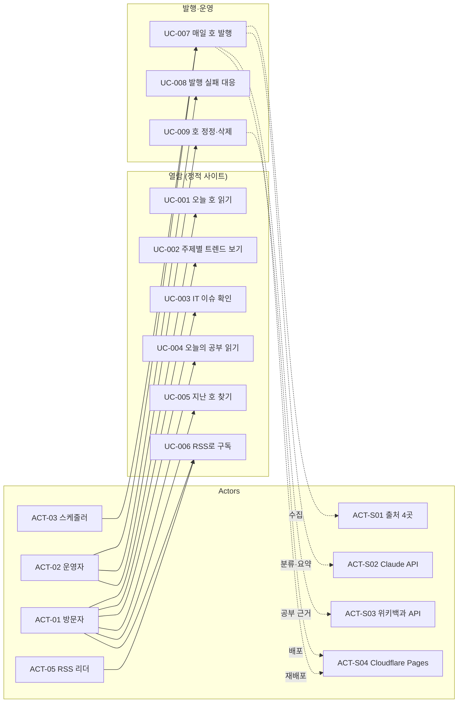
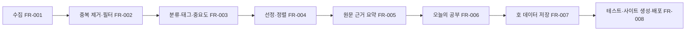

# 유스케이스 명세서

> Use Case Specification
> 정상·예외 흐름의 동작은 [비즈니스 정책서](../00-기획/비즈니스정책서.md) v1.1의 규칙 ID를 따른다. 요구사항은 [SRS](요구사항명세서-SRS.md) 1.0을 기준으로 한다.

---

## 문서 정보

| 항목 | 내용 |
|------|------|
| 프로젝트명 | IT 뉴스레터 (가칭) |
| 문서 번호 | UCS-ITNL-001 |
| 버전 | 1.0 |
| 작성일 | 2026-11-25 |
| 작성자 | Claude (초안 작성) / 임지영 (프로젝트 담당) |

---

## 변경 이력

| 버전 | 날짜 | 변경 내용 | 작성자 | 승인자 |
|------|------|-----------|--------|--------|
| 0.1 | 2026-11-25 | 초안 작성. 방문자 UC 6개, 시스템·운영 UC 3개 | Claude | - |
| 1.0 | 2026-11-25 | G1 승인. 상태를 완료로 변경 | Claude | 임지영 |

---

## 목차

1. [유스케이스 다이어그램](#1-유스케이스-다이어그램)
2. [액터 정의](#2-액터-정의)
3. [유스케이스 목록](#3-유스케이스-목록)
4. [유스케이스 상세 명세](#4-유스케이스-상세-명세)

---

## 1. 유스케이스 다이어그램

### 1.1 전체 시스템 유스케이스 다이어그램

### 1.2 발행 작업 내부 단계

UC-007은 SRS FR-001~008의 단계를 차례로 포함한다.

---

## 2. 액터 정의

### 2.1 주요 액터 (Primary Actors)

| Actor ID | 이름 | 설명 | 권한 수준 | 인증 여부 |
|----------|------|------|-----------|-----------|
| ACT-01 | 방문자 | 개발 직군 취업 준비생, 현직 개발자. 모든 페이지를 열람한다 | 열람 | 미인증 (로그인 없음) |
| ACT-02 | 운영자 | 프로젝트 담당자. 수동 실행, 실패 대응, 데이터 정정·삭제 | 저장소 쓰기 | GitHub 계정 |
| ACT-03 | 스케줄러 | GitHub Actions 일정 실행 (매일 23:00 UTC) | 저장소 쓰기, 배포 | 저장소 권한 |
| ACT-05 | RSS 리더 | 방문자가 쓰는 피드 구독 프로그램 | 열람 | 미인증 |

### 2.2 보조 액터 (Secondary Actors)

| Actor ID | 이름 | 설명 | 연동 방식 |
|----------|------|------|-----------|
| ACT-S01 | 출처 4곳 | GeekNews(Atom 피드), Hacker News(공식 API), GitHub(검색 API), arXiv(API) | HTTPS GET (SRS 5.3절) |
| ACT-S02 | Claude API | 분류·요약·공부 글 생성 | Anthropic 공식 Python SDK |
| ACT-S03 | 위키백과 API | 오늘의 공부 근거 문서 요약 | HTTPS GET (REST 요약) |
| ACT-S04 | Cloudflare Pages | 정적 사이트 호스팅·배포 | wrangler (공식 Action) |

### 2.3 액터 관계

방문자와 RSS 리더는 같은 공개 콘텐츠를 본다. 운영자는 스케줄러가 하는 발행 작업을 수동으로도 시작할 수 있다. 계층형 권한은 없다.

---

## 3. 유스케이스 목록

| UC-ID | 유스케이스명 | 주요 액터 | 우선순위 | 상태 | 관련 FR |
|-------|-------------|-----------|----------|------|---------|
| UC-001 | 오늘 호 읽기 | 방문자 | P1 | 완료 | FR-009, FR-016 |
| UC-002 | 주제별 트렌드 보기 | 방문자 | P1 | 완료 | FR-010 |
| UC-003 | IT 이슈 확인 | 방문자 | P1 | 완료 | FR-011 |
| UC-004 | 오늘의 공부 읽기 | 방문자 | P1 | 완료 | FR-012 |
| UC-005 | 지난 호 찾기 | 방문자 | P2 | 완료 | FR-013 |
| UC-006 | RSS로 구독 | 방문자, RSS 리더 | P2 | 완료 | FR-014, FR-015 |
| UC-007 | 매일 호 발행 | 스케줄러, 운영자 | P1 | 완료 | FR-001~008 |
| UC-008 | 발행 실패 대응 | 운영자 | P1 | 완료 | FR-008 |
| UC-009 | 호 정정·삭제 | 운영자 | P2 | 완료 | FR-007, FR-017 |

**상태 정의:**

| 상태 | 설명 |
|------|------|
| 초안 | 최초 작성, 검토 필요 |
| 검토중 | 이해관계자 검토 진행 중 |
| 완료 | 검토 완료 및 승인됨 |
| 변경중 | 승인 후 변경 사항 발생 |

---

## 4. 유스케이스 상세 명세

---

### 4.1 UC-001: 오늘 호 읽기

| 항목 | 내용 |
|------|------|
| **UC-ID** | UC-001 |
| **유스케이스명** | 오늘 호 읽기 |
| **액터** | 방문자 |
| **설명** | 방문자가 홈에서 오늘 호를 훑고, 관심 있는 소식은 원문으로 이동한다. |
| **우선순위** | P1 |
| **트리거** | 방문자가 사이트 주소(`/`)에 접속한다 |
| **관련 요구사항** | FR-009, FR-016 |

#### 사전 조건 (Pre-conditions)

1. 발행된 호가 1개 이상 있다.

#### 기본 흐름 (Main Flow)

| 단계 | 액터 | 시스템 |
|------|------|--------|
| 1 | 방문자가 `/`에 접속한다. | 최신 호의 호수·날짜, 대표 제목, 소식 수·출처 수·읽는 시간을 보여 준다. |
| 2 | 방문자가 주요 소식을 읽는다. | 정렬 1위 소식을 큰 카드로 보여 준다 (BP-RANK-008). |
| 3 | 방문자가 IT 트렌드·IT 이슈 목록을 훑는다. | 소식마다 출처·발행 시각·제목·요약·"원문 보기"를 보여 준다 (BP-SUM-006, BP-TEXT-004). |
| 4 | 방문자가 관심 소식의 "원문 보기"를 누른다. | 원문 링크를 새 탭으로 연다. |
| 5 | 방문자가 사이드바의 많이 이야기된 소식을 본다. | 반응 수 상위 5건을 순위로 보여 준다. |

#### 대안 흐름 (Alternative Flow)

**AF-001-01: 오늘의 공부로 이동**

- 분기 시점: 단계 3 이후
- 방문자가 오늘의 공부 카드의 "자세히 읽기"를 누르면 UC-004로 이어진다.

**AF-001-02: 오늘 호가 아직 없음**

- 분기 시점: 단계 1
- 조건: 08:00~10:00 KST 사이로, 오늘 호 배포 전이다.
- 시스템은 직전 호를 보여 준다 (날짜 표시로 구분 가능).

#### 예외 흐름 (Exception Flow)

**EF-001-01: 없는 주소 접속**

- 분기 시점: 단계 1
- 조건: 방문자가 잘못된 주소로 접속한다.
- 시스템은 404 페이지("페이지를 찾을 수 없어요"와 홈 링크)를 보여 준다 (BP-ERROR-008).

#### 사후 조건 (Post-conditions)

**성공 시:** 방문자가 오늘 호를 읽었다. 시스템 상태 변화는 없다 (정적 열람).

**실패 시:** 해당 없음.

#### 비즈니스 규칙

| 규칙 ID | 내용 |
|---------|------|
| BP-RANK-008 | 정렬 1위 소식이 주요 소식이다 |
| BP-SUM-006 | 소식마다 출처명과 발행 시각을 표시한다 |
| BP-SUM-007 | 모든 페이지 하단에 자동 생성 고지를 표시한다 |
| BP-TEXT-004 | 발행 시각은 같은 날이면 `HH:mm`, 다른 날이면 `M월 D일 HH:mm` (KST) |
| BP-ERROR-008 | 없는 주소는 404 안내와 홈 링크 |

#### UI 참조

| 화면 ID | 화면명 | 설명 |
|---------|--------|------|
| SCR-01 | 홈 | 디자인 시스템 PageHome |
| SCR-08 | 404 | 안내와 홈 링크 |

#### 관련 요구사항 ID (RTM)

| 요구사항 ID | 설계 문서 | 테스트케이스 |
|------------|----------|-------------|
| FR-009 | 02 화면 설계서 (예정) | 미작성 (05 단계) |
| FR-016 | 02 화면 설계서 (예정) | 미작성 (05 단계) |

---

### 4.2 UC-002: 주제별 트렌드 보기

| 항목 | 내용 |
|------|------|
| **UC-ID** | UC-002 |
| **유스케이스명** | 주제별 트렌드 보기 |
| **액터** | 방문자 |
| **설명** | 방문자가 IT 트렌드 페이지에서 관심 주제의 소식만 골라 본다. |
| **우선순위** | P1 |
| **트리거** | 방문자가 헤더의 "IT 트렌드"를 누른다 |
| **관련 요구사항** | FR-010 |

#### 사전 조건 (Pre-conditions)

1. 최신 호에 `trend` 소식이 1건 이상 있다.

#### 기본 흐름 (Main Flow)

| 단계 | 액터 | 시스템 |
|------|------|--------|
| 1 | 방문자가 "IT 트렌드"를 누른다. | 최신 호의 `trend` 소식 전체와 주제 칩(전체 + 태그별 건수)을 보여 준다. |
| 2 | 방문자가 "AI" 칩을 누른다. | AI 태그 소식만 남기고 그 칩을 선택 상태로 바꾼다. |
| 3 | 방문자가 "전체" 칩을 누른다. | 모든 소식을 다시 보여 준다. |

#### 대안 흐름 (Alternative Flow)

**AF-002-01: 자바스크립트를 쓸 수 없는 환경**

- 분기 시점: 단계 1
- 칩이 동작하지 않지만 모든 소식이 보인다.

#### 예외 흐름 (Exception Flow)

**EF-002-01: 최신 호에 트렌드 소식이 없음**

- 분기 시점: 단계 1
- 조건: 최신 호의 소식이 모두 `issue`다.
- 시스템은 "오늘은 트렌드 소식이 없어요" 안내를 보여 준다.

#### 사후 조건 (Post-conditions)

**성공 시:** 방문자가 원하는 주제의 소식을 봤다. 상태 변화 없음.

#### 비즈니스 규칙

| 규칙 ID | 내용 |
|---------|------|
| BP-RANK-005 | 태그는 정해진 8개 중 하나다 |

#### UI 참조

| 화면 ID | 화면명 | 설명 |
|---------|--------|------|
| SCR-02 | IT 트렌드 | 디자인 시스템 PageTrends |

#### 관련 요구사항 ID (RTM)

| 요구사항 ID | 설계 문서 | 테스트케이스 |
|------------|----------|-------------|
| FR-010 | 02 화면 설계서 (예정) | 미작성 (05 단계) |

---

### 4.3 UC-003: IT 이슈 확인

| 항목 | 내용 |
|------|------|
| **UC-ID** | UC-003 |
| **유스케이스명** | IT 이슈 확인 |
| **액터** | 방문자 (주로 현직 개발자) |
| **설명** | 방문자가 최근 3개 호의 보안·장애·정책 이슈를 날짜별로 확인한다. |
| **우선순위** | P1 |
| **트리거** | 방문자가 헤더의 "IT 이슈"를 누른다 |
| **관련 요구사항** | FR-011 |

#### 사전 조건 (Pre-conditions)

1. 발행된 호가 1개 이상 있다.

#### 기본 흐름 (Main Flow)

| 단계 | 액터 | 시스템 |
|------|------|--------|
| 1 | 방문자가 "IT 이슈"를 누른다. | 최근 3개 호의 `issue` 소식을 날짜 묶음으로, 최신 날짜를 위에 보여 준다. |
| 2 | 방문자가 이슈의 "원문 보기"를 누른다. | 원문 링크를 새 탭으로 연다. |
| 3 | 방문자가 날짜 묶음의 "제N호"를 누른다. | 해당 호 페이지(`/issue/N/`)로 이동한다. |

#### 예외 흐름 (Exception Flow)

**EF-003-01: 최근 3개 호에 이슈가 하나도 없음**

- 분기 시점: 단계 1
- 시스템은 "최근에 올라온 이슈가 없어요" 안내를 보여 준다.

#### 사후 조건 (Post-conditions)

**성공 시:** 방문자가 최근 이슈를 확인했다. 상태 변화 없음.

#### 비즈니스 규칙

| 규칙 ID | 내용 |
|---------|------|
| BP-RANK-003 | `issue`는 보안 사고, 서비스 장애, 정책·규제·법적 분쟁이다 |

#### UI 참조

| 화면 ID | 화면명 | 설명 |
|---------|--------|------|
| SCR-03 | IT 이슈 | 디자인 시스템 PageIssues |

#### 관련 요구사항 ID (RTM)

| 요구사항 ID | 설계 문서 | 테스트케이스 |
|------------|----------|-------------|
| FR-011 | 02 화면 설계서 (예정) | 미작성 (05 단계) |

---

### 4.4 UC-004: 오늘의 공부 읽기

| 항목 | 내용 |
|------|------|
| **UC-ID** | UC-004 |
| **유스케이스명** | 오늘의 공부 읽기 |
| **액터** | 방문자 (주로 취업 준비생) |
| **설명** | 방문자가 오늘의 공부 글을 읽고 요점을 확인하며, 필요하면 참고 자료로 이동한다. |
| **우선순위** | P1 |
| **트리거** | 헤더의 "오늘의 공부" 또는 홈 카드의 "자세히 읽기"를 누른다 |
| **관련 요구사항** | FR-012 |

#### 사전 조건 (Pre-conditions)

1. 오늘의 공부가 있는 호가 1개 이상 있다.

#### 기본 흐름 (Main Flow)

| 단계 | 액터 | 시스템 |
|------|------|--------|
| 1 | 방문자가 "오늘의 공부"를 누른다. | 가장 최근 주제 페이지를 연다: 제목, 호수·읽는 시간, 소제목별 설명 글. |
| 2 | 방문자가 글을 끝까지 읽는다. | 요점 3개를 번호와 함께 보여 준다 (BP-STUDY-004). |
| 3 | 방문자가 참고 자료의 "원문 보기"를 누른다. | 위키백과 문서나 관련 소식 원문을 새 탭으로 연다. |
| 4 | 방문자가 하단의 이전·다음 주제를 누른다. | 해당 주제 페이지로 이동한다. |

#### 대안 흐름 (Alternative Flow)

**AF-004-01: 오늘 호에 오늘의 공부가 없음**

- 분기 시점: 단계 1
- 조건: 오늘 공부 생성이 실패했다 (BP-ERROR-004).
- 시스템은 직전 호의 오늘의 공부를 보여 준다.

#### 예외 흐름 (Exception Flow)

해당 없음 (정적 페이지).

#### 사후 조건 (Post-conditions)

**성공 시:** 방문자가 주제를 읽었다. 상태 변화 없음.

#### 비즈니스 규칙

| 규칙 ID | 내용 |
|---------|------|
| BP-STUDY-004 | 한 줄 정의, 소제목 2~4개, 요점 정확히 3개, 참고 링크 1개 이상 |
| BP-STUDY-007 | 근거는 위키백과 문서와 그날 소식 원문, 출처를 밝힌다 |
| BP-ERROR-004 | 공부 생성 실패 시 직전 호의 공부를 보여 준다 |

#### UI 참조

| 화면 ID | 화면명 | 설명 |
|---------|--------|------|
| SCR-04 | 오늘의 공부 | 디자인 시스템 PageStudy |

#### 관련 요구사항 ID (RTM)

| 요구사항 ID | 설계 문서 | 테스트케이스 |
|------------|----------|-------------|
| FR-012 | 02 화면 설계서 (예정) | 미작성 (05 단계) |
| NFR-013 | 02 화면 설계서 (예정) | 미작성 (05 단계) |

---

### 4.5 UC-005: 지난 호 찾기

| 항목 | 내용 |
|------|------|
| **UC-ID** | UC-005 |
| **유스케이스명** | 지난 호 찾기 |
| **액터** | 방문자 |
| **설명** | 방문자가 지난 호 목록에서 키워드로 호를 찾아 그 날 소식을 다시 본다. |
| **우선순위** | P2 |
| **트리거** | 방문자가 헤더의 "지난 호"를 누른다 |
| **관련 요구사항** | FR-013 |

#### 사전 조건 (Pre-conditions)

1. 발행된 호가 1개 이상 있다.

#### 기본 흐름 (Main Flow)

| 단계 | 액터 | 시스템 |
|------|------|--------|
| 1 | 방문자가 "지난 호"를 누른다. | 모든 호를 최신순으로 호수·날짜·대표 제목·태그·소식 수와 함께 보여 준다. |
| 2 | 방문자가 검색창에 "보안"을 입력한다. | 입력할 때마다 키워드가 포함된 호만 남긴다. |
| 3 | 방문자가 호 하나를 누른다. | 그 호의 페이지(`/issue/N/`)를 연다. |

#### 대안 흐름 (Alternative Flow)

**AF-005-01: 검색어를 지움**

- 분기 시점: 단계 2 이후
- 모든 호를 다시 보여 준다.

#### 예외 흐름 (Exception Flow)

**EF-005-01: 한 글자 입력**

- 분기 시점: 단계 2
- 시스템은 "두 글자 이상 입력해 주세요." 안내를 보이고 목록을 거르지 않는다.

**EF-005-02: 결과 없음**

- 분기 시점: 단계 2
- 시스템은 "찾는 호가 없어요. 다른 키워드로 검색해 주세요." 안내를 보여 준다.

#### 사후 조건 (Post-conditions)

**성공 시:** 방문자가 원하는 호를 열었다. 상태 변화 없음.

#### 비즈니스 규칙

| 규칙 ID | 내용 |
|---------|------|
| BP-CONTENT-003 | 지난 호는 기간 제한 없이 공개한다 |
| BP-TEXT-005 | 목록 날짜는 `2026.11.25`, 호 번호는 `제128호` |

#### UI 참조

| 화면 ID | 화면명 | 설명 |
|---------|--------|------|
| SCR-05 | 지난 호 | 디자인 시스템 PageArchive |
| SCR-06 | 호별 페이지 | 홈과 같은 구성 |

#### 관련 요구사항 ID (RTM)

| 요구사항 ID | 설계 문서 | 테스트케이스 |
|------------|----------|-------------|
| FR-013 | 02 화면 설계서 (예정) | 미작성 (05 단계) |

---

### 4.6 UC-006: RSS로 구독

| 항목 | 내용 |
|------|------|
| **UC-ID** | UC-006 |
| **유스케이스명** | RSS로 구독 |
| **액터** | 방문자, RSS 리더 |
| **설명** | 방문자가 RSS 주소를 복사해 RSS 리더에 등록하고, 리더가 새 호를 받아 온다. 메일 구독을 대신한다. |
| **우선순위** | P2 |
| **트리거** | 방문자가 소개 페이지의 "RSS 주소 복사"나 하단의 "RSS" 링크를 누른다 |
| **관련 요구사항** | FR-014, FR-015 |

#### 사전 조건 (Pre-conditions)

1. 운영 사이트 주소(SITE_URL)가 설정돼 있다.

#### 기본 흐름 (Main Flow)

| 단계 | 액터 | 시스템 |
|------|------|--------|
| 1 | 방문자가 소개 페이지에서 "RSS 주소 복사"를 누른다. | `<사이트 주소>/feed.xml`을 클립보드에 넣고 "RSS 주소를 복사했어요" 토스트를 3초 보여 준다. |
| 2 | 방문자가 RSS 리더에 주소를 등록한다. | - |
| 3 | RSS 리더가 `/feed.xml`을 요청한다. | 최근 20개 호를 최신순 RSS 2.0으로 응답한다 (BP-CONTENT-006). |
| 4 | RSS 리더가 새 항목을 방문자에게 보여 준다. | - |
| 5 | 방문자가 항목을 연다. | 해당 호 페이지(`/issue/N/`)로 이동한다. |

#### 대안 흐름 (Alternative Flow)

**AF-006-01: 하단 "RSS" 링크**

- 분기 시점: 단계 1 대신
- 방문자가 하단 링크를 누르면 브라우저가 `/feed.xml`을 연다.

#### 예외 흐름 (Exception Flow)

**EF-006-01: 클립보드 접근 불가**

- 분기 시점: 단계 1
- 조건: 브라우저가 클립보드 쓰기를 막았다.
- 시스템은 토스트를 띄우지 않는다. 방문자는 하단 "RSS" 링크 주소를 직접 쓴다.

#### 사후 조건 (Post-conditions)

**성공 시:** RSS 리더가 매일 새 호를 받는다. 시스템 상태 변화 없음.

#### 비즈니스 규칙

| 규칙 ID | 내용 |
|---------|------|
| BP-CONTENT-006 | `/feed.xml`에 최근 20개 호, 항목은 "제N호 · 대표 제목", 호 페이지 링크(https), 발행일, 요약 |
| BP-NOTI (제외) | 메일·푸시는 보내지 않는다 |

#### UI 참조

| 화면 ID | 화면명 | 설명 |
|---------|--------|------|
| SCR-07 | 소개 | 디자인 시스템 PageAbout |

#### 관련 요구사항 ID (RTM)

| 요구사항 ID | 설계 문서 | 테스트케이스 |
|------------|----------|-------------|
| FR-014 | 02 화면 설계서 (예정) | 미작성 (05 단계) |
| FR-015 | 02 시스템 아키텍처 설계서 (예정) | 미작성 (05 단계) |

---

### 4.7 UC-007: 매일 호 발행

| 항목 | 내용 |
|------|------|
| **UC-ID** | UC-007 |
| **유스케이스명** | 매일 호 발행 |
| **액터** | 스케줄러(주), 운영자(수동 실행), 출처 4곳·Claude API·위키백과 API·Cloudflare Pages(보조) |
| **설명** | 매일 정해진 시각에 소식을 모아 선정·요약하고 오늘의 공부를 만든 뒤, 호 데이터를 저장하고 사이트를 배포한다. |
| **우선순위** | P1 |
| **트리거** | 매일 23:00 UTC(08:00 KST) 일정, 또는 운영자의 수동 실행 |
| **관련 요구사항** | FR-001~008 |

#### 사전 조건 (Pre-conditions)

1. Claude API 키, Cloudflare 토큰·계정 ID가 GitHub Secrets에 있다.
2. 운영 사이트 주소(SITE_URL)가 설정돼 있다.

#### 기본 흐름 (Main Flow)

| 단계 | 액터 | 시스템 |
|------|------|--------|
| 1 | 스케줄러가 발행 작업을 시작한다. | 수집 기간을 계산한다 (BP-PUB-006). |
| 2 | - | 출처 4곳에서 소식을 수집한다 (FR-001). |
| 3 | - | https가 아닌 링크, 중복, 최근 7개 호에 실린 소식을 뺀다 (FR-002). |
| 4 | - | Claude로 분류·태그·중요도를 매기고 무관 소식을 뺀다 (FR-003). |
| 5 | - | 정렬해 최대 12건(트렌드 8, 이슈 4)을 고르고 주요 소식을 정한다 (FR-004). |
| 6 | - | Claude로 원문 근거 한국어 제목·요약을 만든다 (FR-005). |
| 7 | - | 주제 후보를 뽑고 위키백과 문서를 찾아 오늘의 공부를 만든다 (FR-006). |
| 8 | - | 호 번호·날짜를 정하고 검증한 뒤 데이터를 저장·커밋한다 (FR-007). |
| 9 | - | 테스트를 돌리고 사이트를 생성한다. |
| 10 | - | Cloudflare Pages에 배포한다 (FR-008). |

#### 대안 흐름 (Alternative Flow)

**AF-007-01: 운영자 수동 실행**

- 분기 시점: 단계 1
- 운영자가 GitHub Actions 화면에서 실행한다. 이후 흐름은 같다.

**AF-007-02: 같은 날 재실행**

- 분기 시점: 단계 8
- 조건: 오늘 날짜의 호가 이미 있다.
- 시스템은 같은 번호로 덮어쓴다 (BP-PUB-005).

**AF-007-03: 일부 출처 실패**

- 분기 시점: 단계 2
- 실패한 출처는 네트워크 오류·5xx일 때만 5초 뒤 1회 다시 시도한다. 그래도 실패하면 로그에 남기고 나머지로 계속한다 (BP-ERROR-001, BP-ERROR-005).

**AF-007-04: 오늘의 공부 실패**

- 분기 시점: 단계 7
- 공부 없이 단계 8로 간다. 화면은 직전 호의 공부를 보여 준다 (BP-ERROR-004).

#### 예외 흐름 (Exception Flow)

**EF-007-01: 소식 0건**

- 분기 시점: 단계 5
- 조건: 선정 후 0건이다.
- 호를 만들지 않고 실패로 끝낸다. 사이트는 직전 호를 유지한다 (BP-ERROR-002). UC-008로 이어진다.

**EF-007-02: 데이터 검증 실패**

- 분기 시점: 단계 8
- 저장·배포하지 않고 실패로 끝낸다 (BP-ERROR-006). UC-008로 이어진다.

**EF-007-03: 테스트·사이트 생성·배포 실패**

- 분기 시점: 단계 9~10
- 배포하지 않거나 배포가 반영되지 않는다. 사이트는 직전 배포 상태로 남는다. UC-008로 이어진다.

#### 사후 조건 (Post-conditions)

**성공 시:**

1. `data/issues/<오늘 날짜>.json`이 커밋돼 있다.
2. 홈이 새 호를 보여 주고, RSS 첫 항목이 새 호다.
3. 원문 본문은 어디에도 저장되지 않았다.

**실패 시:**

1. 사이트는 직전 배포 상태다.
2. Actions 실행이 실패로 표시되고 운영자에게 알림이 간다.

#### 비즈니스 규칙

| 규칙 ID | 내용 |
|---------|------|
| BP-PUB-001~006 | KST 기준, 08:00 시작·10:00까지 정상, 매일, 번호 규칙, 하루 한 호, 수집 기간 |
| BP-SRC-001~006 | 출처 4곳, 공식 수단, 요청 간격, 우회 금지, 본문 미저장, 네이버 제외 |
| BP-RANK-001~008 | 중복·필터·분류·태그·건수·정렬·주요 소식 |
| BP-SUM-001~005 | 원문 근거 요약, 길이, 사실 추가 금지, https 링크, 제목 |
| BP-STUDY-001~007 | 오늘의 공부 규칙 |
| BP-ERROR-001~007 | 실패 처리 |

#### UI 참조

해당 없음 (배치 작업). 결과는 SCR-01~07에 반영된다.

#### 관련 요구사항 ID (RTM)

| 요구사항 ID | 설계 문서 | 테스트케이스 |
|------------|----------|-------------|
| FR-001~008 | 02 시스템 아키텍처 설계서 (예정) | 미작성 (05 단계) |
| NFR-001, NFR-002, NFR-007, NFR-011 | 02 시스템 아키텍처 설계서 (예정) | 미작성 (05 단계) |

---

### 4.8 UC-008: 발행 실패 대응

| 항목 | 내용 |
|------|------|
| **UC-ID** | UC-008 |
| **유스케이스명** | 발행 실패 대응 |
| **액터** | 운영자 |
| **설명** | 운영자가 실패 알림을 받고 로그로 원인을 확인한 뒤, 필요하면 다시 실행한다. |
| **우선순위** | P1 |
| **트리거** | GitHub Actions 실패 알림 |
| **관련 요구사항** | FR-008 |

#### 사전 조건 (Pre-conditions)

1. UC-007이 실패로 끝났다.

#### 기본 흐름 (Main Flow)

| 단계 | 액터 | 시스템 |
|------|------|--------|
| 1 | 운영자가 실패 알림을 받는다. | - |
| 2 | 운영자가 Actions 실행 로그를 연다. | 출처별 수집 결과, 제외 사유별 건수, 실패 단계와 오류를 보여 준다. |
| 3 | 운영자가 원인을 판단한다. | - |
| 4 | 일시적 원인이면 운영자가 수동 실행한다. | UC-007을 다시 수행한다 (AF-007-01). |

#### 대안 흐름 (Alternative Flow)

**AF-008-01: 출처가 계속 실패함**

- 분기 시점: 단계 3
- 조건: 같은 출처가 3일 연속 실패한다.
- 운영자는 출처 형식 변경을 확인하고, 정책 변경 절차(비즈니스 정책서 13장)로 출처를 고치거나 뺀다.

**AF-008-02: 비밀 값 만료**

- 분기 시점: 단계 3
- 조건: Claude API나 Cloudflare 인증 오류다.
- 운영자가 GitHub Secrets의 값을 새로 등록하고 다시 실행한다.

#### 예외 흐름 (Exception Flow)

**EF-008-01: 10:00 KST 이후 복구**

- 조건: 다시 실행해도 10:00 KST를 넘긴다.
- 그 날은 지연 발행으로 기록한다 (NFR-002 판정에 반영).

#### 사후 조건 (Post-conditions)

**성공 시:** 새 호가 배포됐거나, 발행하지 않기로 한 사유가 기록됐다.

**실패 시:** 사이트는 직전 호를 유지한다.

#### 비즈니스 규칙

| 규칙 ID | 내용 |
|---------|------|
| BP-ERROR-007 | 실패는 GitHub Actions 기본 알림으로만 알린다 |
| BP-PUB-004 | 발행하지 않은 날은 호 번호를 쓰지 않는다 |

#### UI 참조

해당 없음 (GitHub Actions 화면).

#### 관련 요구사항 ID (RTM)

| 요구사항 ID | 설계 문서 | 테스트케이스 |
|------------|----------|-------------|
| FR-008 | 06 운영 가이드 (예정) | 미작성 (05 단계) |
| NFR-001, NFR-002 | 06 운영 가이드 (예정) | 미작성 (05 단계) |

---

### 4.9 UC-009: 호 정정·삭제

| 항목 | 내용 |
|------|------|
| **UC-ID** | UC-009 |
| **유스케이스명** | 호 정정·삭제 |
| **액터** | 운영자 |
| **설명** | 운영자가 요약의 사실 오류를 고치거나 권리자 요청으로 소식을 지우고, 사이트를 다시 배포한다. |
| **우선순위** | P2 |
| **트리거** | 주간 대조(H-002)에서 오류 발견, 또는 권리자 삭제 요청 접수 |
| **관련 요구사항** | FR-007, FR-017 |

#### 사전 조건 (Pre-conditions)

1. 대상 호가 발행돼 있다.

#### 기본 흐름 (Main Flow)

| 단계 | 액터 | 시스템 |
|------|------|--------|
| 1 | 운영자가 해당 호 데이터 파일을 연다. | - |
| 2 | 운영자가 요약을 고치거나 소식을 지운다. | - |
| 3 | 운영자가 사유를 커밋 메시지에 적어 `main`에 푸시한다. | 테스트와 데이터 검증을 돌린다. |
| 4 | - | 사이트를 다시 생성해 배포한다. 호 번호·날짜는 그대로다. |

#### 대안 흐름 (Alternative Flow)

**AF-009-01: 권리자 삭제 요청**

- 분기 시점: 단계 1 이전
- 요청을 받은 날부터 3일 이내에 단계 1~4를 끝낸다 (BP-CONTENT-005).

#### 예외 흐름 (Exception Flow)

**EF-009-01: 잘못된 형식으로 저장**

- 분기 시점: 단계 3
- 테스트·검증이 실패하고 배포되지 않는다. 운영자가 고쳐 다시 푸시한다.

#### 사후 조건 (Post-conditions)

**성공 시:** 고친 내용이 호 페이지, (최신이면) 홈, RSS에 반영된다.

**실패 시:** 사이트는 이전 상태다.

#### 비즈니스 규칙

| 규칙 ID | 내용 |
|---------|------|
| BP-CONTENT-004 | 정정·삭제는 운영자가 데이터 파일 수정·커밋으로 한다 |
| BP-CONTENT-005 | 권리자 삭제 요청은 3일 이내 처리 |

#### UI 참조

해당 없음 (저장소 편집).

#### 관련 요구사항 ID (RTM)

| 요구사항 ID | 설계 문서 | 테스트케이스 |
|------------|----------|-------------|
| FR-017 | 06 운영 가이드 (예정) | 미작성 (05 단계) |

---

정책 ID는 [비즈니스 정책서](../00-기획/비즈니스정책서.md)에서 가져온다. 테스트 연결은 [RTM](요구사항추적매트릭스-RTM.md)에서 관리한다.

---

## 부록

### 부록 A: 유스케이스 간 관계 요약

| 유스케이스 | 관계 유형 | 대상 유스케이스 | 설명 |
|-----------|-----------|---------------|------|
| UC-001 오늘 호 읽기 | extends | UC-004 오늘의 공부 읽기 | 홈 카드의 "자세히 읽기" |
| UC-003 IT 이슈 확인 | extends | UC-005 지난 호 찾기 | 날짜 묶음의 "제N호"로 호 페이지 이동 |
| UC-007 매일 호 발행 | extends | UC-008 발행 실패 대응 | 실패 시 운영자 대응 |
| UC-009 호 정정·삭제 | includes | UC-007의 테스트·생성·배포 단계 | 정정 후 재배포 |

### 부록 B: 비즈니스 규칙 종합 목록

| 규칙 ID | 관련 UC | 내용 |
|---------|---------|------|
| BP-PUB-001~006 | UC-007 | 발행 일정·번호·수집 기간 |
| BP-SRC-001~006 | UC-007 | 수집 출처와 방식 |
| BP-RANK-001~008 | UC-001, UC-002, UC-003, UC-007 | 중복·필터·분류·정렬 |
| BP-SUM-001~007 | UC-001, UC-007 | 요약과 출처 표기 |
| BP-STUDY-001~007 | UC-004, UC-007 | 오늘의 공부 |
| BP-ERROR-001~008 | UC-001, UC-004, UC-007, UC-008 | 실패 처리, 404 |
| BP-CONTENT-001~006 | UC-005, UC-006, UC-009 | 공개·보관·정정·RSS |
| BP-TEXT-001~006 | UC-001~006 | 문체·숫자·시각 표기 |

---

> **본 문서는 요구사항 명세서(SRS)와 함께 관리되며, 요구사항 변경 시 동시에 갱신한다.**
