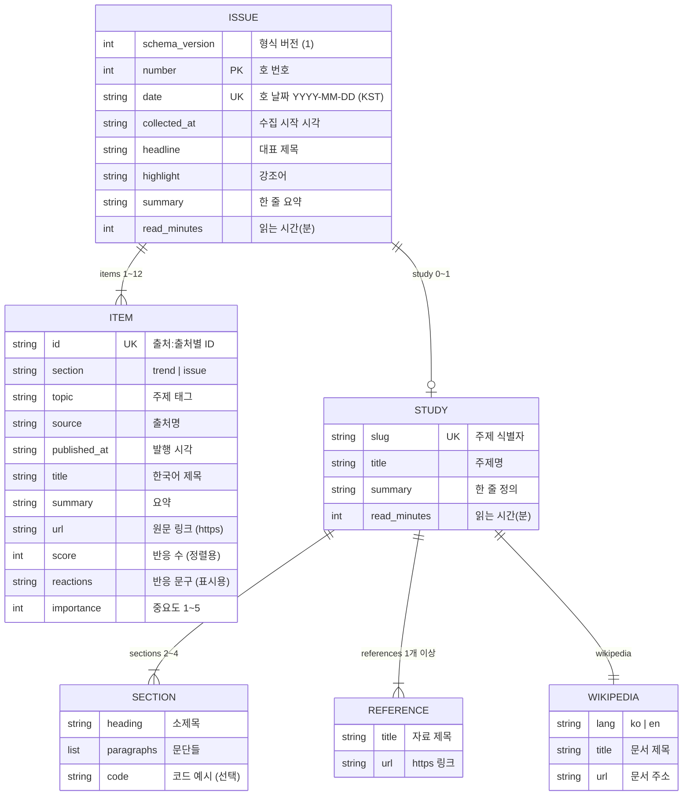

# 데이터 설계서 (호 데이터 파일 형식)

> 이 시스템은 데이터베이스를 쓰지 않는다 (SAD ADR-002). 템플릿의 "테이블"은 JSON 파일의 객체로, "마이그레이션"은 `schema_version` 변경 절차로 바꿔 쓴다.

| 항목 | 내용 |
|------|------|
| **프로젝트명** | IT 뉴스레터 (가칭) |
| **문서 버전** | v1.0 |
| **작성일** | 2026-11-25 |
| **작성자** | Claude (초안 작성) / 임지영 (프로젝트 담당) |
| **승인자** | 임지영 / 프로젝트 담당 |
| **문서 상태** | 승인됨 (G2, 2026-11-25) |

---

## 1. 개요

### 1.1 목적

호 데이터 파일(`data/issues/<YYYY-MM-DD>.json`)의 구조, 필드 규칙, 검증 규칙, 형식 변경 절차를 정의한다. 발행 작업(FR-007)은 이 형식으로 저장하고, 사이트 생성(FR-009~016)과 운영자 정정(FR-017)은 이 형식을 읽는다.

### 1.2 저장 방식 선정

| 항목 | 내용 |
|------|------|
| 저장 방식 | JSON 파일, Git 저장소 (DB 없음) |
| 위치 | `data/issues/` |
| 파일 이름 | `<호 날짜 YYYY-MM-DD>.json` (KST) |
| 선정 근거 | 하루 1건·수 KB, 사람이 읽고 고칠 수 있음, 커밋 이력이 곧 백업 (ADR-002) |
| 인코딩 | UTF-8 (BOM 없음), 들여쓰기 2칸, 한글은 이스케이프하지 않음 |
| 시간 표기 | ISO 8601, 시간대 오프셋 포함 (예: `2026-11-25T05:10:00+09:00`) |

### 1.3 설계 원칙

| 원칙 | 설명 |
|------|------|
| 한 파일 = 한 호 | 호 하나의 모든 내용을 한 파일에. 여러 호에 걸친 값(최근 7호 링크, 최근 30호 주제)은 파일들을 읽어 계산한다 |
| 저장하지 않는 것 | 원문 본문, 위키백과 원문 텍스트, 방문자 정보 (BP-SRC-005, BP-CONTENT-001) |
| 표시용과 계산용 분리 | 반응 수는 숫자(`score`, 정렬용)와 문구(`reactions`, 화면용)를 따로 둔다 |
| 형식 버전 | 모든 파일에 `schema_version`. 형식이 바뀌면 버전을 올린다 |
| 검증 후 저장 | 3장 규칙을 모두 통과한 파일만 저장·배포한다 (BP-ERROR-006) |

### 1.4 변경 이력

| 버전 | 날짜 | 작성자 | 변경 내용 |
|------|------|--------|-----------|
| v0.1 | 2026-11-25 | Claude | 초안 작성. 프로토타입 예시 데이터 형식을 바탕으로 `schema_version`, `collected_at`, 소식 `id`·`importance`, 공부 `wikipedia`를 추가 |
| v1.0 | 2026-11-25 | Claude | G2 승인 |

---

## 2. 구조 다이어그램

### 2.1 전체 구조



`STUDY`의 `points`(요점 3개)는 문자열 목록이라 다이어그램에서 생략했다.

### 2.2 파일 예시

```json
{
  "schema_version": 1,
  "number": 128,
  "date": "2026-11-25",
  "collected_at": "2026-11-25T08:00:00+09:00",
  "headline": "오늘은 오픈소스 LLM 소식이 가장 많았어요",
  "highlight": "오픈소스 LLM",
  "summary": "트렌드 4건, 이슈 2건, 오늘의 공부 1개를 골랐어요.",
  "read_minutes": 6,
  "items": [
    {
      "id": "hn:42123456",
      "section": "issue",
      "topic": "보안",
      "source": "Hacker News",
      "published_at": "2026-11-25T03:20:00+09:00",
      "title": "인기 npm 패키지에서 보안 취약점이 발견됐어요",
      "summary": "영향받는 버전과 패치 버전이 공개됐어요. 의존성 목록에서 해당 버전을 쓰고 있는지 확인하는 방법이 원문에 있어요.",
      "url": "https://example.com/npm-vuln",
      "score": 412,
      "reactions": "포인트 412점",
      "importance": 5
    }
  ],
  "study": {
    "slug": "vector-database",
    "title": "벡터 데이터베이스",
    "summary": "의미가 가까운 문서를 빠르게 찾는 데이터베이스예요.",
    "read_minutes": 4,
    "points": ["텍스트를 벡터로 바꿔 저장해요", "ANN 인덱스로 가까운 벡터를 찾아요", "RAG에서 LLM에 넘길 문서를 고를 때 써요"],
    "sections": [
      {"heading": "무엇인가요", "paragraphs": ["..."]},
      {"heading": "어떻게 동작하나요", "paragraphs": ["..."], "code": "results = index.query(...)"}
    ],
    "references": [
      {"title": "위키백과: 벡터 데이터베이스", "url": "https://ko.wikipedia.org/wiki/..."},
      {"title": "오픈소스 LLM, 사내 서버에서 돌리기 쉬워졌어요", "url": "https://news.hada.io/topic?id=..."}
    ],
    "wikipedia": {"lang": "ko", "title": "벡터 데이터베이스", "url": "https://ko.wikipedia.org/wiki/..."}
  }
}
```

---

## 3. 객체 명세

### 3.1 issue - 호

#### 필드 정의

| 필드 | 타입 | 필수 | 규칙 | 설명 | 근거 |
|------|------|------|------|------|------|
| schema_version | int | Y | `1` | 형식 버전 | 1.3절 |
| number | int | Y | 1 이상, 전체 파일에서 고유 | 호 번호 | BP-PUB-004 |
| date | string | Y | `YYYY-MM-DD`, 파일 이름과 같음, 전체에서 고유 | 호 날짜 (KST) | BP-PUB-001·005 |
| collected_at | string | Y | ISO 8601 + 오프셋 | 이번 수집 시작 시각. 다음 호의 수집 기간 시작점 | BP-PUB-006 |
| headline | string | Y | 1~60자 | 홈 히어로 대표 제목 | FR-009 |
| highlight | string | Y | `headline`에 포함된 부분 문자열, 1~20자 | 제목에서 블루로 강조할 말 | 디자인 시스템 IssueHero |
| summary | string | Y | 1~120자 | 한 줄 요약 (홈 히어로, RSS 설명) | FR-009, FR-015 |
| read_minutes | int | Y | 1~15 | 다 읽는 시간 | H-001 |
| items | list[item] | Y | 1~12개, `trend` 8개 이하, `issue` 4개 이하 | 소식 | BP-RANK-006 |
| study | study \| null | Y | 없으면 `null` | 오늘의 공부 | BP-ERROR-004 |

#### 제약조건

| 제약 | 내용 |
|------|------|
| 번호 연속 | 새 호 번호 = 기존 최대 번호 + 1 (같은 날짜 재실행은 같은 번호) |
| 날짜·번호 순서 | 날짜가 늦을수록 번호가 크다 |
| 주요 소식 | 별도 필드 없음. `items`의 정렬 1위가 주요 소식이다 (저장 순서 = 정렬 순서) |

### 3.2 item - 소식

#### 필드 정의

| 필드 | 타입 | 필수 | 규칙 | 설명 | 근거 |
|------|------|------|------|------|------|
| id | string | Y | `<출처 코드>:<출처별 ID>`, 호 안에서 고유. 출처 코드: `gn`, `hn`, `gh`, `ax` | 소식 식별자 (예: `hn:42123456`, `gh:owner/repo`, `ax:2611.01234`) | 추적·중복 확인 |
| section | string | Y | `trend` \| `issue` | 분류 | BP-RANK-003 |
| topic | string | Y | 4.2절 열거형 | 주제 태그 | BP-RANK-005 |
| source | string | Y | `GeekNews` \| `Hacker News` \| `GitHub` \| `arXiv` | 출처명 (화면 표시) | BP-SRC-001 |
| published_at | string | Y | ISO 8601 + 오프셋 (KST로 저장) | 원문 발행 시각 | BP-TEXT-004 |
| title | string | Y | 1~100자 | 한국어 제목 | BP-SUM-005 |
| summary | string | Y | 2~3문장, 공백 포함 1~200자 | 원문 근거 요약 | BP-SUM-002 |
| url | string | Y | `https://`로 시작, 공백 없음 | 원문 링크 | BP-SUM-004, BP-SRC-007 |
| score | int | Y | 0 이상 | 반응 수 (정렬·순위용). 출처가 주지 않으면 0 | BP-RANK-007 |
| reactions | string | Y | 0~30자. `score`가 0이면 빈 문자열 | 반응 문구 (4.3절) | FR-009 |
| importance | int | Y | 1~5 | LLM 중요도 | BP-RANK-007 |

#### 제약조건

| 제약 | 내용 |
|------|------|
| 링크 고유 | 한 호 안에서 정규화 링크(BP-RANK-001)가 같은 소식은 하나뿐 |
| 최근 7호 | 직전 7개 호에 있는 정규화 링크와 겹치지 않음 (BP-RANK-002) |
| 원문 본문 없음 | 원문 텍스트를 담는 필드가 없다 (BP-SRC-005) |

### 3.3 study - 오늘의 공부

#### 필드 정의

| 필드 | 타입 | 필수 | 규칙 | 설명 | 근거 |
|------|------|------|------|------|------|
| slug | string | Y | `^[a-z0-9]+(-[a-z0-9]+)*$`, 1~60자, **모든 호에서 고유** | 주소 `/study/<slug>/` | BP-STUDY-003 |
| title | string | Y | 1~40자 | 주제명 | |
| summary | string | Y | 1~80자 | 한 줄 정의 | BP-STUDY-004 |
| read_minutes | int | Y | 1~10 | 읽는 시간 | |
| points | list[string] | Y | **정확히 3개**, 각 1~60자 | 요점 | BP-STUDY-004 |
| sections | list[section] | Y | 2~4개 | 설명 글 | BP-STUDY-004 |
| references | list[reference] | Y | 1개 이상, 첫 항목은 위키백과 문서 | 참고 자료 | BP-STUDY-004·007 |
| wikipedia | object | Y | `lang`(`ko`\|`en`), `title`, `url`(https) | 근거 문서와 라이선스 표기용 | BP-STUDY-008 |

**section:** `heading`(1~30자, 필수), `paragraphs`(문자열 1개 이상, 필수), `code`(문자열, 선택).
**reference:** `title`(1~100자), `url`(`https://`).

#### 제약조건

| 제약 | 내용 |
|------|------|
| 글 길이 | 모든 `paragraphs`의 글자 수 합(공백 포함)이 600~1,500자 (BP-STUDY-005) |
| 최근 30호 | 직전 30개 호의 `study.title`·`slug`와 겹치지 않음 (BP-STUDY-002) |
| 위키백과 링크 | `wikipedia.url`이 `references`에 포함됨 |

### 3.4 파생 값 (저장하지 않음)

사이트 생성이나 발행 작업이 파일들을 읽어 계산한다.

| 값 | 계산 | 사용처 |
|----|------|--------|
| 최신 호 | `number`가 가장 큰 호 | 홈, 트렌드 |
| 최근 3개 호의 이슈 | 번호 상위 3개 호의 `section == issue` | IT 이슈 페이지 |
| 최근 7호 정규화 링크 집합 | 직전 7개 호의 `items[].url` 정규화 | FR-002 |
| 최근 30호 공부 주제 | 직전 30개 호의 `study.slug`, `study.title` | FR-006 |
| 전체 사용 slug | 모든 호의 `study.slug` | slug 고유 검사 |
| 출처 목록 | 모든 호의 `items[].source` 고유값 | 푸터, 소개 |
| 화면의 "현재 오늘의 공부" | `study`가 있는 가장 최근 호 | 헤더 메뉴, 홈 카드 (BP-ERROR-004) |

---

## 4. 데이터 사전 (Data Dictionary)

### 4.1 공통 도메인 정의

| 도메인 | 형식 | 예시 |
|--------|------|------|
| 날짜 | `YYYY-MM-DD` (KST) | `2026-11-25` |
| 시각 | ISO 8601 + `+09:00` | `2026-11-25T05:10:00+09:00` |
| 링크 | `https://`로 시작하는 절대 URL | `https://arxiv.org/abs/2611.01234` |
| 한국어 문장 | 해요체, 이모지 없음 (BP-TEXT-001·002) | `원문에 비용 표가 있어요.` |

### 4.2 열거형 (Enum) 값 정의

#### section

| 값 | 설명 |
|----|------|
| `trend` | 기술·도구·연구·제품 소식 |
| `issue` | 보안 사고, 서비스 장애, 정책·규제·법적 분쟁 |

#### topic

| 값 | 설명 |
|----|------|
| `AI` | 인공지능·LLM·ML |
| `개발 도구` | 언어, 프레임워크, 빌드·편집 도구 |
| `클라우드` | 클라우드, 인프라, 배포 |
| `보안` | 취약점, 보안 사고, 보안 기법 |
| `정책` | 규제, 법, 플랫폼 정책 |
| `장애` | 서비스 장애와 회고 |
| `연구` | 논문, 연구 결과 |
| `기타` | 그 밖의 IT 소식 |

#### source와 출처 코드

| source | 코드 | id 예시 |
|--------|------|---------|
| GeekNews | `gn` | `gn:37829` (토픽 번호) |
| Hacker News | `hn` | `hn:42123456` (HN 아이템 번호) |
| GitHub | `gh` | `gh:owner/repo` |
| arXiv | `ax` | `ax:2611.01234` (버전 제외) |

### 4.3 reactions 문구 규칙

| 출처 | score 의미 | reactions 형식 |
|------|-----------|----------------|
| Hacker News | 포인트 | `포인트 412점` |
| GitHub | 스타 수 | `스타 3,120개` |
| GeekNews | 없음 (0) | 빈 문자열 |
| arXiv | 없음 (0) | 빈 문자열 |

숫자는 세 자리마다 쉼표를 찍는다 (BP-TEXT-003). 화면은 `reactions`가 빈 문자열이면 반응 부분을 표시하지 않는다.

---

## 5. 형식 변경 (마이그레이션) 전략

### 5.1 도구

별도 도구 없이 Python 스크립트(`scripts/migrate_<from>_<to>.py`, 필요할 때만)로 모든 호 파일을 한 번에 고쳐 한 커밋으로 반영한다.

### 5.2 버전 관리 규칙

| 변경 종류 | 예 | `schema_version` |
|-----------|----|------------------|
| 선택 필드 추가 | `item.comments_url` 추가 | 유지 (읽는 쪽은 없을 때 기본값) |
| 필수 필드 추가·이름 변경·의미 변경 | `score` → `points` | 1 증가 + 마이그레이션 스크립트 |

### 5.3 롤백 계획

마이그레이션 커밋을 `git revert`로 되돌린다. 마이그레이션은 데이터와 읽는 코드를 같은 커밋에 넣어 반쯤 바뀐 상태가 배포되지 않게 한다.

### 5.4 형식 변경 프로세스

1. 이 문서 3장·4장을 고친다.
2. 검증 코드와 사이트 생성 코드를 고친다.
3. 필요하면 마이그레이션 스크립트로 기존 파일을 고친다.
4. 테스트가 모든 기존 파일을 읽고 검증하는지 확인한 뒤 커밋한다.

### 5.5 위험 변경 관리

| 위험 | 대응 |
|------|------|
| 기존 호가 새 검증 규칙에 걸림 | 검증 규칙을 강화할 때는 기존 파일 전체 검증을 테스트에 포함 |
| 운영자가 손으로 고치다 형식을 깨뜨림 | push 시 검증·테스트 실패 → 배포 안 됨 (FR-017-AC3) |

---

## 6. 성능 설계

DB가 없으므로 파티셔닝·샤딩·복제본·인덱스는 해당 없다. 사이트 생성과 발행 작업은 매번 `data/issues/*.json`을 모두 읽는다. 10년 치(약 3,650개, 수십 MB 이하)도 몇 초 안에 읽을 수 있어 별도 최적화를 하지 않는다.

---

## 7. 백업/복구 정책

### 7.1 백업 스케줄

| 대상 | 방식 | 주기 |
|------|------|------|
| `data/issues/` | Git 커밋 + GitHub 원격 저장소 | 매 발행·정정마다 |

### 7.2 보존 기간 정책

| 데이터 | 보존 |
|--------|------|
| 호 데이터 | 영구 (BP-CONTENT-003) |
| 프로토타입 예시 호(제126~128호, `example.com` 링크) | 운영 시작 전 삭제 |

### 7.3 복구 절차

| 상황 | 절차 |
|------|------|
| 한 호가 잘못됨 | 파일을 고치거나 해당 커밋을 되돌린 뒤 push (UC-009) |
| 여러 호가 잘못됨 | 마지막 정상 커밋으로 `data/issues/`를 되돌린 커밋을 만들어 push |
| 파일 삭제 사고 | Git 이력에서 복원 |

### 7.4 재해 복구 (DR)

GitHub 저장소가 원본이다. 로컬 사본이 있으면 다시 push한다. 사이트는 저장소에서 언제든 다시 생성·배포할 수 있다.

---

## 부록

### A. 검증 코드 위치

| 항목 | 위치 (03에서 확정) |
|------|------|
| 호 파일 검증 | `newsletter/issue_store.py`의 검증 함수 (발행 작업과 사이트 생성이 같은 함수를 씀) |
| 전체 파일 검증 테스트 | `tests/` |

### B. 참조 문서

- [요구사항 명세서 (SRS)](../01-요구사항분석/요구사항명세서-SRS.md) 6장
- [비즈니스 정책서](../00-기획/비즈니스정책서.md) BP-PUB, BP-RANK, BP-SUM, BP-STUDY, BP-CONTENT
- [시스템 아키텍처 설계서](시스템아키텍처설계서-SAD.md) ADR-002
