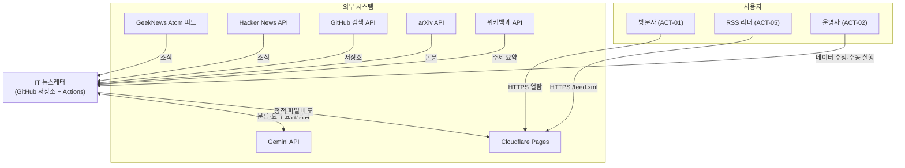
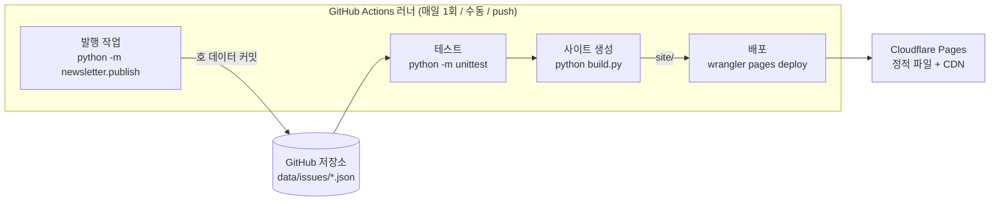
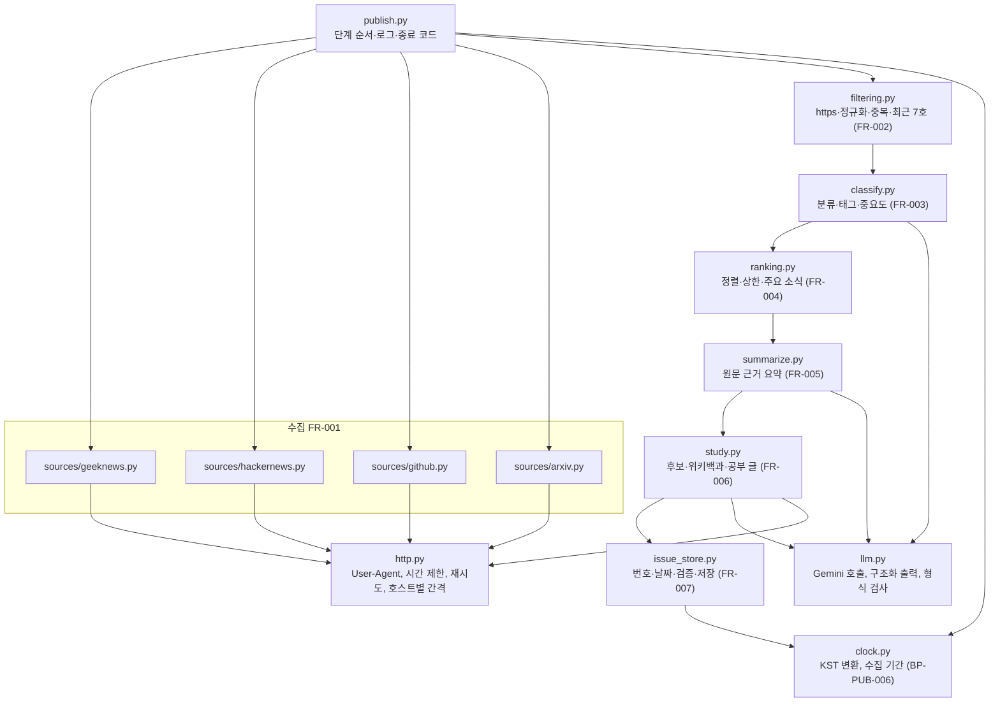
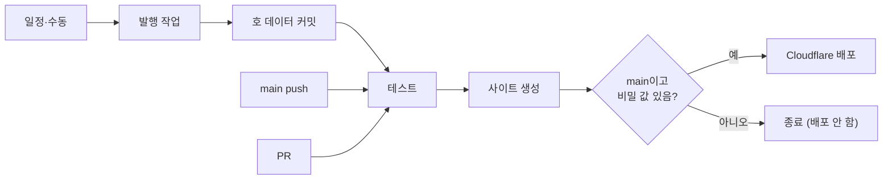

# 시스템 아키텍처 설계서 (SAD - System Architecture Document)

> 이 시스템은 서버·DB가 없는 **매일 일괄 작업 + 정적 사이트**다. 템플릿의 서버형 항목(API Gateway, 메시지 큐, 오토스케일링 등)은 해당 여부와 사유를 적고 간단히 정리했다. 결정은 5장 ADR에 모았다.

| 항목 | 내용 |
|------|------|
| **프로젝트명** | IT 뉴스레터 (가칭) |
| **문서 버전** | v1.0 |
| **작성일** | 2026-11-25 |
| **작성자** | Claude (초안 작성) / 임지영 (프로젝트 담당) |
| **승인자** | 임지영 / 프로젝트 담당 |
| **문서 상태** | 승인됨 (G2, 2026-11-25) |

---

## 1. 문서 개요

### 1.1 목적

본 문서는 IT 뉴스레터(가칭)의 시스템 아키텍처를 정의하고, 주요 기술 결정과 설계 원칙을 기술한다. 03 상세 설계와 04 구현이 같은 구조를 따르도록 한다.

### 1.2 범위

- 시스템 구조와 구성 요소 (발행 작업 모듈, 사이트 생성, 배포)
- 기술 스택 선정과 근거
- 배포 아키텍처, CI/CD 흐름
- 비기능 요구사항 대응
- 외부 시스템 통합 방식

### 1.3 참조 문서

| 문서명 | 버전 | 비고 |
|--------|------|------|
| [요구사항 명세서 (SRS)](../01-요구사항분석/요구사항명세서-SRS.md) | 1.0 | FR-001~017, NFR-001~013 |
| [비즈니스 정책서](../00-기획/비즈니스정책서.md) | v1.1 | 규칙 ID |
| [데이터(파일) 설계서](데이터베이스설계서.md) | v0.1 | 호 데이터 JSON 형식 |
| [외부 연동·출력 인터페이스 설계서](API설계서.md) | v0.1 | 외부 API 호출 규격, 사이트 경로·RSS |
| [화면 설계서](화면설계서.md) | v0.1 | SCR-01~08 |

### 1.4 변경 이력

| 버전 | 날짜 | 작성자 | 변경 내용 |
|------|------|--------|-----------|
| v0.1 | 2026-11-25 | Claude | 초안 작성 |
| v1.0 | 2026-11-25 | Claude | G2 승인. ADR-004 결정(claude-opus-5-5, 월 상한 $40), ADR-005~007 승인 |
| v1.1 | 2026-11-26 | Claude | 04 구현 중 작성자 결정: LLM을 Gemini `gemini-3.8-flash`(SDK `google-genai`)로 변경 (ADR-004 개정) |

### 1.5 용어 정의

| 용어 | 정의 |
|------|------|
| 발행 작업 (publish job) | 수집부터 호 데이터 커밋까지 매일 한 번 도는 Python 일괄 작업 |
| 사이트 생성 (build) | 호 데이터로 정적 HTML·RSS를 만드는 단계 (`build.py`) |
| 호 데이터 | `data/issues/<YYYY-MM-DD>.json`. 호 하나의 전체 내용 |
| 후보 소식 | 수집 후 선정 전의 소식 (최대 약 80건) |
| 워크플로 | GitHub Actions 작업 정의 파일 (`.github/workflows/*.yml`) |

---

## 2. 아키텍처 개요

### 2.1 아키텍처 스타일 선택

#### 선택된 아키텍처 스타일

**파이프 앤 필터(Pipes and Filters) 방식의 일괄 작업 + 정적 사이트 생성(SSG)**

#### 후보 아키텍처 스타일 비교

| 평가 항목 | 일괄 작업 + 정적 사이트 (선택) | 서버 렌더링 웹앱 (Flask 등) | Next.js 앱 |
|-----------|---------|---------------|--------------|
| 구현 복잡도 | 낮음 | 중간 | 중간 (새 언어·프레임워크) |
| 운영 부담 | 거의 없음 (서버 없음) | 서버·DB 운영 필요 | 호스팅 플랫폼 의존 |
| 비용 | 무료 등급 | 서버 비용 | 무료~유료 |
| 작성자 역량 적합성 | 높음 (Python) | 높음 | 낮음 (학습 의사 없음) |
| 요구사항 적합성 | 하루 1회 갱신, 모두 같은 화면 → 충분 | 과함 | 과함 |
| 보안 표면 | 작음 (정적 파일) | 큼 | 중간 |

#### 선택 근거

- 콘텐츠가 하루 한 번만 바뀌고 모든 방문자가 같은 화면을 본다 (SRS 1.2절, EX-002·003).
- 작성자가 Python에 익숙하고 Next.js를 배우지 않기로 했다 (서비스 기획서 3.1절 결정).
- 서버가 없어 운영 부담과 비용이 거의 없고, 공격 표면이 작다 (NFR-006).
- 수집→필터→분류→선정→요약은 단계마다 입력과 출력이 분명해 파이프 앤 필터 구조로 나누면 단계별 테스트가 쉽다 (NFR-012).

### 2.2 아키텍처 원칙

| 원칙 | 설명 | 적용 방법 |
|------|------|-----------|
| 단계 분리 | 파이프라인 각 단계는 한 가지 일만 한다 | 수집·필터·분류·선정·요약·공부·저장을 모듈로 나누고, 단계 간에는 데이터(목록)만 넘긴다 |
| 외부 호출 격리 | 네트워크·LLM 호출은 정해진 모듈에서만 | `http.py`(외부 HTTP 공통), `llm.py`(Gemini) 두 곳으로 모아, 나머지 단계는 순수 함수로 테스트 |
| 실패해도 사이트는 그대로 | 부분 실패는 건너뛰고, 전체 실패는 배포하지 않는다 | BP-ERROR-001~006을 단계별 반환값과 검증으로 구현 |
| 최소 의존성 | 꼭 필요한 패키지만 | Jinja2, Google Gen AI SDK 외에는 표준 라이브러리 (HTTP는 `urllib`, XML은 `xml.etree`) |
| 데이터가 단일 진실 | 화면은 데이터에서만 만든다 | 사이트는 `data/issues/*.json`만 읽어 생성. 운영자 정정도 데이터 수정으로 (FR-017) |
| 비밀 값 분리 | 키는 코드·데이터·로그에 없다 | GitHub Secrets → 환경 변수로만 전달 |

### 2.3 시스템 컨텍스트 다이어그램



### 2.4 컨테이너 다이어그램

실행 단위는 세 가지다: 발행 작업, 사이트 생성, 정적 호스팅.



| 컨테이너 | 기술 | 책임 | 관련 FR |
|----------|------|------|---------|
| 발행 작업 | Python 3.12 패키지 `newsletter/` | 수집·필터·분류·선정·요약·공부·저장·커밋 | FR-001~007 |
| 테스트 | Python `unittest` | 규칙 단위 테스트, 사이트 생성 검사 | NFR-012 |
| 사이트 생성 | `build.py` + Jinja2 | 페이지·RSS·404·토큰 CSS 생성 | FR-009~016 |
| 배포 | Cloudflare 공식 Action (wrangler) | `site/` 업로드 | FR-008 |
| 정적 호스팅 | Cloudflare Pages | HTTPS 제공, CDN, 404 페이지 | FR-016, NFR-002 |

### 2.5 컴포넌트 다이어그램

발행 작업 패키지 `newsletter/`의 구성이다. 모듈 이름은 03 상세 설계에서 확정한다.



| 컴포넌트 | 입력 | 출력 | 외부 호출 |
|----------|------|------|-----------|
| sources/* | 수집 기간 | 후보 소식 목록(원문 텍스트 포함) | 출처 API·피드 (http.py) |
| filtering | 후보 소식, 최근 7개 호 | 걸러진 후보 | 없음 |
| classify | 걸러진 후보 | 분류·태그·중요도가 붙은 후보 (무관 제외) | Claude |
| ranking | 분류된 후보 | 최대 12건 + 주요 소식 | 없음 |
| summarize | 선정 소식(원문 텍스트) | 한국어 제목·요약 | Claude |
| study | 선정 소식, 최근 30개 호 | 오늘의 공부 또는 없음 | Claude, 위키백과 |
| issue_store | 소식·공부, 기존 호 | 검증된 호 파일 | 없음 (커밋은 워크플로) |

원문 텍스트는 수집부터 요약·공부까지 메모리로만 전달하고, issue_store는 저장할 필드만 받는다 (BP-SRC-005).

---

## 3. 기술 스택 선정

### 3.1 선정 기준 매트릭스

| 기준 | 가중치 | 설명 |
|------|--------|------|
| 작성자 역량 | 30% | Python 단일 언어, 새 프레임워크 학습 최소화 |
| 운영 부담·비용 | 25% | 서버 없음, 무료 등급 |
| 요구사항 적합성 | 25% | 하루 1회 갱신, 정적 열람, RSS |
| 의존성 최소화 | 20% | 공용 PC·보안 고려, 패키지 수 최소 |

### 3.2 프론트엔드 기술 선정

#### 선정 결과

| 항목 | 선정 기술 | 버전 | 근거 |
|------|-----------|------|------|
| 페이지 생성 | Jinja2 템플릿 → 정적 HTML | 3.1.4 | Python만으로 생성, 자동 이스케이프 (NFR-006) |
| 스타일 | 디자인 시스템 CSS (`static/site.css`) + 토큰 CSS (`build.py`가 생성) | - | 디자인 시스템과 일치, 다크 모드 (NFR-010) |
| 스크립트 | 페이지별 짧은 바닐라 JS (칩 필터, 검색, 복사) | - | 프레임워크 불필요. JS가 꺼져도 내용은 보임 (FR-010-AC3) |
| 서체 | Pretendard (jsDelivr, 버전 고정) | v1.3.9 | 디자인 시스템 |

#### 평가 상세

React·Next.js는 작성자 결정으로 제외했다. 상호작용이 칩 필터·검색·복사 세 가지뿐이라 바닐라 JS로 충분하다.

### 3.3 백엔드 기술 선정

#### 선정 결과

| 항목 | 선정 기술 | 버전 | 근거 |
|------|-----------|------|------|
| 언어 | Python | 3.12 | 작성자 역량, Actions 기본 지원 |
| HTTP | 표준 라이브러리 `urllib.request` | - | 의존성 최소. 요청 수가 적어 충분 |
| XML(Atom) | 표준 라이브러리 `xml.etree.ElementTree` | - | GeekNews·arXiv Atom 파싱 |
| LLM | Google 공식 Python SDK `google-genai` | 3.6.1 | Gemini 호출의 공식 경로. 구조화 출력(JSON 스키마)·재시도 옵션 내장 |
| 모델 | `gemini-3.8-flash` | - | ADR-004 개정 (2026-11-26) |
| 테스트 | 표준 라이브러리 `unittest` | - | 프로토타입과 동일 |

#### 평가 상세

`requests`, `feedparser`, `pydantic` 같은 편의 패키지는 쓰지 않는다. 표준 라이브러리로 충분하고, 의존성을 늘리지 않는 편이 공용 PC 환경과 보안에 낫다. 03 상세 설계에서 구현이 지나치게 길어지면 다시 검토한다.

### 3.4 데이터베이스 기술 선정

데이터베이스를 쓰지 않는다. 호마다 JSON 파일 하나를 저장소에 커밋한다 (ADR-002, [데이터(파일) 설계서](데이터베이스설계서.md)).

### 3.5 인프라 기술 선정

| 항목 | 선정 기술 | 근거 |
|------|-----------|------|
| 일정 실행·CI | GitHub Actions | 저장소와 한곳에서 관리, 무료 등급, 작성자 희망 |
| 호스팅 | Cloudflare Pages (Direct Upload) | 무료 정적 호스팅·CDN·HTTPS, 작성자 희망 |
| 비밀 값 | GitHub Secrets | `GEMINI_API_KEY`, `CLOUDFLARE_API_TOKEN`, `CLOUDFLARE_ACCOUNT_ID` |
| 설정 값 | GitHub Variables | `SITE_URL` |
| GitHub API 인증 | Actions 기본 `GITHUB_TOKEN` | 별도 토큰 발급 불필요 |

### 3.6 대안 기술 및 불채택 사유

| 대안 | 불채택 사유 |
|------|-------------|
| Next.js / React | 작성자가 학습하지 않기로 결정. 요구사항에 비해 과함 |
| Flask·FastAPI 서버 | 서버 운영 필요, 하루 1회 갱신에 과함 |
| SQLite·PostgreSQL | 데이터가 작고 하루 1건. 파일이 사람이 고치기도 쉬움 |
| GitHub Pages | 작성자가 Cloudflare를 써 보기로 함. 기능상으로는 대체 가능 |
| GitHub Trending 페이지 수집 | GitHub 이용 정책의 복제 금지 조항 (SRS ISSUE-01) |
| `feedparser`, `requests` | 표준 라이브러리로 충분 |

---

## 4. 배포 아키텍처

### 4.1 배포 다이어그램

```mermaid
graph TB
    subgraph GitHub
        WF["워크플로 publish.yml<br/>(일정 23:00 UTC, 수동)"]
        WF2["워크플로 deploy.yml<br/>(main push, PR)"]
        REPO[("저장소 main 브랜치")]
        SEC["Secrets / Variables"]
    end

    subgraph "Cloudflare"
        PAGES["Pages 프로젝트 it-newsletter<br/>(production 브랜치 main)"]
        CDN["전역 CDN · HTTPS"]
    end

    SEC --> WF
    SEC --> WF2
    WF -->|1. 발행 작업 → 호 데이터 커밋| REPO
    WF -->|2. 테스트·생성·배포| PAGES
    REPO -->|운영자 정정 push| WF2
    WF2 -->|테스트·생성·배포 (main만)| PAGES
    PAGES --> CDN
```

GitHub Actions가 기본 토큰으로 만든 커밋은 다른 워크플로를 다시 실행하지 않는다. 그래서 발행 작업은 자기 워크플로 안에서 배포까지 끝낸다 (ADR-007).

### 4.2 환경 구성

| 환경 | 용도 | 위치 | 데이터 |
|------|------|------|--------|
| 로컬 | 개발·화면 확인 | 작업 PC의 `.venv`, `python -m http.server` | 예시 호 또는 운영 데이터 사본 |
| PR 미리보기 | 변경 검토 | GitHub Actions (배포 없음, 테스트·생성만) | 저장소 데이터 |
| 운영 | 공개 사이트 | Cloudflare Pages production | `main`의 `data/issues/` |

#### 환경별 상세 구성

| 설정 | 로컬 | 운영 |
|------|------|------|
| `SITE_URL` | `http://localhost:8000` (기본값) | GitHub Variables (예: `https://it-newsletter.pages.dev`) |
| `GEMINI_API_KEY` | 로컬에서 발행 작업을 돌릴 때만 환경 변수로 (커밋 금지) | GitHub Secrets |
| Cloudflare 토큰 | 사용 안 함 | GitHub Secrets |

### 4.3 CI/CD 파이프라인



#### CI 단계 상세

| 단계 | 명령 | 실패 시 |
|------|------|---------|
| 의존성 설치 | `pip install -r requirements.txt` | 중단 |
| 발행 작업 (일정·수동만) | `python -m newsletter.publish` | 0건·검증 실패면 비정상 종료 → 이후 단계 없음 (BP-ERROR-002·006) |
| 호 데이터 커밋 (일정·수동만) | `git commit` + `git push` (기본 토큰, `contents: write`) | 중단 |
| 테스트 | `python -m unittest discover -s tests` | 배포 안 함 (NFR-012) |
| 사이트 생성 | `python build.py` (`SITE_URL` 필수) | 배포 안 함 |

#### CD 단계 상세

| 단계 | 명령 | 조건 |
|------|------|------|
| 배포 | `wrangler pages deploy site --project-name=it-newsletter --branch=main` | `main` 브랜치이고 Cloudflare 비밀 값 두 개와 `SITE_URL`이 모두 있음 |

같은 워크플로가 겹쳐 돌지 않도록 동시 실행 그룹을 하나로 묶는다 (예: 수동 실행 중 일정 실행이 오면 대기).

### 4.4 인프라 코드(IaC) 전략

별도 IaC 도구를 쓰지 않는다. 인프라 정의는 워크플로 파일 두 개와 Cloudflare Pages 프로젝트 1개(대시보드에서 한 번 생성)뿐이다.

#### 저장소 디렉토리 구조

```
.github/workflows/
  publish.yml        # 일정·수동: 발행 작업 → 커밋 → 테스트 → 생성 → 배포
  deploy.yml         # push·PR: 테스트 → 생성 → (main이면) 배포
newsletter/          # 발행 작업 패키지 (2.5절)
build.py             # 사이트 생성
templates/ static/   # 화면
data/issues/         # 호 데이터
design/tokens.json   # 디자인 토큰
tests/               # 단위·생성 테스트
```

---

## 5. 아키텍처 결정 기록 (ADR)

### 5.1 ADR 형식

각 ADR은 상태(제안/승인/폐기), 컨텍스트, 결정, 근거, 결과로 쓴다.

### 5.2 ADR 목록

| ADR | 제목 | 상태 | 관련 |
|-----|------|------|------|
| ADR-001 | 서버 없는 일괄 작업 + 정적 사이트 | 승인 (G0 결정) | 서비스 기획서 3.1 |
| ADR-002 | DB 대신 호별 JSON 파일 | 승인 (G0 결정) | 서비스 기획서 5.5 |
| ADR-003 | GitHub Actions + Cloudflare Pages | 승인 (G0 결정) | 서비스 기획서 5.5 |
| ADR-004 | LLM 모델과 월 비용 상한 | 승인 (G2), 개정 (2026-11-26) | DEC-002, ISSUE-04, NFR-011 |
| ADR-005 | 분류는 후보 전체를 한 번에, 요약은 선정된 소식만 | 승인 (G2) | FR-003·005, NFR-011 |
| ADR-006 | 외부 호출은 표준 라이브러리로 직접 | 승인 (G2) | NFR-007 |
| ADR-007 | 발행 워크플로가 커밋과 배포를 함께 수행 | 승인 (G2) | FR-008 |

### 5.3 ADR 상세

#### ADR-001: 서버 없는 일괄 작업 + 정적 사이트

- **컨텍스트:** 하루 1회 갱신, 로그인 없음, 1인 운영, Python만 사용.
- **결정:** 매일 일괄 작업으로 데이터를 만들고 정적 사이트를 생성해 배포한다.
- **근거:** 2.1절 비교. 운영 부담·비용·보안 표면이 가장 작다.
- **결과:** 실시간 기능(댓글, 개인화)은 구조상 어렵다. 필요해지면 다시 결정한다 (EX-003·004).

#### ADR-002: DB 대신 호별 JSON 파일

- **컨텍스트:** 1년 365개 파일, 파일당 수 KB. 운영자가 직접 정정해야 한다 (FR-017).
- **결정:** `data/issues/<YYYY-MM-DD>.json`을 저장소에 커밋한다. 커밋 이력이 아카이브·백업이다.
- **근거:** 사람이 읽고 고칠 수 있고, 변경 이력이 남고, 별도 저장소가 필요 없다.
- **결과:** 여러 호를 가로지르는 조회(최근 7호 URL, 최근 30호 주제)는 파일을 모두 읽어 계산한다. 몇 년 분량도 1초 안쪽이다.

#### ADR-003: GitHub Actions + Cloudflare Pages

- **컨텍스트:** 작성자가 두 서비스를 써 보고 싶어 했고, 둘 다 무료 등급으로 충분하다.
- **결정:** 일정 실행·CI는 Actions, 호스팅은 Cloudflare Pages(Direct Upload).
- **결과:** Actions 일정 실행 지연을 감안해 10:00 KST까지 정상으로 본다 (BP-PUB-002).

#### ADR-004: Claude 모델과 월 비용 상한 (승인)

- **컨텍스트:** 매일 분류(후보 약 80건), 요약(최대 12건), 오늘의 공부(1건)에 Claude를 쓴다. 모델에 따라 품질과 비용이 다르다.
- **예상 사용량 (하루):** 입력 약 13만 토큰(분류 약 4만, 요약 약 8만 — 원문 앞부분 최대 약 6천 토큰 × 12건, 공부 약 1만), 출력 약 2만 토큰(생각 토큰 포함 추정). 실제 값은 운영 첫 주에 측정해 갱신한다.
- **선택지와 예상 월 비용 (30일, 2026-11 공개 가격 기준 추정):**

| 모델 | 가격 (입력 / 출력, 100만 토큰당) | 예상 월 비용 | 비고 |
|------|------|------|------|
| `claude-opus-5-5` (기본 후보) | $4 / $20 | 약 $28 | 현재 기본 권장 모델. 요약 품질·지시 준수가 가장 좋음 |
| `claude-sonnet-5-5` | $2 / $10 | 약 $14 | 중간 |
| `claude-haiku-5-5` | $0.10 / $0.50 | 약 $1 미만 | 가장 저렴. 요약 품질은 표본 대조(NFR-004)로 확인 필요 |

- **결정 (2026-11-25, G2):** 모델은 `claude-opus-5-5`, 월 비용 상한은 $40 (예상 약 $28 + 여유). 운영자는 Anthropic 콘솔에서 월 사용 한도를 $40로 설정한다. 운영 첫 주에 실제 토큰 사용량을 측정해 예상치를 갱신하고, 상한을 넘을 것 같으면 요약 원문 길이를 먼저 줄인다.
- **함께 정할 설계:** 구조화 출력으로 형식을 강제하고, 작업 난이도에 맞춰 effort를 낮게(분류) 또는 중간(요약·공부)으로 둔다. 거절 응답에 대비해 서버 측 대체 모델 옵션을 켠다. 상한을 넘을 것 같으면 요약 원문 길이를 줄인다.
- **개정 (2026-11-26, 작성자 결정):** LLM을 Google Gemini로 바꾼다. 작성자가 Gemini API 키를 GitHub Secrets(`GEMINI_API_KEY`)에 등록했다.
  - 모델: `gemini-3.8-flash` (최신 안정판 Flash, 무료 등급 있음. 유료 가격 입력 $0.75 / 출력 $3.75 per 100만 토큰 → 위 사용량 기준 월 약 $5 이하). 월 상한 $40은 그대로 둔다.
  - SDK: `google-genai` 3.6.1. 구조화 출력은 `response_mime_type="application/json"` + `response_json_schema`.
  - 생각 깊이: `thinking_level`로 분류 `low`, 요약·공부 `medium` (effort 대응).
  - Gemini에는 서버 측 대체 모델 옵션이 없으므로, 안전 차단(거절) 응답은 그 항목만 제외한다 (`LLM_REFUSED`).

#### ADR-005: 분류는 후보 전체를 한 번에, 요약은 선정된 소식만

- **컨텍스트:** 후보는 약 80건이지만 실리는 소식은 최대 12건이다.
- **결정:** 분류·태그·중요도는 후보의 제목과 짧은 발췌(약 1,000자)만으로 한 번의 요청에 묶어 매기고, 원문 앞부분을 넣는 요약은 선정된 12건에만 한다.
- **근거:** 비용의 대부분인 원문 입력을 12건으로 제한한다 (NFR-011).
- **결과:** 분류 정확도가 발췌 길이에 영향을 받는다. 표본 검사(FR-003-AC3)로 확인한다.

#### ADR-006: 외부 호출은 표준 라이브러리로 직접

- **컨텍스트:** 출처 4곳과 위키백과에 하루 수십 번 요청한다. 출처마다 간격 규칙이 다르다 (NFR-007).
- **결정:** `urllib.request` 기반 공통 모듈 하나에 User-Agent, 시간 제한(20초), 재시도 규칙, 호스트별 최소 간격을 모은다.
- **결과:** 출처별 수집 코드는 URL과 응답 해석만 담당한다.

#### ADR-007: 발행 워크플로가 커밋과 배포를 함께 수행

- **컨텍스트:** Actions 기본 토큰으로 만든 커밋은 다른 워크플로를 실행하지 않는다.
- **결정:** `publish.yml`이 발행 → 커밋 → 테스트 → 생성 → 배포를 한 번에 한다. 운영자 정정(사람의 push)은 `deploy.yml`이 처리한다.
- **결과:** 두 워크플로가 테스트·생성·배포 단계를 공유하므로, 03에서 공통 부분을 재사용 가능한 워크플로나 같은 단계 정의로 맞춘다.

---

## 6. 비기능 요구사항 대응 설계

### 6.1 성능 (Performance)

#### 성능 목표

| 항목 | 목표 | 대응 |
|------|------|------|
| 페이지 (NFR-005) | Lighthouse 모바일 성능·접근성 90 이상 | 정적 HTML, 이미지 없음, CSS 2개, 작은 인라인 JS |
| 발행 작업 시간 | 30분 이내 | 요청 수 제한, 요약 12건만 |
| 사이트 생성 | 1분 이내 | 파일 몇백 개 수준 |

#### 캐싱 전략

Cloudflare 기본 캐시를 쓴다. HTML은 배포마다 갱신되고, `static/`의 CSS는 파일명이 바뀌지 않으므로 배포 시 캐시가 갱신되도록 Pages 기본 동작을 따른다.

#### CDN 구성

Cloudflare Pages에 포함된 전역 CDN을 쓴다. 별도 설정 없음.

#### 데이터베이스 최적화

해당 없음 (DB 없음).

### 6.2 보안 (Security)

#### 인증/인가 아키텍처

방문자 인증 없음. 쓰기 권한은 GitHub 저장소 권한(운영자)과 Actions 토큰(`contents: write`, 발행 워크플로만)으로 제한한다.

#### 보안 계층별 대응

| 계층 | 위협 | 대응 | 요구사항 |
|------|------|------|----------|
| 수집 데이터 | 악성 링크(`javascript:` 등) | `https://`만 통과, 그 외 제외 | BP-SUM-004 |
| 수집·생성 텍스트 | HTML·스크립트 주입 | 템플릿 자동 이스케이프, 원문 HTML을 출력에 쓰지 않음 | NFR-006 |
| LLM 입력 | 원문 속 지시문(프롬프트 주입) | 원문은 데이터로만 전달, 출력은 구조화 형식·길이·링크 검사 후에만 저장 | FR-005 |
| 비밀 값 | 키 유출 | Secrets만 사용, 로그에 출력 금지, `.env` 무시 | NFR-006 |
| 배포 | 잘못된 데이터 배포 | 검증·테스트 통과해야 배포 | FR-007, NFR-012 |
| 외부 리소스 | 서체 CDN 변조 | 버전 고정 URL | NFR-006 |

#### 데이터 암호화

전송 구간은 HTTPS(Cloudflare 기본). 저장 데이터는 공개 콘텐츠라 암호화하지 않는다. 개인정보는 없다.

### 6.3 확장성 (Scalability)

해당 없음. 방문자 수는 CDN이 처리하고, 데이터는 하루 1개 파일씩 는다. 출처를 늘리면 `sources/`에 모듈을 추가하고 정책(BP-SRC-001)을 바꾼다.

### 6.4 가용성 (Availability)

#### 가용성 목표

| 항목 | 목표 | 대응 |
|------|------|------|
| 매일 발행 (NFR-001) | 30일 중 28일 | 출처 일부 실패는 건너뛰기, 재시도 1회 |
| 발행 시각 (NFR-002) | 10:00 KST 이전 | 08:00 KST 시작, 30분 이내 완료 |
| 사이트 열람 | 발행 실패와 무관하게 유지 | 실패 시 배포하지 않음 → 직전 사이트 유지 |

#### 이중화 구성

Cloudflare Pages가 담당한다. 별도 이중화 없음.

#### 장애 복구 (DR)

| 상황 | 복구 |
|------|------|
| 잘못된 호가 배포됨 | 데이터 파일을 고치거나 이전 커밋으로 되돌려 push → 재배포 (UC-009) |
| Cloudflare 프로젝트 문제 | 같은 `site/`를 다시 배포 |
| 저장소 손상 | GitHub 원격과 로컬 사본에서 복구 |

#### 헬스체크 구성

별도 헬스체크 없음. Actions 실패 알림이 감지 수단이다 (BP-ERROR-007). 실행 로그에 출처별 수집 건수를 남겨 이상 징후(특정 출처 0건 연속)를 확인한다.

---

## 7. 통합 패턴

### 7.1 API Gateway 패턴

해당 없음 (자체 API 없음).

### 7.2 외부 연동 패턴

모든 외부 호출은 동기식 요청-응답이며, 발행 작업 안에서 순서대로 실행한다. 출처 간 병렬 요청은 하지 않는다 (출처 예의, 단순성). 상세 규격은 [외부 연동·출력 인터페이스 설계서](API설계서.md)를 따른다.

| 연동 | 패턴 | 실패 처리 |
|------|------|-----------|
| 출처 4곳 | 요청-응답, 순차 | 출처 단위 건너뛰기 (BP-ERROR-001) |
| Gemini | SDK 요청-응답, 구조화 출력 | 항목 단위 제외, 전체 실패 시 발행 중단 (BP-ERROR-003) |
| 위키백과 | 요청-응답, 후보 순서대로 | 다음 후보로, 모두 실패 시 공부 없이 (BP-ERROR-004) |
| Cloudflare | 업로드 | 실패 시 다음 실행이나 수동 재실행 |

### 7.3 메시지 큐 / 이벤트 버스

해당 없음.

---

## 부록

### A. 다이어그램 목록

| 다이어그램 | 위치 |
|------------|------|
| 시스템 컨텍스트 | 2.3절 |
| 컨테이너 | 2.4절 |
| 컴포넌트 (발행 작업) | 2.5절 |
| 배포 | 4.1절 |
| CI/CD 흐름 | 4.3절 |

### B. 기술 스택 요약

| 구분 | 기술 |
|------|------|
| 언어 | Python 3.12 |
| 화면 | Jinja2 3.1.4, 디자인 시스템 CSS, 바닐라 JS, Pretendard |
| LLM | Google Gen AI SDK, `gemini-3.8-flash` (ADR-004) |
| 데이터 | JSON 파일 (Git) |
| CI·일정 | GitHub Actions |
| 호스팅 | Cloudflare Pages |
| 테스트 | unittest |

### C. 관련 문서 링크

- [요구사항 명세서 (SRS)](../01-요구사항분석/요구사항명세서-SRS.md)
- [요구사항 추적 매트릭스 (RTM)](../01-요구사항분석/요구사항추적매트릭스-RTM.md)
- [데이터(파일) 설계서](데이터베이스설계서.md)
- [외부 연동·출력 인터페이스 설계서](API설계서.md)
- [화면 설계서](화면설계서.md)
