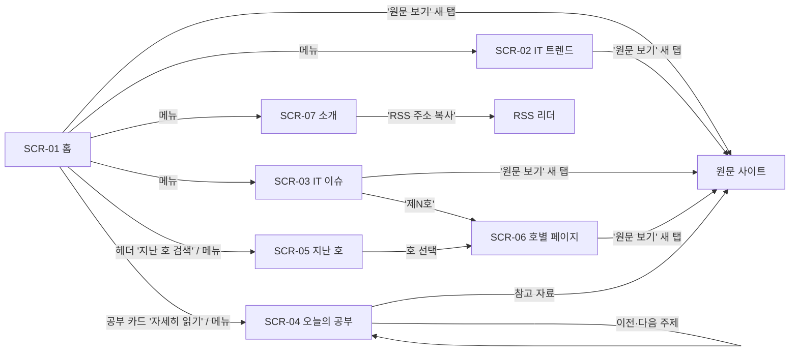
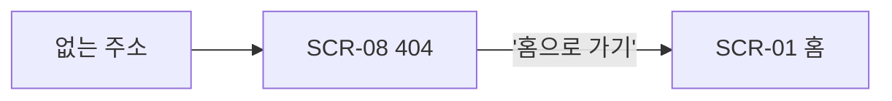

# 화면(UI/UX) 설계서

> 화면의 시각 기준은 [IT 뉴스레터 디자인 시스템](https://claude.ai/artifact/D1jHCFGWMkQTcqQgAj9KKv)(페이지 템플릿 6종 포함)이고, 동작하는 시안은 브랜치 `feat/static-site`의 프로토타입(`templates/`)이다. 이 문서는 화면별 구성·동작·상태를 요구사항(SRS FR-009~016)에 연결한다.

| 항목 | 내용 |
|------|------|
| **프로젝트명** | IT 뉴스레터 (가칭) |
| **문서 버전** | v1.0 |
| **작성일** | 2026-11-25 |
| **작성자** | Claude (초안 작성) / 임지영 (프로젝트 담당) |
| **승인자** | 임지영 / 프로젝트 담당 |
| **문서 상태** | 승인됨 (G2, 2026-11-25) |

---

## 1. 설계 원칙

### 1.1 사용성 (Usability)

| 원칙 | 설명 | 적용 방법 |
|------|------|-----------|
| 6분 안에 읽기 | 하루 분량을 짧게 훑을 수 있다 | 소식당 제목 + 2~3문장, 주요 소식 1건 강조, 숫자 요약 (H-001) |
| 일관성 | 모든 페이지가 같은 틀 | 공통 헤더·푸터, 디자인 시스템 컴포넌트만 사용 |
| 원문으로 바로 | 요약을 바로 확인할 수 있다 | 모든 소식에 "원문 보기"(새 탭) |
| 피드백 | 행동에 바로 반응 | 칩 선택 상태, 검색 결과 즉시 반영, 복사 토스트 |
| 꾸밈 최소 | 정보만 | 이모지·과장 문구·장식 그라디언트 없음 (BP-TEXT-002) |

### 1.2 접근성 (Accessibility)

| 기준 | 수준 | 적용 항목 |
|------|------|-----------|
| WCAG | 2.1 AA 목표 | 전체 화면 (NFR-009) |
| 색상 대비 | 본문 4.5:1 이상 | 디자인 시스템 역할 토큰 (`text-link`는 라이트 5.59:1, 다크 5.0:1) |
| 키보드 | 필수 | 모든 링크·버튼·칩·검색창 Tab 이동, 포커스 링 표시 |
| 시멘틱 HTML | 필수 | `header`, `nav`, `main`, `footer`, `article`, 제목 계층 h1→h2→h3 |
| 상태 알림 | 필수 | 칩 `aria-pressed`, 토스트 `role="status"`·`aria-live="polite"`, 현재 메뉴 `aria-current="page"` |
| 폼 | 필수 | 검색창에 보이는 라벨 연결 |
| 이미지 | 해당 없음 | 사진을 쓰지 않음. 장식 아이콘은 `aria-hidden` |

### 1.3 반응형 디자인 (Responsive)

| 브레이크포인트 | 범위 | 대상 기기 | 레이아웃 |
|--------------|------|-----------|----------|
| Mobile | ≤ 640px | 스마트폰 | 1단, 헤더 메뉴는 가로 스크롤 |
| Tablet | 641 ~ 959px | 태블릿 | 1단 (홈 사이드바는 본문 아래로) |
| Desktop | ≥ 960px | 노트북·데스크톱 | 홈만 본문 + 사이드바 340px 2단, 콘텐츠 최대 폭 1080px |

글 페이지(오늘의 공부)는 읽기 폭 720px, 목록 페이지는 820~900px로 제한한다.

### 1.4 변경 이력

| 버전 | 날짜 | 작성자 | 변경 내용 |
|------|------|--------|-----------|
| v0.1 | 2026-11-25 | Claude | 초안 작성. 디자인 시스템 페이지 템플릿과 프로토타입 기준, G1 결정(공유 버튼 제거, 위키백과 표기, 삭제 요청 안내) 반영 |
| v1.0 | 2026-11-25 | Claude | G2 승인 |

---

## 2. 화면 목록

### 2.1 전체 화면 목록

| 화면 ID | 화면명 | URL | 접근 권한 | 상태 | 비고 |
|---------|--------|-----|-----------|------|------|
| SCR-01 | 홈 | `/` | 전체 | 설계완료 | 최신 호. FR-009 |
| SCR-02 | IT 트렌드 | `/trends/` | 전체 | 설계완료 | FR-010 |
| SCR-03 | IT 이슈 | `/issues/` | 전체 | 설계완료 | FR-011 |
| SCR-04 | 오늘의 공부 | `/study/<slug>/` | 전체 | 설계완료 | FR-012 |
| SCR-05 | 지난 호 | `/archive/` | 전체 | 설계완료 | FR-013 |
| SCR-06 | 호별 페이지 | `/issue/<number>/` | 전체 | 설계완료 | SCR-01과 같은 구성. FR-013 |
| SCR-07 | 소개 | `/about/` | 전체 | 설계완료 | FR-014 |
| SCR-08 | 404 | 없는 주소 (`/404.html`) | 전체 | 설계완료 | FR-016 (프로토타입에 없음) |
| - | RSS 피드 | `/feed.xml` | 전체 | 설계완료 | 화면 아님. [외부 연동 설계서](API설계서.md) 5.8 |

### 2.2 공통 틀

| 영역 | 구성 | 근거 |
|------|------|------|
| 헤더 (64px, 상단 고정) | 워드마크(블루 점 + "IT 뉴스레터") · 메뉴 6개(홈, IT 트렌드, IT 이슈, 오늘의 공부, 지난 호, 소개) · 오른쪽 버튼 1개(홈에서는 "지난 호 검색", 그 외 "오늘 호 보기") | FR-016-AC1, 디자인 시스템 SiteHeader |
| 본문 | 페이지별 | |
| 푸터 | 워드마크, 서비스 한 줄 설명 + 자동 생성 고지, 링크(소개·지난 호·RSS) | BP-SUM-007, FR-016-AC2 |

---

## 3. 화면 흐름도

### 3.1 방문 흐름



### 3.2 오류 흐름



---

## 4. 화면 상세 명세 형식

각 화면은 기본 정보, 레이아웃, 구성 요소, 이벤트, 상태별 화면 순으로 쓴다. 정적 사이트라 "로딩" 상태는 없고(페이지가 통째로 온다), 대신 "빈 상태"와 "자바스크립트 꺼짐"을 적는다. "관련 데이터"는 [데이터 설계서](데이터베이스설계서.md)의 필드다.

---

## 5. 화면 명세

### 5.1 SCR-01 홈 (SCR-06 호별 페이지 공통)

#### 기본 정보

| 항목 | 내용 |
|------|------|
| **화면 ID** | SCR-01 (SCR-06은 같은 템플릿, 대상 호만 다름) |
| **화면명** | 홈 |
| **URL** | `/` (SCR-06: `/issue/<number>/`) |
| **접근 권한** | 전체 |
| **관련 데이터** | 최신 호(SCR-06은 해당 호)의 issue 전체, 현재 오늘의 공부 |
| **디자인 시안** | 디자인 시스템 PageHome, 프로토타입 `templates/home.html` |

#### 레이아웃 설명

```
+--------------------------------------------------------------+
| 헤더: ● IT 뉴스레터 | 홈 트렌드 이슈 공부 지난호 소개 | [지난 호 검색] |
+--------------------------------------------------------------+
| 제128호 · 11월 25일 (수)                                      |
| 오늘은 [오픈소스 LLM] 소식이 가장 많았어요   (display-2 40px) |
| 한 줄 요약                                                    |
| 6건 오늘의 소식 | 4곳 수집한 출처 | 6분 다 읽는 시간          |
+----------------------------------------------+---------------+
| [주요 소식 카드]  01  뱃지·출처·시각·반응    | [오늘의 공부]  |
|                  제목 (h2 24px)              | 주제·정의     |
|                  요약 (body-1)               | 요점 ①②③     |
|                  원문 보기 >                 | [자세히 읽기] |
+----------------------------------------------+---------------+
| [IT 트렌드 카드]                 전체보기    | [많이 이야기된 |
|   출처·시각 / 제목 / 요약 / 원문 보기 >      |  소식] 1~5위  |
|   ...                                        |               |
| [IT 이슈 카드]                   전체보기    |               |
+----------------------------------------------+---------------+
| 푸터                                                          |
+--------------------------------------------------------------+
  960px 미만: 오른쪽 열(공부, 순위)이 본문 아래로 내려간다.
```

#### 구성 요소

| 요소 ID | 유형 | 설명 | 동작 | 데이터·규칙 |
|---------|------|------|------|-----------|
| EL-01-01 | IssueHero | 호수·날짜, 대표 제목(강조어 블루), 요약, 숫자 3개 | 없음 | `number`, `date`(BP-TEXT-005), `headline`+`highlight`, `summary`, 소식 수, 출처 수, `read_minutes` |
| EL-01-02 | TopStory | 주요 소식 (정렬 1위) | "원문 보기" → 새 탭 | `items[0]`, 반응 문구가 비면 생략. **공유하기 버튼 없음** (ISSUE-06) |
| EL-01-03 | NewsCard 목록 (IT 트렌드) | 주요 소식을 뺀 `trend` 소식 | "원문 보기" → 새 탭, "전체보기" → SCR-02 | 출처·시각(BP-TEXT-004)·제목·요약. SCR-06에서는 "전체보기" 숨김 |
| EL-01-04 | NewsCard 목록 (IT 이슈) | 주요 소식을 뺀 `issue` 소식 | 위와 같음, "전체보기" → SCR-03 | 소식이 없으면 카드 전체 숨김 |
| EL-01-05 | StudyCard | 현재 오늘의 공부 (요점 3개) | "자세히 읽기" → SCR-04 | 그 호에 공부가 없으면 직전 공부 (BP-ERROR-004) |
| EL-01-06 | RankList | 반응 수 상위 5건 | 제목 → 원문 새 탭 | `score` 내림차순, 1위만 진한 숫자. `score`가 모두 0이면 카드 숨김 |

#### 이벤트

| 이벤트 | 트리거 | 동작 | 연동 |
|--------|--------|------|------|
| 원문 열기 | "원문 보기"·순위 제목 클릭 | `item.url`을 새 탭(`rel="noopener"`) | 없음 |
| 공부 이동 | "자세히 읽기" | `/study/<slug>/` | 없음 |

#### 상태별 화면

| 상태 | 조건 | 화면 구성 |
|------|------|-----------|
| 정상 | 소식 1~12건 | 위 레이아웃 |
| 트렌드 또는 이슈 없음 | 해당 분류 0건 | 그 카드만 숨김 |
| 공부 없음 | 모든 호에 공부가 없음 (운영 첫날 실패 등) | StudyCard 숨김 |
| 오늘 호 배포 전 | 08:00~10:00 KST | 직전 호를 그대로 표시 (날짜로 구분) |

---

### 5.2 SCR-02 IT 트렌드

#### 기본 정보

| 항목 | 내용 |
|------|------|
| **화면 ID** | SCR-02 |
| **URL** | `/trends/` |
| **관련 데이터** | 최신 호의 `section == trend` 소식, 태그별 건수 |
| **디자인 시안** | PageTrends, `templates/trends.html` |

#### 레이아웃 설명

```
+------------------------------------------------+
| 헤더 (IT 트렌드 선택 표시)                      |
+------------------------------------------------+
| 제128호 · 오늘 4건                  (eyebrow)  |
| IT 트렌드                           (h1 28px)  |
| 개발자 커뮤니티에서 많이 이야기된 ...           |
| [전체 4] [AI 2] [개발 도구 1] [클라우드 1]  칩 |
| +--------------------------------------------+ |
| | 뱃지·출처·시각 / 제목 / 요약 / 원문 보기 > | |
| | ...                                        | |
| +--------------------------------------------+ |
+------------------------------------------------+
| 푸터                                            |
+------------------------------------------------+
```

#### 구성 요소

| 요소 ID | 유형 | 설명 | 동작 | 데이터·규칙 |
|---------|------|------|------|-----------|
| EL-02-01 | PageTitle | 호수·건수, 제목, 설명 | 없음 | |
| EL-02-02 | Chip 그룹 | "전체 N" + 건수가 있는 태그만, 건수 많은 순 | 클릭 시 해당 태그만 표시, 선택 칩 반전·`aria-pressed=true` | BP-RANK-005 |
| EL-02-03 | NewsCard 목록 | `trend` 소식 전체, 저장 순서(정렬 순) | 원문 새 탭 | 뱃지는 태그 |

#### 이벤트

| 이벤트 | 트리거 | 동작 | 연동 |
|--------|--------|------|------|
| 주제 필터 | 칩 클릭 | 해당 `data-topic` 행만 보이고 나머지 `hidden` | 브라우저 JS |
| 필터 해제 | "전체" 칩 | 모두 표시 | 브라우저 JS |

#### 상태별 화면

| 상태 | 조건 | 화면 구성 |
|------|------|-----------|
| 정상 | 트렌드 1건 이상 | 위 레이아웃 |
| 빈 상태 | 트렌드 0건 | 칩 숨김, 카드 안에 "오늘은 트렌드 소식이 없어요" (FR-010-AC4) |
| JS 꺼짐 | 스크립트 미실행 | 모든 소식 표시, 칩은 눌러도 변화 없음 (FR-010-AC3) |

---

### 5.3 SCR-03 IT 이슈

#### 기본 정보

| 항목 | 내용 |
|------|------|
| **화면 ID** | SCR-03 |
| **URL** | `/issues/` |
| **관련 데이터** | 번호 상위 3개 호의 `section == issue` 소식 |
| **디자인 시안** | PageIssues, `templates/issues.html` |

#### 레이아웃 설명

```
| 최근 3개 호 · N건 / IT 이슈 / 설명                 |
| +-[최신 호] 11월 25일 (수) ----------- 제128호 >-+ |
| | 뱃지·출처·시각 / 제목 / 요약 / 원문 보기 >     | |
| +-------------------------------------------------+ |
| +- 11월 24일 (화) ---------------------- 제127호 >-+ |
| ...                                                  |
```

#### 구성 요소

| 요소 ID | 유형 | 설명 | 동작 | 데이터·규칙 |
|---------|------|------|------|-----------|
| EL-03-01 | PageTitle | 건수, 제목, 설명 | 없음 | |
| EL-03-02 | SectionHeader + NewsCard (호별 묶음) | 날짜 제목, "제N호" 링크, 그 호의 이슈 | "제N호" → SCR-06, 원문 새 탭 | 이슈가 없는 호는 묶음 생략, 최신 묶음에 "최신 호" 표시 |

#### 상태별 화면

| 상태 | 조건 | 화면 구성 |
|------|------|-----------|
| 정상 | 이슈 1건 이상 | 위 레이아웃 |
| 빈 상태 | 3개 호 모두 이슈 0건 | "최근에 올라온 이슈가 없어요" (FR-011-AC3) |

---

### 5.4 SCR-04 오늘의 공부

#### 기본 정보

| 항목 | 내용 |
|------|------|
| **화면 ID** | SCR-04 |
| **URL** | `/study/<slug>/` (헤더 메뉴는 현재 오늘의 공부로) |
| **관련 데이터** | 해당 호의 `study`, 이전·다음 공부 |
| **디자인 시안** | PageStudy, `templates/study.html` |

#### 레이아웃 설명

```
+--------------- 읽기 폭 720px ----------------+
| [오늘의 공부] 제128호 · 읽는 데 4분          |
| 벡터 데이터베이스                  (h1)      |
| ## 무엇인가요                      (h2)      |
| 문단 (17px, 행간 1.7)                        |
| ## 어떻게 동작하나요                         |
| 문단 + [코드 블록]                           |
| ## 더 읽어 보기                              |
|   위키백과: 벡터 데이터베이스   원문 보기    |
|   관련 소식 제목               원문 보기    |
| 출처·라이선스: 이 글은 위키백과 '벡터 데이터  |
|   베이스' 문서를 참고해 작성했어요. CC BY-SA |
+----------------------------------------------+
| [요점 정리] ① ② ③                           |
+----------------------------------------------+
| [이전 주제: WebAssembly] [다음 주제: ...]    |
+----------------------------------------------+
```

#### 구성 요소

| 요소 ID | 유형 | 설명 | 동작 | 데이터·규칙 |
|---------|------|------|------|-----------|
| EL-04-01 | StudyArticle | 뱃지·호수·읽는 시간, 제목, 소제목별 문단, 코드 | 없음 | `sections` (코드는 이스케이프해 `pre`로) |
| EL-04-02 | 참고 자료 목록 | 제목 + "원문 보기" | 새 탭 | `references` (https) |
| EL-04-03 | 출처·라이선스 표기 | 고정 문구 + 위키백과 문서 링크 + CC BY-SA 4.0 링크 | 링크 새 탭 | `wikipedia`, BP-STUDY-008, FR-012-AC3 |
| EL-04-04 | StudyCard (요점 정리) | 요점 3개 | 없음 | `points` |
| EL-04-05 | Pager | 이전(더 오래된) 주제, 다음(더 최근) 주제 | 이동 | 한쪽만 있으면 그쪽만, 왼쪽 정렬 유지 (리뷰 지적 반영) |

#### 상태별 화면

| 상태 | 조건 | 화면 구성 |
|------|------|-----------|
| 정상 | 공부 있음 | 위 레이아웃 |
| 가장 최근 주제 | 다음 주제 없음 | Pager에 이전 주제만 |
| 가장 오래된 주제 | 이전 주제 없음 | Pager에 다음 주제만 |

---

### 5.5 SCR-05 지난 호

#### 기본 정보

| 항목 | 내용 |
|------|------|
| **화면 ID** | SCR-05 |
| **URL** | `/archive/` |
| **관련 데이터** | 모든 호의 `number`, `date`, `headline`, 태그, 공부 제목, 소식 수, 검색용 텍스트 |
| **디자인 시안** | PageArchive, `templates/archive.html` |

#### 레이아웃 설명

```
| 지금까지 N호 / 지난 호 / 설명                     |
| 지난 호 검색 [주제나 키워드를 입력해 주세요     ] |
| (오류 안내 자리)                                  |
| +-----------------------------------------------+ |
| | 제128호      대표 제목                 소식 6건 | |
| | 2026.11.25   [AI] [오늘의 공부 · 벡터 DB]      | |
| | ...                                           | |
| | (결과 없음 안내 자리)                          | |
| +-----------------------------------------------+ |
```

#### 구성 요소

| 요소 ID | 유형 | 설명 | 동작 | 데이터·규칙 |
|---------|------|------|------|-----------|
| EL-05-01 | TextField (검색) | 보이는 라벨 "지난 호 검색" | 입력할 때마다 거르기 | 2글자 이상부터 거름 |
| EL-05-02 | IssueRow 목록 | 최신순 모든 호 | 행 클릭 → SCR-06 | 태그는 앞 2개 + 공부 뱃지 |
| EL-05-03 | 안내 문구 | 오류·결과 없음 | 없음 | |

#### 이벤트

| 이벤트 | 트리거 | 동작 | 연동 |
|--------|--------|------|------|
| 검색 | 입력 | 호 번호·대표 제목·소식 제목·태그·공부 제목에 키워드가 있는 행만 표시 (대소문자 무시) | 브라우저 JS |

#### 상태별 화면

| 상태 | 조건 | 화면 구성 |
|------|------|-----------|
| 정상 | 입력 없음 | 모든 호 |
| 1글자 | 입력 1자 | 입력창 오류 스타일 + "두 글자 이상 입력해 주세요." 목록은 그대로 (FR-013-AC3) |
| 결과 없음 | 일치 0건 | "찾는 호가 없어요. 다른 키워드로 검색해 주세요." (FR-013-AC4) |
| JS 꺼짐 | 스크립트 미실행 | 모든 호 표시, 검색은 동작 안 함 |

---

### 5.6 SCR-07 소개

#### 기본 정보

| 항목 | 내용 |
|------|------|
| **화면 ID** | SCR-07 |
| **URL** | `/about/` |
| **관련 데이터** | 최신 호 `read_minutes`, 출처 목록, `SITE_URL`, 저장소 이슈 주소 |
| **디자인 시안** | PageAbout, `templates/about.html` |

#### 레이아웃 설명

```
|            매일 아침 업데이트                        |
|      IT 소식, [하루 6분]이면 충분해요   (display-1) |
|            서비스 설명 두 문장                       |
|      [오늘 호 읽기]  [RSS 주소 복사]                 |
| [4곳에서 모아요] [겹치는 건 걸러요] [원문에 근거해 ] |
|  (FeatureList 3열, 960px 미만 1열)                   |
|   [GeekNews] [Hacker News] [GitHub] [arXiv]  출처   |
|   안내: 각 출처는 이 서비스를 보증하거나 운영하지    |
|   않아요. 소식 삭제 요청은 GitHub 이슈로 받아요.     |
|                                   (토스트 자리)      |
```

#### 구성 요소

| 요소 ID | 유형 | 설명 | 동작 | 데이터·규칙 |
|---------|------|------|------|-----------|
| EL-07-01 | IssueHero (가운데) | 문구, 버튼 2개 | "오늘 호 읽기" → SCR-01 | `read_minutes` |
| EL-07-02 | Button "RSS 주소 복사" | 보조 버튼 | `<SITE_URL>/feed.xml`을 클립보드에 쓰고 토스트 | FR-014-AC2 |
| EL-07-03 | FeatureList | 일하는 방식 3가지 | 없음 | 출처 수는 데이터에서 |
| EL-07-04 | Chip 목록 (표시만) | 출처 이름 | 없음 | 모든 호의 `source` 고유값 |
| EL-07-05 | 안내 문단 | 비보증 문구, 삭제 요청 안내(저장소 이슈 링크) | 링크 새 탭 | NFR-013, BP-CONTENT-005 |
| EL-07-06 | Toast | "RSS 주소를 복사했어요" 3초 | 자동 사라짐 | `role="status"` |

#### 상태별 화면

| 상태 | 조건 | 화면 구성 |
|------|------|-----------|
| 복사 성공 | 클립보드 쓰기 성공 | 토스트 3초 |
| 복사 불가 | 클립보드 권한 없음 | 토스트 없음 (방문자는 푸터 RSS 링크 사용, UC-006 EF-006-01) |

---

### 5.7 SCR-08 404

#### 기본 정보

| 항목 | 내용 |
|------|------|
| **화면 ID** | SCR-08 |
| **URL** | 없는 모든 주소 (`site/404.html`을 Cloudflare Pages가 404 상태로 제공) |
| **디자인 시안** | 신규 (PageTitle + 버튼 조합) |

#### 레이아웃 설명

```
| 헤더 (선택 메뉴 없음)                  |
|        페이지를 찾을 수 없어요  (h1)   |
|   주소가 바뀌었거나 없는 페이지예요.   |
|          [홈으로 가기]                 |
| 푸터                                   |
```

#### 구성 요소

| 요소 ID | 유형 | 설명 | 동작 | 데이터·규칙 |
|---------|------|------|------|-----------|
| EL-08-01 | PageTitle (가운데) | 안내 문구 | 없음 | BP-ERROR-008 |
| EL-08-02 | Button "홈으로 가기" | L 크기 primary | → `/` | |

---

## 6. UX 검토 체크리스트

결과는 05 테스트 단계에서 실제 화면으로 확인한다. 여기서는 설계에 반영한 방법을 적는다.

### 6.1 사용성 (Usability)

| 검토 항목 | 설계 반영 | 결과 |
|-----------|-----------|------|
| 주요 기능 3클릭 이내 | 모든 페이지가 헤더 메뉴 1클릭 | 05에서 확인 |
| 레이블이 동작을 설명 | "원문 보기", "자세히 읽기", "RSS 주소 복사" 등 (BP-TEXT-006) | 05에서 확인 |
| 일관된 네비게이션 | 공통 헤더, 메뉴 순서 고정 | 05에서 확인 |
| 행동 피드백 | 칩 선택, 검색 즉시 반영, 복사 토스트 | 05에서 확인 |
| 되돌릴 수 없는 작업 | 없음 (열람 전용) | 해당 없음 |

### 6.2 접근성 (Accessibility)

| 검토 항목 | 설계 반영 | 결과 |
|-----------|-----------|------|
| 대비 4.5:1 | 역할 토큰 대비 확인 완료 (디자인 시스템 README) | 05에서 측정 |
| 색만으로 정보 전달 금지 | 선택 칩은 색 반전 + `aria-pressed`, 현재 메뉴는 굵기 + `aria-current` | 05에서 확인 |
| 키보드·포커스 | 버튼 포커스 링(2px accent), 칩은 `button` 요소 | 05에서 확인 |
| 시멘틱·제목 계층 | 페이지당 h1 하나, 카드 제목 h2/h3 | 05에서 확인 |
| 동적 변경 알림 | 토스트 `aria-live`, 검색 결과 없음 안내 | 05에서 확인 |

### 6.3 반응형 (Responsive)

| 검토 항목 | 설계 반영 | 결과 |
|-----------|-----------|------|
| 모바일 1단 | 640px 이하 1단 | 05에서 확인 |
| 터치 대상 44px | 메뉴 링크 높이 40px + 간격, 버튼 M 40px 이상 → 05에서 44px 미만 요소 확인 | 05에서 확인 |
| 가로 스크롤 없음 | 최소 폭 360px에서 확인 (FR-009-AC4) | 05에서 확인 |
| 모바일 메뉴 | 햄버거 대신 가로 스크롤 메뉴 (디자인 시스템 SiteHeader) | 05에서 확인 |
| 최대 폭 | 1080px | 05에서 확인 |

### 6.4 성능 (Performance)

| 검토 항목 | 설계 반영 | 결과 |
|-----------|-----------|------|
| Lighthouse 모바일 90 이상 | 정적 HTML, 이미지 없음, CSS 2개, 작은 인라인 JS (NFR-005) | 05에서 측정 |
| 레이아웃 흔들림 | 서체 로딩 시 대체 서체 지정, 이미지 없음 | 05에서 측정 |

### 6.5 에러 처리 (Error Handling)

| 검토 항목 | 설계 반영 | 결과 |
|-----------|-----------|------|
| 사용자 친화 문구 | 해요체 안내 문구 (5장 각 상태) | 05에서 확인 |
| 404에서 홈 이동 | SCR-08 "홈으로 가기" | 05에서 확인 |
| 검색 입력 오류 | 1글자 안내, 입력값 유지 | 05에서 확인 |

---

## 7. 디자인 시스템 참조

원본은 `design/tokens.json`과 [디자인 시스템](https://claude.ai/artifact/D1jHCFGWMkQTcqQgAj9KKv)이다. 아래는 자주 쓰는 값의 요약이다.

### 7.1 컬러 팔레트 (역할 토큰)

| 용도 | 토큰명 | 라이트 | 다크 | 사용 위치 |
|------|--------|--------|------|-----------|
| 페이지 바탕 | `--bg-grey` | #f2f4f6 | #101013 | 페이지 |
| 헤더·푸터 바탕 | `--bg` | #ffffff | #17171c | 헤더, 푸터 |
| 카드 | `--bg-layered` | #ffffff | #202027 | 카드 |
| 1차 텍스트 | `--text-primary` | #191f28 | #ffffff | 제목 |
| 2차 텍스트 | `--text-secondary` | #4e5968 | #c3c3c6 | 요약 |
| 메타 텍스트 | `--text-tertiary` | rgba(1,10,37,0.58) | #9e9ea4 | 출처·시각 |
| 링크 | `--text-link` | #1065cc | #3485fa | 원문 보기 |
| 강조 채움 | `--accent` | #3182f6 | #3485fa | primary 버튼, 주요 소식 번호, 공부 요점 번호 |
| 구분선 | `--hairline` | #e5e8eb | #3c3c47 | 1px 선 |
| 오류 | `--danger` | #f04452 | #f04251 | 검색 오류 |
| 성공 | `--success` | #007738 | #007738 | 토스트 아이콘 |

### 7.2 타이포그래피

서체는 Pretendard (대체: Apple SD Gothic Neo, Noto Sans KR, 맑은 고딕).

| 용도 | 토큰명 | 크기 | 두께 | 행간 |
|------|--------|------|------|------|
| 소개 히어로 | `display-1` | 56px | 700 | 1.3 |
| 홈 히어로 | `display-2` | 40px | 700 | 1.2 |
| 페이지 제목 | `h1` | 28px | 700 | 1.3 |
| 주요 소식 제목 | `h2` | 24px | 700 | 1.3 |
| 섹션 제목 | `h4` | 20px | 700 | 1.35 |
| 소식 제목 | `title-1` | 18px | 600 | 1.45 |
| 공부 본문 | `body-1` | 17px | 400 | 1.5 (글 페이지 1.7) |
| 요약 | `body-2` | 15px | 400 | 1.5 |
| 메타 | `caption` | 12px | 500 | 1.4 |

### 7.3 주요 컴포넌트

| 컴포넌트 | 변형 | 사용 위치 |
|----------|------|-----------|
| SiteHeader / SiteFooter | - | 전 페이지 |
| IssueHero | 기본, 가운데 | SCR-01, SCR-06, SCR-07 |
| PageTitle | - | SCR-02, SCR-03, SCR-05, SCR-08 |
| TopStory | 공유 버튼 없음 (ISSUE-06) | SCR-01, SCR-06 |
| NewsCard | 뱃지 있음·없음 | SCR-01~03, SCR-06 |
| RankList | - | SCR-01, SCR-06 |
| StudyCard | 요약형, 요점 정리형 | SCR-01, SCR-04 |
| StudyArticle | - | SCR-04 |
| IssueRow | - | SCR-05 |
| Chip | 선택·기본·표시용 | SCR-02, SCR-07 |
| Badge | brand, neutral, inverse | 분류 표시 |
| Button | primary, dark, secondary, ghost (XL·L·M·S) | 전역 |
| TextField | 기본, focus, 오류 | SCR-05 |
| FeatureList | - | SCR-07 |
| Toast | 성공 | SCR-07 |

### 7.4 스페이싱 (Spacing)

| 토큰 | 값 | 용도 |
|------|-----|------|
| `--space-2` | 8px | 라벨과 입력, 칩 사이 |
| `--space-4` | 16px | 목록 행 사이 |
| `--space-5` | 20px | 소식 카드 상하 패딩 |
| `--space-6` | 24px | 페이지 좌우 여백, 카드 사이 |
| `--space-8` | 32px | 섹션 제목 위 |
| `--space-12` | 48px | 큰 섹션 사이 |

### 7.5 그림자 (Elevation)

| 토큰 | 용도 |
|------|------|
| `--shadow-toast` | 토스트 (`0 8px 24px rgba(1,10,37,0.16)`) |

카드에는 그림자를 쓰지 않는다 (평평한 표면, 디자인 시스템 원칙).

### 7.6 라운드 (Border Radius)

| 토큰 | 값 | 용도 |
|------|-----|------|
| `--radius-m` | 12px | 입력창, M 버튼 |
| `--radius-xl` | 16px | 카드, XL 버튼 |
| `--radius-3xl` | 24px | 주요 소식, 공부 카드, 글 |
| `--radius-full` | 999px | 칩 |

---

## 부록

### A. 참조 문서

| 문서 | 경로 |
|------|------|
| 요구사항 명세서 | [SRS](../01-요구사항분석/요구사항명세서-SRS.md) 3.10~3.17절 |
| 외부 연동·출력 인터페이스 설계서 | [API설계서.md](API설계서.md) |
| 디자인 시스템 | https://claude.ai/artifact/D1jHCFGWMkQTcqQgAj9KKv |
| 프로토타입 | 브랜치 `feat/static-site`, `templates/`, `static/site.css` |

### B. 프로토타입과의 차이 (구현 단계에서 반영)

| 화면 | 차이 | 근거 |
|------|------|------|
| SCR-01·06 | 주요 소식의 "공유하기" 버튼 제거 | ISSUE-06 |
| SCR-02 | 트렌드 0건 빈 상태 추가 | FR-010-AC4 |
| SCR-03 | 이슈 0건 빈 상태 추가 | FR-011-AC3 |
| SCR-04 | 출처·라이선스 표기 추가, 한쪽만 있는 Pager 정렬 수정 | BP-STUDY-008, 코드 리뷰 |
| SCR-07 | 출처 비보증·삭제 요청 안내 추가, 출처명 "GitHub" | NFR-013, BP-CONTENT-005, ISSUE-01 |
| SCR-08 | 404 페이지 신규 | FR-016-AC3 |
| 전체 | 소식 시각에 날짜 표시(다른 날이면), `reactions` 비면 생략 | BP-TEXT-004, 데이터 설계서 4.3 |
